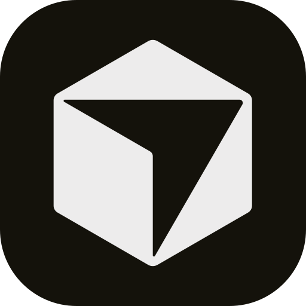
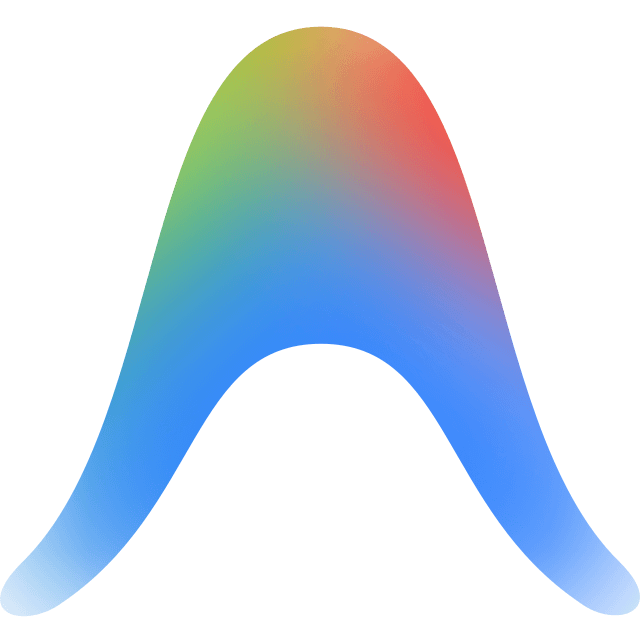
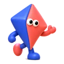
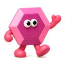
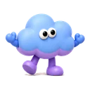
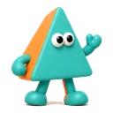

<div align="center">


# Lemma

**A multiplayer harness that shapes itself around your work.**

Your people meet it as a teammate: give it a job, share it with everyone, and teach it as you go.

<a href="https://lemma.work"></a>
<a href="https://lemma.work/download"></a>

[Docs](https://lemma.work/docs) · [Discord](https://discord.gg/x2NVyNPQR) · [Templates](https://lemma.work/templates)

</div>

<br>

<picture>
  <source media="(prefers-color-scheme: dark)" srcset="docs/Assets/hero-dark.svg">
  
</picture>

It runs on the Claude Code or Codex subscription you already pay for, Lemma's hosted models, or any OpenAI- or Anthropic-compatible key.

## Get started

**Lemma Cloud.** Sign up at [lemma.work](https://lemma.work). Nothing to install.

**On your Mac.** [Download Lemma](https://lemma.work/download), open it, and choose
**Local**. It installs everything it needs and runs on your machine. See
[installation](docs/installation.md) if something doesn't start.

**On your own server.** Bring up the whole stack on a VM you control, with
HTTPS. See [self-hosting](docs/self-hosting.md).

```bash
git clone https://github.com/lemma-work/lemma-platform.git
cd lemma-platform/deploy/compose && ./bootstrap.sh
# add your model provider key to .env, then:
docker compose up -d
```

**Your coding agent.**
&nbsp;Claude Code,
&nbsp;Codex,
&nbsp;Cursor,
&nbsp;OpenCode or
&nbsp;Antigravity
can build a whole teammate. Paste this in:

```text
Set up Lemma, then build me a teammate.

1. Install the CLI with `uv tool install lemma-terminal` (not pip; it needs
   Python 3.14 and uv provides it).
2. Run `lemma auth login` and let me finish signing in.
3. Run `lemma skills install`, then tell me to restart you so the skills load.
4. After the restart, use the Lemma builder skills.

Based on what you already know about me, my work and how my team works,
propose the one teammate that would take the most off our plate: its job,
who it works with, and what it should never do without asking. Ask me
anything you can't work out. Once I agree, build it: the tables that hold
the shared state, the agents and workflows that move the work, the app
people open, and the permissions, with a person approving anything
consequential.
```

It writes everything as files, imports them, and runs the workflow to check it
stops where it should.

## Inside a teammate

Each teammate lives in a **pod**: the boundary around one job. A pod holds its
own agents, apps, tables, files and workflows, decides who is inside and what
each person and agent can touch, and nothing crosses it unless you connect it.
It exports as a folder of files, so you can version it, share it, or import it
somewhere else.

##  Agents

An agent is a role: a model, an instruction, and the tools, tables and
connectors it is allowed to use. It answers when someone asks, and it also runs
without being asked, on a schedule, when a row in a table changes, or when a
webhook arrives from Slack, GitHub or anywhere else. Each run is recorded step
by step, so you can see what it read, what it called, and where it stopped.

Before anything consequential, like sending an email, issuing a refund or
deleting a record, it pauses and asks the person who owns that decision. The run
waits, for days if it has to, and carries on when they answer.

##  Apps

A lot of work needs a screen rather than a chat thread: a queue to clear, a
board to move, a form to fill in. Ask the teammate for one and it builds a web
app, deployed at its own URL, that reads and writes the same tables its agents
use. When an agent updates a record, the app is already showing it.

Apps are built on the TypeScript SDK, so a developer can open the code, change
it, and redeploy with `lemma apps deploy`.

##  People

A teammate is shared by the whole team, and each person has their own account
and role inside it. One permission model covers people and agents alike: which
tables they can read or write, which rows they can see, and which steps need
their approval. Clients and guests are invited the same way and see only their
part.

Every action lands in one history: who asked, which agent ran, and what changed.

##  Context

The teammate keeps its memory as Markdown notes. Shared notes are readable by
everyone on the team; personal notes only by you. Correct it once ("refunds over
$500 go to Sam") and it writes that down and works that way from then on. Any
note can be opened, read and fixed by hand.

Alongside the notes are tables, typed records with row-level security, and
files, the documents and PDFs agents can search. All three are read at run time,
so what the teammate knows is what your team can see and edit.

##  Surfaces

People reach the same teammate from Slack, Microsoft Teams, WhatsApp, Telegram
and email. Each surface works out who is writing, matches them to their account,
and applies their permissions, so a question in a Slack thread gets the same
answer it would get in the app. Every agent also has its own email address that
anyone can write to.

Approvals travel too: a workflow waiting on someone can ask them in the chat
they already use.

##  Workflows

When work passes between people and agents in the same order every time, write
it down as a workflow. Each step is an agent, a function (plain code that does
the same thing every time), a decision, a loop, a wait, or a form for a named
person. A workflow starts on a schedule, a table change, a webhook, or by hand.

Runs are durable. A step waiting on a person can wait for days, and the run
resumes exactly where it stopped.

## Open source

The core is [AGPLv3](LICENSE); the SDKs, CLI and skills are
[Apache-2.0](LICENSES/Apache-2.0.txt). Run it on your laptop, your own server,
or Lemma Cloud. To work on Lemma itself, start with
[CONTRIBUTING.md](CONTRIBUTING.md) and [ARCHITECTURE.md](ARCHITECTURE.md).

Questions go in [Discussions](https://github.com/lemma-work/lemma-platform/discussions)
or [Discord](https://discord.gg/x2NVyNPQR).

<br>

<div align="center">









<sub>© 2026 Folks and Machines, Inc.</sub>

</div>
