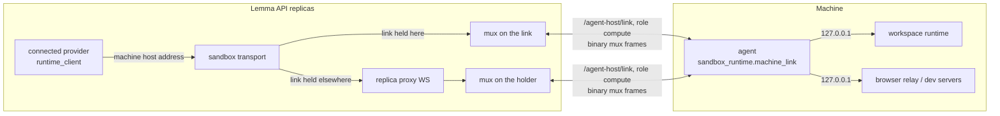

# Connected machines

A person can join their own laptop or VM to Lemma with `lemma machine connect`.
It then serves the same workspace runtime an E2B or Docker sandbox serves, and
agents, apps and the API reach it as `mine:<name>` through the same `/machines`
routes and the same provider seam as any other machine. Nothing calling a machine knows it is a connected one: the unchanged
`WorkspaceRuntimeClient` talks to it over the machine's own outbound link.

## Joining

1. **The machine asks for a code.** `lemma machine connect` makes a *claim key*
   it keeps to itself and sends only its SHA-256 to
   `POST /agent-host/compute/pairings`, with what the machine calls itself, its
   mode and platform. The answer is a code (`ABCD-EFGH-JKMN`, 60 bits, ten
   minutes) and the page that approves it.
2. **The person approves it in the browser** (`/machines/connect?code=…`,
   `POST /machine-connections:pair`). This is where the machine's name, its
   owner and any pod it is shared into (`--pod`, editors and admins only) are
   decided, and where the plan's `max_connected_machines` (`MachinePolicy`) is
   counted. Approving creates the connection and its machine -- a `sandboxes`
   row of the person's, named by the connection, with `connection_id` set --
   under one id. Pairing, approval, listing and removal are a person's own acts:
   the route policy (`app/core/api/actor_policy.py`) keeps them closed to
   agents, functions and pod apps.
3. **The machine claims its secret on its link.** It opens `/agent-host/link`
   and sends `pair` with `role: "compute"`, the code *and* the claim key. The
   link waits for the approval (a notice wakes it; it also re-checks every two
   seconds) and answers `paired` with a per-machine secret, shown exactly once;
   only its hash is stored. A code seen over someone's shoulder approves
   nothing and claims nothing.

Before anything is paired the CLI says, and asks to confirm, what the machine
is about to allow: in host mode, commands run as the person's OS user with
their files under `--root`.

## The link

A connected machine speaks the Agent Host link
([agent-host.md#the-link](agent-host.md#the-link)) in its `compute` role, added
in protocol 4. Envelope, `error`, `reconnect`, heartbeat and close codes are the
Agent Host's; the frames are:

| Direction | `type` | Body | Answered by |
|---|---|---|---|
| machine → Lemma | `pair` | `role`, `pairing_code`, `claim_key`, `hello` | `paired` (`connection_id`, `user_id`, `name`, `machine_secret`), then close |
| machine → Lemma | `hello` | `role`, `hello`, `machine` | `welcome` (`connection_id`, `user_id`, `name`, `protocol_version`, `heartbeat_ms`, `server_time`, `runtime`) |
| machine → Lemma | `control` | `machine` | `control_ok` |
| machine → Lemma | `revoke` | nothing | `revoked`, then close |
| either | binary | one mux frame | — |

`machine` is the machine's own report: `mode` (`host`/`image`), `platform`,
`home`, `runtime_version`, `runtime_ready`, `runtime_port`, `relay_port` and
`capabilities` (`processes`, `files`, `python`, `browser`, `docker`,
`previews`). Capabilities are reported, never assumed. `welcome.runtime` carries
the token Lemma will present to the machine's runtime (derived per connection
from the runtime credential key, never stored) and the overlay version the
server will push. Everything is held to `wire_contract.json` (`compute`) from
both `agent_host_link_compute.py` and `link/protocol.rs`.

Close codes mean what they mean to an Agent Host. The agent reconnects with
backoff after anything else, and:

- **4401** three times in a row is a removed machine: the agent stops (exit 0,
  so a service manager does not restart it into the same refusal);
- **4409** is a newer link for the machine: it takes the link back at once only
  if its own had lasted a minute (a hand-over), and otherwise backs off, so two
  agents holding one secret do not trade the link for ever;
- **4426** is an agent too old for the server; **1012** after `reconnect` waits
  `after_ms`.

Ownership is the Agent Host's rule: every accepted `hello` claims the
machine's next `link_generation` in the transaction that authenticates it, and
any link holding a smaller one closes with 4409.

## Streams

Every connection Lemma makes into the machine is a stream multiplexed on the
link (`sandbox_runtime/machine_link/mux.py`, one module used by both ends). Each
mux frame is one binary WebSocket message, `type (u8) | stream id (u32 BE) |
payload`:

| Frame | Payload |
|---|---|
| `OPEN` (1) | `{"target", "window"}` |
| `ACCEPT` (2) | `{"window"}` |
| `DATA` (3) | up to 64 KiB |
| `WINDOW` (4) | u32 credit |
| `FIN` (5) | nothing: half close |
| `RESET` (6) | `{"code", "message"}` |

**Flow control** is per stream and credit based: a sender never has more bytes
in flight than the window the receiver advertised (256 KiB), and credit comes
back only as the stream's *consumer* reads. A slow consumer stalls its own
stream and nothing else; a peer that overruns its window has the stream reset
with `flow_control`. **Backpressure** on the socket is the writer: every frame
is awaited, under the same lock as text frames, so a full socket slows every
writer instead of buffering. Losing the link resets every stream on it with
`link_lost`.

Targets are `port` (a TCP port on the machine's loopback: the runtime, the
browser relay, a dev server for a preview) and `runtime_bundle` (below).

## The `connected` provider

A connected machine's id carries a tag (`lmconn…`, like a host sandbox's
`lmhost…`; `domain/machine_connection.connected_machine_id`), so
`HostRoutingProvider` sends every call for it to the connected fabric without a
lookup (`provider_factory._with_machines` installs the route when
`MACHINE_CONNECTIONS_ENABLED`). `providers/connected_fabric.py` reads the
connection's row -- name, home, reported ports; remembered for five seconds, as
`lemma_local` remembers a guest's address -- and hands the call to
`providers/connected.py`, a `SandboxProvider` and `SandboxOpsProvider` for one
connection. Its operations are `DockerOpsMixin`'s, unchanged, against
`http://<connection>.machine.lemma.internal:<port>`; the sandbox transport
(`desktop_tunnel.sandbox_transport`, `tunneled_socket`) sends that suffix down
the link, as it already sends a Desktop guest's addresses down vsock, so the
port proxy and the browser view bridge reach a machine unchanged too.

- **Lifecycle is the person's.** Nothing is created, released or destroyed;
  a sweep finds nothing to reclaim. Connected machines meter 0 CU.
- **Offline is a sentence, never a fallback.** A machine whose link is down, or
  whose connection was removed, raises `MachineNotConnected`
  (`domain/machine_errors`) -- "`<name>` is not connected.", a 409 from every
  `/machines` route -- and nothing runs anywhere else.
- **Paths.** Lemma names `/home/user/...`; a host-mode machine's home is its
  `--root`. The provider moves paths under the reported home on the way in and
  back out on the way out, so callers see the same paths on every fabric. On
  the machine, `sandbox_runtime/paths.py` takes its home from
  `LEMMA_MACHINE_HOME` and its overlay root from `LEMMA_RUNTIME_OVERLAY_ROOT`.

## Replicas

A machine's link is held by one API replica; a request for it can arrive at any.
The holder records `machine-link:route:<connection>` in Redis
(`{url, session, generation}`, refreshed every heartbeat, TTL three heartbeats)
and releases it on close only if it is still its own. Another replica connects
to the holder's `WS /agent-host/compute/streams/<connection>` over the cluster
network — signed with an HMAC derived from the runtime credential key, bound to
the connection and a one-minute window — and the holder opens the mux stream
and splices. No route is "not connected". The replica's own address is
`MACHINE_LINK_REPLICA_URL`, else `POD_IP` (set it from the downward API) on
`MACHINE_LINK_REPLICA_PORT`.

## The runtime on the machine

- **Host mode** (default). The CLI builds `<root>/.lemma/env` with uv and
  Python 3.14 from the image's own locked closure — the bundle build exports
  `sandbox-images/templates/workspace-python/uv.lock` as a hashed
  `requirements.txt` — then downloads the server's overlay and installer
  (`GET /agent-host/compute/runtime[/archive|/installer]`, under the machine's
  secret) and installs it under `<root>/.lemma/runtime`. The agent serves the
  runtime on loopback as the person's user. The browser capability is off in
  host mode.
- **Image mode** (`--image`). The CLI runs the image the server runs its own
  machines from (`workspace_image`, or `--image-ref`) with
  `docker create`/`cp -a`/`start`: the config and secret go in owned by the
  image's user, the home is a named volume, and Docker's restart policy keeps it
  up. `--docker` mounts the host's Docker socket.
- **Updates are pushed.** When a machine reports a runtime version other than
  the server's bundle, the server opens a `runtime_bundle` stream and writes the
  archive; the agent checks its digest, installs it with the server's
  installer, restarts the runtime and answers one JSON line.
- `--install-service` writes a systemd user unit or a launchd agent that
  restarts the agent after a crash but not after it stopped on purpose.
- `lemma machine disconnect` revokes over the link, removes the service or
  container, and forgets the secret. Removing a machine (here or in Lemma)
  retires its machine row and frees its name.

## Tests

- `sandbox_runtime/tests/test_machine_link_mux.py` — the mux: windows,
  backpressure, half close, resets, isolation between streams.
- `workspace/tests/e2e/test_connected_machine_api_e2e.py` — the `/machines`
  API on a connected machine: listed as `connected`, files and processes over
  the link, and the 409 once it is offline.
- `workspace/tests/e2e/test_connected_machine_e2e.py` — pairing, operations over
  the link, offline, a link killed mid-stream, 4409, revoke (4401 and every
  refusal after), the replica proxy.
- `workspace/tests/e2e/test_connected_machine_parity_e2e.py` — the machine
  journeys (`machine_journeys.py`) on host mode in process, the real CLI in a
  throwaway `python:3.14-slim` container, and the real CLI's image mode, which
  also opens Chrome and reaches the relay over the link.
- `lemma-cli/tests/test_commands_machines.py` — consent, the files written and
  their permissions, the pairing frame, each mode's commands.
