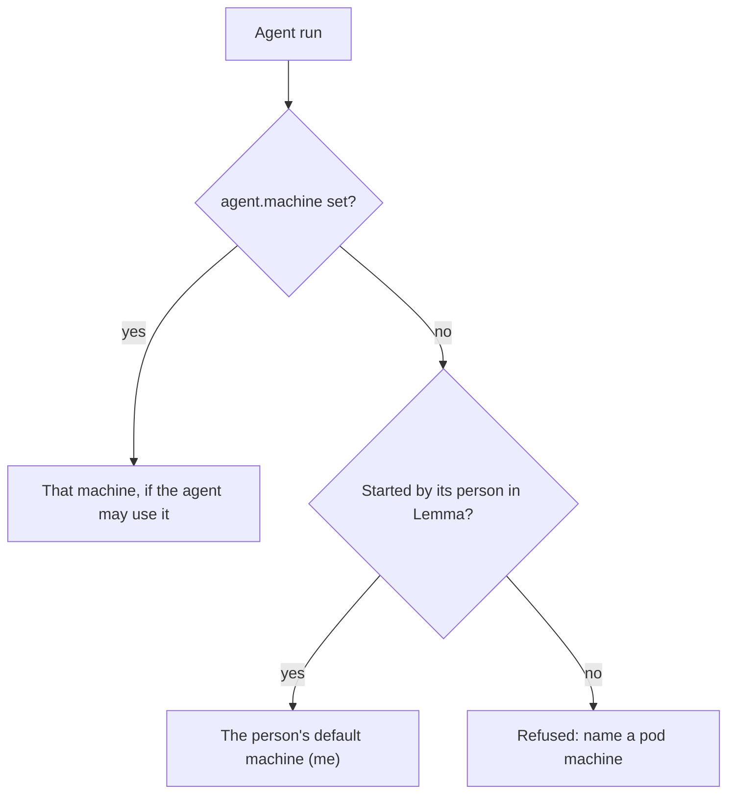

# Machines

A **machine** is a computer that commands, files and a browser run on, addressed
by name. Agents run their shell commands on one, apps and functions reach one
through the SDK, people reach theirs from the Environments screen and the CLI.
Underneath, a machine is a workspace sandbox on the
[sandbox fabric](sandbox/README.md); this document is the layer people and
callers see.

The code: `lemma-backend/app/modules/workspace` (module doc:
[workspace.md](../../lemma-backend/docs/modules/workspace.md)). The paths inside a
machine come from `lemma-backend/sandbox_runtime/paths.py` and nowhere else.

## Kinds and refs

| Kind | What it is | Ref | Owner | Compute counts against |
|---|---|---|---|---|
| Default machine | One per person, created on first use, 2 vCPU / 4 GB | `me` | The person | The person |
| Pod machine | Shared by a pod's agents; created by its editors and admins within the plan's policy; templates `workspace` and `workspace-docker` (has Docker) | `pod:<name>` in the pod, `pod:<pod>/<name>` from outside | The pod — it outlives whoever created it | The organization |
| Connected machine | A person's own laptop or VM joined with the CLI | `mine:<name>` | The person | — |

Any machine can also be named by its id. `services/machine_resolver.py` is the
only thing that turns a ref into a machine, and it decides access on the way
(`domain/machine_access.py`). A machine a caller may not reach is reported as
not found, so a `restricted` machine's name does not leak.

A pod machine is `pod` (every agent in the pod may use it) or `restricted`
(only agents, functions and members named in its `machine.use` grants, and pod
admins) — for isolation, such as a verifier's machine the builder must not
reach. `run_slots` bounds how many agent runs share it at once; later runs
queue.

## Who may do what

Access is cumulative: **status** (see that it exists and how it is), **use**
(processes, files, previews, the browser) and **manage** (resize, reset,
delete).

| Caller → machine | Default (`me`) | Pod, `pod` visibility | Pod, `restricted` | Connected |
|---|---|---|---|---|
| Its owner | manage | — | — | manage |
| Pod viewer | — | status | status, if granted | status, if shared |
| Pod editor | — | manage | manage, if granted | use, if shared |
| Pod admin | — | manage | manage | use, if shared |
| Agent run started by its person in Lemma | use, on that person's machine | use | use, with a grant | use, if shared and granted |
| Agent run started by a channel, schedule or other surface | never | use | use, with a grant | use, if shared and granted |
| Function | never | use, with a grant | use, with a grant | use, if shared and granted |
| App page, as its viewer | processes, files and previews, after the viewer's consent | as the viewer, in the app's own pod only | as the viewer, in the app's own pod only | never |

Three rules carry most of the weight:

- **A run that a person did not start in Lemma never touches a person's own
  machine.** A schedule, a channel message or a webhook acts for nobody sitting
  at a computer, so such an agent needs a pod machine, named by its `machine`
  field.
- **An app reaches its viewer's machine only after the viewer says yes, in
  Lemma.** The first call answers `MACHINE_CONSENT_REQUIRED` with the URL of a
  Lemma page that asks them; the app cannot grant consent to itself, and the
  person can revoke it in Settings. Even then the app gets processes, files and
  previews: the browser, its logins and a `home` reset stay the person's own.
- **Agents pick a machine, they do not pick a person.** An agent's `machine`
  field names where its commands run; unset, it is the default machine of
  whoever the run acts for. Each tool call can name another machine the agent
  may use (`list_machines` shows them).

## Inside a machine

| Path | What it is |
|---|---|
| `/home/user` | The home, and the durable root: everything under it survives release and resume |
| `~/lemma` | Projects and conversations: `c/<date>/<slug>`, `repos/<owner>/<repo>` |
| `~/lemma/runs/<agent>/<run>` | A run's own directory on a pod machine |
| `~/lemma/services/<name>` | A long-lived service on a pod machine |
| `~/.lemma/browser/profile` | The browser profile: every login. Protected |
| `/tmp` | Not durable; short-lived credentials are staged here |

### Pod machines run many runs at once

- Each run works in its own directory, and the processes it starts are tagged
  with it and stopped when the run ends.
- A **service** is the exception: named, exempt from the process lifetime cap,
  not stopped at run end, and restarted when the machine resumes.
- Repositories are kept as mirrors and checked out as worktrees at any ref, so
  concurrent runs on one repository do not clone it again or share a tree.
- A **disk janitor** watches the fixed-size disk: from
  `MACHINE_DISK_PRUNE_FRACTION` it prunes finished runs, then Docker images and
  build cache; from `MACHINE_DISK_REFUSE_FRACTION` the machine refuses new runs.
  It never touches a protected path or a running service.
- A machine with a run slot taken or a service running is busy, and the idle
  sweep leaves it alone.

## Previews

A preview turns a port on a machine into a URL people can open:
`p-<id>.<MACHINE_PREVIEW_DOMAIN>`. Each preview is its own origin, so hot
reload and root-absolute assets work as they do on `localhost`.

- `private` asks the visitor to be signed in to Lemma and allowed on the machine.
- `link` works for anyone, for at most `MACHINE_PREVIEW_MAX_TTL_SECONDS`.
- Either can be revoked; a revoked preview answers 404 at once.
- With `MACHINE_PREVIEW_DOMAIN` unset, previews are off and the API says so.
- On Docker the API has to reach the port. With `WORKSPACE_DOCKER_PRIVATE_NETWORK`
  set (the compose deployment) every port is reachable; without it, as on a
  laptop, only the ports the container publishes are, and a preview of any
  other port answers 502.

Agents make one with `expose_port`, people with `lemma machine preview create`
or the Environments screen, apps and functions through the SDK.

## Reset scopes

`POST /machines/{ref}:reset` takes the scopes to clean:

| Scope | What it does | Who may |
|---|---|---|
| `processes` | Stops every process except services | Anyone with use, agents included |
| `runs` | Deletes finished runs' directories | Anyone with use, agents included |
| `caches` | Clears package-manager and tool caches | Anyone with use, agents included |
| `docker` | Removes unused images, build cache and stopped containers | Anyone with use, agents included |
| `browser-session` | Closes the browser's tabs; logins stay | A person |
| `home` | A fresh disk. Needs `confirm`; logins are restored unless `forget_logins` | A person, never an app |

The reply says how much disk came back.

## Logins are protected

The browser profile is where every site a person signed in to lives, and losing
it means asking them again for something an agent cannot explain. So:

- nothing deletes, moves or overwrites it — not the files API, not a reset scope
  other than a confirmed `home`, not the janitor, not quiesce;
- the HTTP files route will not even read it;
- a machine never stops with the browser open: release, reset and the compute
  grace path close it cleanly first, and the provider's own timeout is
  refreshed while a browser is open;
- after a clean close the login-bearing parts are backed up, encrypted, off the
  machine, and restored onto any new disk: a confirmed `home` reset, a move to a
  new size, and a machine that starts holding no login at all because its
  provider lost the disk. That last restore runs in the sweep that sees the
  machine start, and never over a profile that holds anything, since a login
  made since the last copy is newer than the copy.

## Compute

Machine time is metered in **compute units**: one CU is an hour of a 2 vCPU /
4 GB machine, and other sizes scale with their vCPUs. Running time is sliced
into the usage ledger as it accrues — a default machine's against its person, a
pod machine's against the organization — and, with a price set, counts in the
same spend limits as model calls. Allowances and prices come from the plan, or
from the `USAGE_*_COMPUTE_UNITS` and `USAGE_COMPUTE_UNIT_USD` settings on a
self-hosted deployment ([configuration](../configuration.md#machines)).

With `COMPUTE_BILLING_ENABLED`, an allowance is enforced: warnings at 80% and
95%; at 100% no new processes, then a grace period, then the machine is
released with its browser closed cleanly. The agent's run context shows the
compute left this month, and the disk, so a run can clean up before a build
fails halfway.

## Reaching a machine

| From | How |
|---|---|
| API | `/machines`, `/machines/{ref}` and its `processes`, `files`, `previews`, `browser` routes; `/pods/{pod}/machines` and its grants; `/machine-consents` |
| TypeScript SDK | `client.machines` |
| Python SDK | `lemma.machines`; `ctx.machines` inside a function |
| CLI | `lemma machine list \| exec \| shell \| ps \| kill \| cp \| preview \| reset \| logins` |
| Agent tools | `exec_command`, `manage_process`, `execute_python` (each takes `machine`), `list_machines`, `expose_port`, `sync_files`, `reset_machine` |
| Bundle | `machines/<name>/<name>.json`, and an agent's `machine` field |

The pre-machines names are deprecated shims over `/machines/me`:

- `/workspace/*` and `/workspace-ports` (deprecated: use `/machines/me/...`);
- `/public/workspace-ports` (deprecated: use `/public/machine-ports`);
- the TypeScript SDK's `client.workspace` (deprecated: use `client.machines`).

Each response carries an `X-Lemma-Deprecation` header naming its replacement,
and the OpenAPI document marks them deprecated. New code uses the machine routes.
