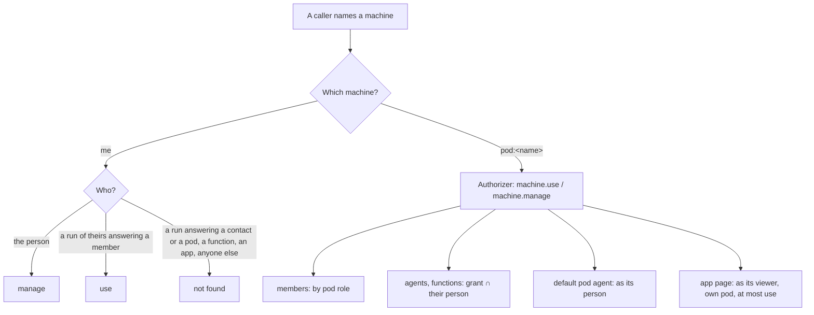

# Machines

A **machine** is a computer that commands, files and a browser run on, addressed
by name. Agents run their shell commands on one, apps and functions reach one
through the SDK, people reach theirs from the Environments screen and the CLI.
Underneath, a machine is a workspace sandbox on the
[sandbox fabric](sandbox/README.md); this document is the layer people and
callers see.

The code: `lemma-backend/app/modules/workspace` (module doc:
[workspace.md](../../lemma-backend/docs/modules/workspace.md)). The paths inside a
machine come from `lemma-backend/sandbox_runtime/paths.py` and nowhere else.

## Kinds and refs

| Kind | What it is | Ref | Owner | Compute counts against |
|---|---|---|---|---|
| Default machine | One per person, created on first use, 1 vCPU / 2 GB by default (a plan may choose another size) | `me` | The person | The person |
| Pod machine | Shared by a pod's agents; created by its editors and admins within the plan's policy; templates `workspace` and `workspace-docker` (has Docker; E2B only) | `pod:<name>` in the pod, `pod:<pod>:<name>` from outside (the pod by id or name; the older `pod:<pod>/<name>` is still read) | The pod — it outlives whoever created it | The organization |
| Connected machine | A person's own laptop or VM joined with the CLI | `mine:<name>` | The person | — |

The API's `ref` field uses the colon form, `pod:<pod>:<name>`, because a
slash cannot sit in a URL path segment; both forms parse. Any machine can also
be named by its id. `services/machine_resolver.py` is the
only thing that turns a ref into a machine, and it decides access on the way
(below). A machine a caller may not reach is reported as not found, so its
name does not leak to the people it is kept from.

`run_slots` bounds how many agent runs share a pod machine at once; later runs
queue.

## Who may do what

Access is cumulative: **status** (see that it exists and how it is), **use**
(processes, files, previews, the browser) and **manage** (resize, reset,
delete). The browser means watching it as well as driving it: the screen shows
whatever is signed in there, so the view socket (and the TURN credentials it
hands out) needs **use** in either mode. **Status** sees only whether the
browser is running and at what size, not who is watching it or who holds the
screen's size. Two rules decide it.

**`me` is the person and every run they own.** A person's default machine is
theirs to manage, and every agent run they own uses it — a chat, a schedule, a
workflow step, a Slack or WhatsApp message, a call, a sub-agent, whatever
started it. The only runs that get no machine are those answering somebody
outside the pod: a contact, or another pod asking over a link. Their toolset
has no machine tools (`OUTSIDER_TOOLSETS`), `refuse_owner_workspace` is the
backstop, and the resolver reads whom the run's conversation answers as a
third line (`agent/contracts/run_audience.py`). Nobody else reaches `me`: not a
function, not an app's page, not another person. An app's page acts as its
viewer inside its own pod, and a person's own machine is not a pod resource.

A run reading what people outside the pod wrote — a group's strangers, or a
row a contact wrote that started a schedule — is held on `me` exactly as on a
pod machine: using it waits for its person's approval
(`core/authorization/outside_text_gate.py`, asked of the run's own context by
`infrastructure/machine_facts.py`). Seeing that it is there does not.

**A pod machine is a pod resource**, authorized by the core `Authorizer`
like every other (`ResourceType.MACHINE`, `machine.use`, `machine.manage`):

- members by their pod role — editors and admins manage, anyone who may read
  the pod sees its status;
- agents and functions by a `machine.use` grant, intersected with the person
  they act for (`workload_authority`), so a grant never lifts a run above its
  person;
- the pod's default agent as the person it acts for;
- an app's page as its viewer, in its own pod only, and never past use —
  and never a terminal: it cannot start a process, read its output, type into
  it or stop it (`APP_ROUTES` leaves those out, and the stream socket refuses
  it), because its script is the app author's.

Grants are for agents and functions; people need none. Setting an agent's
`machine: pod:<name>` — in the editor or in a bundle — confers that agent the
`machine.use` grant, bounded like any conferral by what the person saving it
may do themselves, so naming a machine and granting it cannot drift apart. A
tool call may still name any machine the run may use (`list_machines` shows
them). Keeping a machine from an agent — a verifier the builder agent must not
reach — is not granting it to that agent. That isolates agents only: every
editor holds `machine.use` on every pod machine by role, so any editor, and
the pod's default agent acting for one, reaches the verifier too. Creating,
changing, deleting and granting pod machines are a person's own acts, never an
app's or an agent's.

A connected machine is its owner's. Shared into a pod, it is that pod's
resource as above, but never more than usable by anybody else, and never by an
app.

**A pod machine is one trust domain.** Every process on it runs as one Linux
user, so anything running there can read what the others hold: their
environment, their checkouts, their credentials, the browser's profile and
every login in it. Plainly: **anyone with `machine.use` on a pod machine can
see and use everything on it** — every process and its environment, every
terminal (anyone with use can stream another person's terminal and type into
it), every checkout, and the browser's signed-in sessions. An app's page
cannot open a terminal there, but it can still write files that the
machine's processes go on to run.

What Lemma keeps from co-tenants is the reach of the tokens it places there.
Every one is short-lived (the access-token lifetime) and pinned to the pod:
an agent's or function's carries its own delegation (its grant intersected
with its person); a person's own process — the CLI, the SDK, an Environments
terminal — gets the token the pod's default agent would carry for them, which
reaches what they may do in that pod and nothing in any other pod or the
organization, and has destructive actions approved first like any delegated
token (`services/machine_process_credentials.py`). On `me`, where nobody else
runs anything, a person's process keeps their own token. Work that must not
share with another run, or person, belongs on a machine of its own.

## Inside a machine

| Path | What it is |
|---|---|
| `/home/user` | The home, and the durable root: everything under it survives release and resume |
| `~/lemma` | Projects and conversations: `c/<date>/<slug>`, `repos/<owner>/<repo>` |
| `~/lemma/runs/<agent>/<run>` | A run's own directory on a pod machine |
| `~/lemma/services/<name>` | A long-lived service on a pod machine |
| `~/.lemma/browser/profile` | The browser profile: every login. Protected |
| `/tmp` | Not durable; short-lived credentials are staged here |

### Pod machines run many runs at once

- Each run works in its own directory, and the processes it starts are tagged
  with it and stopped when the run ends.
- A **service** is the exception: named (`exec_command` with `service`, or the
  processes API), not stopped at run end, and restarted when the machine
  resumes. Its definition is kept in the database with the caller's variables
  encrypted and the claims its token was minted for, so the restart gets a
  fresh token with the same reach -- once whoever started it is decided again
  to still have use of the machine; one whose starter has not is forgotten.
  A machine's services go with it when it is deleted, made again under its
  name, or its home is reset, and it keeps at most 64: the next name is
  refused (`MACHINE_SERVICE_LIMIT`).
- Repositories are kept as mirrors and checked out as worktrees at any ref, so
  concurrent runs on one repository do not clone it again or share a tree.
- A **disk janitor**, a background job, watches the fixed-size disk: from
  `MACHINE_DISK_PRUNE_FRACTION` it prunes finished runs, then Docker images and
  build cache. A run's first command only measures the disk, and from
  `MACHINE_DISK_REFUSE_FRACTION` the machine refuses new runs. It never touches
  a protected path, a running service or a live run.
- A machine with a run slot taken is busy, and the idle sweep leaves it alone.
  A running service keeps it busy only while it writes output within
  `MACHINE_SERVICE_IDLE_SECONDS`. A run waiting on a process it started
  (`wait_for` on a process) keeps its slot; one waiting on a person, a timer
  or a sub-agent frees it.
  A run that finds no slot free polls for a minute and is told the machine is
  busy; there is no queue.

## Previews

A preview turns a port on a machine into a URL people can open:
`p-<id>.<MACHINE_PREVIEW_DOMAIN>`. Each preview is its own origin, so hot
reload and root-absolute assets work as they do on `localhost`.

- `private` asks the visitor to be signed in to Lemma and allowed on the machine.
- `link` works for anyone, for at most `MACHINE_PREVIEW_MAX_TTL_SECONDS`.
- Either can be revoked; a revoked preview answers 404 at once.
- With `MACHINE_PREVIEW_DOMAIN` unset, previews are off and the API says so.
- On Docker the API has to reach the port. With `WORKSPACE_DOCKER_PRIVATE_NETWORK`
  set (the compose deployment) every port is reachable by address; without it,
  as on a laptop, a port the container did not publish is reached through the
  workspace runtime's `/ports/{port}` relay (`sandbox_runtime/workspace/port_relay.py`),
  behind the runtime credential, which the relay strips before forwarding.
- The machine's own ports -- the runtime (8080), the agent-browser dashboard
  (4848), the browser relay (4850), VNC (5900/5901) and the streamer (4860) --
  are refused as previews (`MACHINE_PORT_RESERVED`), except on a connected
  machine, where 8080 is somebody's dev server. The relay also refuses
  Chrome's DevTools port, which takes a `localhost` request at its word.
- `make dev` turns previews on at `machines.localhost:<backend port>`, over
  plain http; `*.localhost` resolves without DNS setup.

Agents make one with `expose_port`, people with `lemma machine preview create`
or the Environments screen, apps and functions through the SDK.

## Reset scopes

`POST /machines/{ref}:reset` takes the scopes to clean:

| Scope | What it does | Who may |
|---|---|---|
| `processes` | Stops every process except services; an agent stops only its own run's | Anyone with use, agents included |
| `runs` | Deletes finished runs' directories: never one a live run holds a slot for, never one written in the last hour | Anyone with use, agents included |
| `caches` | Clears package-manager and tool caches | Anyone with use, agents included |
| `docker` | Removes unused images, build cache and stopped containers — every run's | The machine's managers |
| `browser-session` | Closes the browser's tabs; logins stay | A person |
| `home` | A fresh disk. Needs `confirm`; logins are restored unless `forget_logins` | A person, never an app |

The reply says how much disk came back.

## Logins are protected

The browser profile is where every site a person signed in to lives, and losing
it means asking them again for something an agent cannot explain. So:

- nothing deletes, moves or overwrites it — not the files API, not a reset scope
  other than a confirmed `home`, not the janitor, not quiesce;
- the HTTP files route will not even read it;
- a machine never stops with the browser open: release, reset and the compute
  grace path close it cleanly first, and the provider's own timeout is
  refreshed while a browser is open;
- after a clean close the login-bearing parts are backed up, encrypted, off the
  machine, and restored onto any new disk: a confirmed `home` reset, a move to a
  new size, and a machine that starts holding no login at all because its
  provider lost the disk. That last restore runs in the sweep that sees the
  machine start, and never over a profile that holds anything, since a login
  made since the last copy is newer than the copy;
- a copy is **stored** (read back intact before older copies are pruned),
  **nothing** to copy, or **failed**; a `home` reset or a size move that cannot
  close the browser cleanly or store its copy stops, with the disk as it was.

## Moving a machine to a new size

Behind `MACHINE_SIZE_MIGRATION_ENABLED`. The sweep only marks an idle default
machine at the legacy size; the `workspace.machine_size_migrations` job does
the move, as states on the machine row written before each step's effects can
be lost: `started` (logins copied, home packed and uploaded, its object key
written), `packed` (old machine destroyed, row resized), `resized` (new machine
started, home unpacked, logins restored, state cleared, carried copy deleted).
A failed step is resumed from its state on the job's next run.

- **Nobody uses a machine while it moves.** From the mark until the state is
  cleared, every use and every change is refused with `MACHINE_MOVING` (409),
  at the resolver every route, tool and SDK call goes through; the machine can
  still be seen. A write after the pack would go with the old disk, and the new
  disk is empty until the home is unpacked. So the sweep marks a move only when
  no other is waiting, and no one is kept off their machine behind another
  person's move.
- **The carried home is sealed.** It holds SSH keys and `.env` files, so it is
  sealed as it streams the way the logins are: a fresh AES-256-GCM data key
  per object, wrapped by the deployment's secret cipher, the machine id bound
  in, in frames that cannot be dropped, reordered or cut short unnoticed.
- **A move given up is not tried again.** A home past 8 GiB or one that will
  not pack, or logins that will not copy five times, abandons the move before
  anything is destroyed. The row keeps the target with no state, so the sweep
  does not mark the same move again and the machine is released like any
  other; a different target size is a new move.

## Compute

Machine time is metered in **compute units**, one open session per running
machine (the database enforces it). A session ends however the machine
stopped: a release, reset or delete ends it at once; any other stop — the
provider pausing a sandbox on its own timeout, a give-up in the sweep — is
found by the next sweep, which ends it where it was last metered, so stopped
time is never billed. One CU is an hour of a 2 vCPU / 4 GB machine, and other
sizes scale with their vCPUs (a default 1 vCPU machine uses half a CU an
hour). Running time is sliced
into the usage ledger as it accrues — a default machine's against its person, a
pod machine's against the organization — and, with a price set, counts in the
same spend limits as model calls. Allowances and prices come from the plan, or
from the `USAGE_*_COMPUTE_UNITS` and `USAGE_COMPUTE_UNIT_USD` settings on a
self-hosted deployment ([configuration](../configuration.md#machines)).

With `COMPUTE_BILLING_ENABLED`, an allowance is enforced: warnings at 80% and
95%; at 100% no new processes, then a grace period, then the machine is
released with its browser closed cleanly. The agent's run context shows the
compute left this month, and the disk, so a run can clean up before a build
fails halfway.

## Reaching a machine

| From | How |
|---|---|
| API | `/machines`, `/machines/{ref}` and its `processes`, `files`, `previews`, `browser` routes; `/pods/{pod}/machines` and its grants |
| TypeScript SDK | `client.machines` |
| Python SDK | `lemma.machines`; `ctx.machines` inside a function |
| CLI | `lemma machine list \| exec \| shell \| ps \| kill \| cp \| preview \| reset \| logins` |
| Agent tools | `exec_command`, `manage_process`, `execute_python` (each takes `machine`), `list_machines`, `expose_port`, `sync_files`, `reset_machine` |
| Bundle | `machines/<name>/<name>.json`, and an agent's `machine` field |

There is one API. The routes from before machines, and the TypeScript SDK's
`client.workspace` alias, are removed; the caller's own machine is the ref
`me`, and a port grant opens under `/public/machine-ports`.
