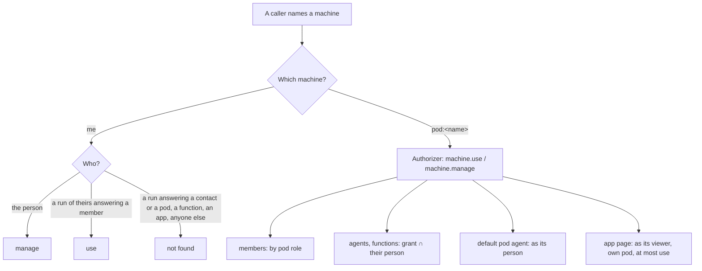

# Machines

A **machine** is a computer that commands, files and a browser run on, addressed
by name. Agents run their shell commands on one, apps and functions reach one
through the SDK, people reach theirs from the Environments screen and the CLI.
Underneath, a machine is a workspace sandbox on the
[sandbox fabric](sandbox/README.md); this document is the layer people and
callers see.

The code: `lemma-backend/app/modules/workspace` (module doc:
[workspace.md](../../lemma-backend/docs/modules/workspace.md)). The paths inside a
machine come from `lemma-backend/sandbox_runtime/paths.py` and nowhere else.

## Kinds and refs

| Kind | What it is | Ref | Owner | Compute counts against |
|---|---|---|---|---|
| Default machine | One per person, created on first use, 1 vCPU / 2 GB by default (a plan may choose another size) | `me` | The person | The person |
| Pod machine | Shared by a pod's agents; created by its editors and admins within the plan's policy; templates `workspace` and `workspace-docker` (has Docker; E2B only) | `pod:<name>` in the pod, `pod:<pod>:<name>` from outside (the pod by id or name; the older `pod:<pod>/<name>` is still read) | The pod — it outlives whoever created it | The organization |
| Connected machine | A person's own laptop or VM joined with the CLI | `mine:<name>` | The person | — |

The API's `ref` field uses the colon form, `pod:<pod>:<name>`, because a
slash cannot sit in a URL path segment; both forms parse. Any machine can also
be named by its id. `services/machine_resolver.py` is the
only thing that turns a ref into a machine, and it decides access on the way
(below). A machine a caller may not reach is reported as not found, so its
name does not leak to the people it is kept from.

`run_slots` bounds how many agent runs share a pod machine at once; later runs
queue.

## Who may do what

Access is cumulative: **status** (see that it exists and how it is), **use**
(processes, files, previews, the browser) and **manage** (resize, reset,
delete). Two rules decide it.

**`me` is the person and every run they own.** A person's default machine is
theirs to manage, and every agent run they own uses it — a chat, a schedule, a
workflow step, a Slack or WhatsApp message, a call, a sub-agent, whatever
started it. The only runs that get no machine are those answering somebody
outside the pod: a contact, or another pod asking over a link. Their toolset
has no machine tools (`OUTSIDER_TOOLSETS`), `refuse_owner_workspace` is the
backstop, and the resolver reads whom the run's conversation answers as a
third line (`agent/contracts/run_audience.py`). Nobody else reaches `me`: not a
function, not an app's page, not another person. An app's page acts as its
viewer inside its own pod, and a person's own machine is not a pod resource.

**A pod machine is a pod resource**, authorized by the core `Authorizer`
like every other (`ResourceType.MACHINE`, `machine.use`, `machine.manage`):

- members by their pod role — editors and admins manage, anyone who may read
  the pod sees its status;
- agents and functions by a `machine.use` grant, intersected with the person
  they act for (`workload_authority`), so a grant never lifts a run above its
  person;
- the pod's default agent as the person it acts for;
- an app's page as its viewer, in its own pod only, and never past use.

Grants are for agents and functions; people need none. Setting an agent's
`machine: pod:<name>` — in the editor or in a bundle — confers that agent the
`machine.use` grant, bounded like any conferral by what the person saving it
may do themselves, so naming a machine and granting it cannot drift apart. A
tool call may still name any machine the run may use (`list_machines` shows
them). Keeping a machine from somebody — a verifier the builder must not
reach — is not granting it to them. Creating, changing, deleting and granting
pod machines are a person's own acts, never an app's or an agent's.

A connected machine is its owner's. Shared into a pod, it is that pod's
resource as above, but never more than usable by anybody else, and never by an
app.

**A pod machine is one trust domain.** Every process on it runs as one Linux
user, so anything running there can read what the others hold: their
environment, their checkouts, their credentials. That is why the tokens Lemma
places on a pod machine are scoped to the workload (its grant intersected with
its person) and short-lived: the most a co-tenant can take is that run's own
narrowed authority. Work that must not share with another run belongs on a
machine of its own.

## Inside a machine

| Path | What it is |
|---|---|
| `/home/user` | The home, and the durable root: everything under it survives release and resume |
| `~/lemma` | Projects and conversations: `c/<date>/<slug>`, `repos/<owner>/<repo>` |
| `~/lemma/runs/<agent>/<run>` | A run's own directory on a pod machine |
| `~/lemma/services/<name>` | A long-lived service on a pod machine |
| `~/.lemma/browser/profile` | The browser profile: every login. Protected |
| `/tmp` | Not durable; short-lived credentials are staged here |

### Pod machines run many runs at once

- Each run works in its own directory, and the processes it starts are tagged
  with it and stopped when the run ends.
- A **service** is the exception: named, exempt from the process lifetime cap,
  not stopped at run end, and restarted when the machine resumes.
- Repositories are kept as mirrors and checked out as worktrees at any ref, so
  concurrent runs on one repository do not clone it again or share a tree.
- A **disk janitor** watches the fixed-size disk: from
  `MACHINE_DISK_PRUNE_FRACTION` it prunes finished runs, then Docker images and
  build cache; from `MACHINE_DISK_REFUSE_FRACTION` the machine refuses new runs.
  It never touches a protected path or a running service.
- A machine with a run slot taken or a service running is busy, and the idle
  sweep leaves it alone.

## Previews

A preview turns a port on a machine into a URL people can open:
`p-<id>.<MACHINE_PREVIEW_DOMAIN>`. Each preview is its own origin, so hot
reload and root-absolute assets work as they do on `localhost`.

- `private` asks the visitor to be signed in to Lemma and allowed on the machine.
- `link` works for anyone, for at most `MACHINE_PREVIEW_MAX_TTL_SECONDS`.
- Either can be revoked; a revoked preview answers 404 at once.
- With `MACHINE_PREVIEW_DOMAIN` unset, previews are off and the API says so.
- On Docker the API has to reach the port. With `WORKSPACE_DOCKER_PRIVATE_NETWORK`
  set (the compose deployment) every port is reachable by address; without it,
  as on a laptop, a port the container did not publish is reached through the
  workspace runtime's `/ports/{port}` relay (`sandbox_runtime/workspace/port_relay.py`),
  behind the runtime credential, which the relay strips before forwarding.
- The machine's own ports -- the runtime (8080), the agent-browser dashboard
  (4848), the browser relay (4850), VNC (5900/5901) and the streamer (4860) --
  are refused as previews (`MACHINE_PORT_RESERVED`), except on a connected
  machine, where 8080 is somebody's dev server. The relay also refuses
  Chrome's DevTools port, which takes a `localhost` request at its word.
- `make dev` turns previews on at `machines.localhost:<backend port>`, over
  plain http; `*.localhost` resolves without DNS setup.

Agents make one with `expose_port`, people with `lemma machine preview create`
or the Environments screen, apps and functions through the SDK.

## Reset scopes

`POST /machines/{ref}:reset` takes the scopes to clean:

| Scope | What it does | Who may |
|---|---|---|
| `processes` | Stops every process except services | Anyone with use, agents included |
| `runs` | Deletes finished runs' directories | Anyone with use, agents included |
| `caches` | Clears package-manager and tool caches | Anyone with use, agents included |
| `docker` | Removes unused images, build cache and stopped containers | Anyone with use, agents included |
| `browser-session` | Closes the browser's tabs; logins stay | A person |
| `home` | A fresh disk. Needs `confirm`; logins are restored unless `forget_logins` | A person, never an app |

The reply says how much disk came back.

## Logins are protected

The browser profile is where every site a person signed in to lives, and losing
it means asking them again for something an agent cannot explain. So:

- nothing deletes, moves or overwrites it — not the files API, not a reset scope
  other than a confirmed `home`, not the janitor, not quiesce;
- the HTTP files route will not even read it;
- a machine never stops with the browser open: release, reset and the compute
  grace path close it cleanly first, and the provider's own timeout is
  refreshed while a browser is open;
- after a clean close the login-bearing parts are backed up, encrypted, off the
  machine, and restored onto any new disk: a confirmed `home` reset, a move to a
  new size, and a machine that starts holding no login at all because its
  provider lost the disk. That last restore runs in the sweep that sees the
  machine start, and never over a profile that holds anything, since a login
  made since the last copy is newer than the copy.

## Compute

Machine time is metered in **compute units**: one CU is an hour of a 2 vCPU /
4 GB machine, and other sizes scale with their vCPUs (a default 1 vCPU machine
uses half a CU an hour). Running time is sliced
into the usage ledger as it accrues — a default machine's against its person, a
pod machine's against the organization — and, with a price set, counts in the
same spend limits as model calls. Allowances and prices come from the plan, or
from the `USAGE_*_COMPUTE_UNITS` and `USAGE_COMPUTE_UNIT_USD` settings on a
self-hosted deployment ([configuration](../configuration.md#machines)).

With `COMPUTE_BILLING_ENABLED`, an allowance is enforced: warnings at 80% and
95%; at 100% no new processes, then a grace period, then the machine is
released with its browser closed cleanly. The agent's run context shows the
compute left this month, and the disk, so a run can clean up before a build
fails halfway.

## Reaching a machine

| From | How |
|---|---|
| API | `/machines`, `/machines/{ref}` and its `processes`, `files`, `previews`, `browser` routes; `/pods/{pod}/machines` and its grants |
| TypeScript SDK | `client.machines` |
| Python SDK | `lemma.machines`; `ctx.machines` inside a function |
| CLI | `lemma machine list \| exec \| shell \| ps \| kill \| cp \| preview \| reset \| logins` |
| Agent tools | `exec_command`, `manage_process`, `execute_python` (each takes `machine`), `list_machines`, `expose_port`, `sync_files`, `reset_machine` |
| Bundle | `machines/<name>/<name>.json`, and an agent's `machine` field |

There is one API. The routes from before machines, and the TypeScript SDK's
`client.workspace` alias, are removed; the caller's own machine is the ref
`me`, and a port grant opens under `/public/machine-ports`.
