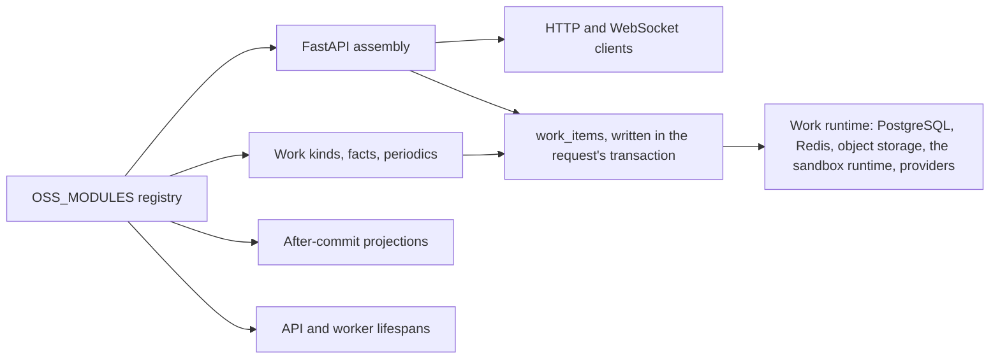
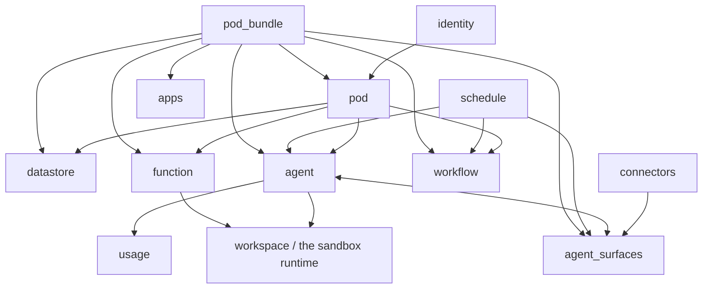

# Lemma backend module guide

This directory describes the open-source runtime modules registered in
`app/core/registry/installed.py`. A module document explains the behavior that
exists today; it is not a product roadmap. Review findings and proposed work
live in the pull request that introduces them.

## How modules are assembled

Each `app/modules/<name>/module.py` exposes a lazy `LemmaModule` declaration.
The declaration may contribute FastAPI routers, work kinds and fact
subscriptions (`register_work`, every process), periodic work
(`register_periodic_work`, worker only), after-commit projections
(`register_analytics`, every process), and API/worker lifespan hooks.
`app.app.create_app()` mounts the API contributions; `python -m app.worker`
(`app/core/infrastructure/work/process.py`) registers the rest and runs the
work runtime. How that runtime behaves, and how the old event transport was
retired, is in [operators/reliability.md](../operators/reliability.md).

The canonical registration order is identity, pod, pod bundle, datastore,
schedule, connectors, agent, function, apps, workflow, agent surfaces,
contacts, channels, icon, usage, workspace, web login, MCP access, decisions, and analytics. Order affects router and lifespan registration, but
modules should communicate through explicit ports or domain events rather than
depending on import order.

## Module catalog

| Module | Primary responsibility | Durable tables owned |
| --- | --- | --- |
| [identity](identity.md) | Users, organizations, invitations, authentication | `users`, `organizations`, `organization_members`, `organization_invitations` |
| [pod](pod.md) | Workspace tenancy, membership, roles, resource grants | `pods`, `pod_members`, `pod_join_requests`; shared authorization grant tables live in core |
| [pod_bundle](pod_bundle.md) | Export, plan, import, and GitHub publish of portable pods | `pod_bundle_jobs`, `pod_bundle_job_steps`; Redis holds only the realtime mirror, and staged archives live in object storage |
| [datastore](datastore.md) | Dynamic tables/records, files, search, document processing | `datastore_tables`, `datastore_files`, per-pod PostgreSQL schemas |
| [schedule](schedule.md) | Time, webhook, datastore, and application triggers | `schedules`; APScheduler also has its own job store |
| [connectors](connectors.md) | Connector catalog, auth configs, accounts, operations, triggers | `connectors`, `auth_configs`, `accounts`, `connect_requests`, `connector_operations`, `connector_triggers` |
| [agent](agent.md) | Agents, conversations, runs, tools, runtimes, approvals, widgets | `agents`, `agent_runtime_profiles`, `agent_hosts`, `agent_conversations`, `agent_runs`, `agent_messages`, `agent_approval_decisions`, `agent_feedback` |
| [function](function.md) | Versioned deterministic function definitions and sandboxed runs | `functions`, `function_runs` |
| [apps](apps.md) | Pod app metadata, source/dist releases, and public asset hosting | `apps`, `app_releases` |
| [workflow](workflow.md) | Workflow graphs, execution, waits, forms, and resumptions | `workflow_flows`, `workflow_flow_runs`, `workflow_run_waits` |
| [agent_surfaces](agent_surfaces.md) | External chat/email ingress, identity mapping, and delivery | `agent_surfaces`, `agent_surface_external_users`, `surface_deliveries` |
| [icon](icon.md) | Public raster icon upload and retrieval | None; bytes live in public object/local storage |
| [usage](usage.md) | Model-usage metering, reservations, limits, and reporting | `usage_records`, `usage_limit_counters`, `usage_contacts_caps` |
| [workspace](workspace.md) | sandbox/session access and workspace tool runtime | `sandboxes`, `sandbox_instances`; live process/session state stays in the sandbox runtime and Redis |
| [mcp_access](mcp_access.md) | Outside MCP clients: the OAuth authorization server, consent, and connected clients | `mcp_oauth_clients`, `mcp_oauth_grants`, `mcp_oauth_tokens`; pending authorizations and codes are short-lived Redis keys |
| [contacts](contacts.md) | People a pod's bots answer who are not members, and the handles they are known by | `contacts`, `contact_identities` |
| [channels](channels.md) | The places members, contacts and agents talk: one timeline per place, fed by outside sources | `channels`, `channel_sources`, `channel_messages`, `channel_participants`, `channel_agents` |
| [decisions](decisions.md) | Stateless closed-question decisions over pluggable providers | None; the per-organization rate window is a short-lived Redis counter |

## Tables owned by core

These tables belong to no module. Five carry authorization, three carry the
work runtime, and two are left from the old event transport until migration
`0057_drop_old_transport` drops them. They sit in `app/core` because every
module depends on them, which is why the catalog above points at them instead
of repeating them in each row.

| Table | Meaning |
| --- | --- |
| `auth_permissions` | The permission catalog itself: id, scope, resource type, description, and whether the permission is system-only |
| `roles`, `role_permissions` | Organization- or pod-scoped roles and the permission bundle each one carries. Built-in pod roles are normalized by the pod module; custom roles are rows here |
| `role_assignments` | Which principal — user or workload — holds which role, unique per role and principal |
| `resource_permission_grants` | Named grants on one resource to one grantee inside one pod. This is what a delegated workload's context is built from, and what a bundle carries by name rather than by id |
| `domain_event_outbox` | Legacy. Events the old transport published to Redis Streams. Nothing writes or reads it any more; `0057` drops it |
| `domain_event_inbox` | Legacy. The old per-consumer delivery record. Nothing writes or reads it any more; `0057` drops it |
| `work_items` | The work runtime's live work: one row per queued or running item, written in the transaction that caused it and deleted in the one that completes it, plus dead items kept for inspection and retry. Its lease columns are what let a crashed or deployed process's work be reclaimed |
| `work_queues` | One row per (work class, namespace) that has had work: the namespace's cap on running items, its named rates, whether it is paused, and when the fair claim last served it. No readiness flag — that is derived from `work_items` |
| `work_rate_buckets` | Token buckets for rate-limited kinds, per namespace, rate name and optional key (a trigger), refilled and spent inside the claim transaction. A missing row is a full bucket |

## Cross-module runtime map

The arrows show runtime use, not desired ownership. Several current imports
cross infrastructure and service boundaries; that design debt is tracked in
the architecture baseline in `lemma-backend/architecture-baseline.json`, which
`make architecture` forbids from growing.

## Shared invariants

- Authentication is global, with a small set of explicitly public routes.
- Pod-scoped work is authorized with a `Context`; delegated workloads receive
  only grants/scopes encoded for that workload.
- A database unit of work must not stay open across model, provider, sandbox,
  object-storage, streaming, or retry I/O.
- Background side effects must be idempotent: a work item whose lease expires
  mid-run runs again. Database effects written in a fast handler's
  transaction, in a job's `complete_work`, or in a transaction fenced with
  `JobContext.hold_lease`, are exactly once; anything outside the database
  needs its own key.
- API errors use the shared `{message, code, details}` envelope.
- Secrets should be encrypted at rest and must never be logged or returned in
  diagnostic details.

## Verification snapshot

Reviewed on 2026-07-09. `make test-unit`/`make coverage-backend-unit` ran 2,007
tests: 2,006 passed and one optional `markitdown` test skipped. Current unit
line coverage is 63.9% overall. The async-safety Ruff gate passes; full Ruff on
production module code reports 31 findings and is not the CI gate. These facts
are evidence for the issue register, not promises that all integration paths
were executed.
