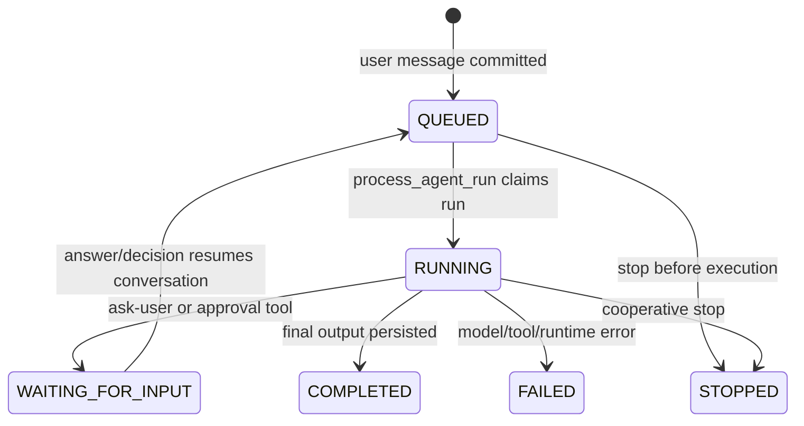

# Agent module

## Purpose

`app/modules/agent` owns agent definitions, conversations/messages, model runs,
runtime profiles, Agent Host dispatch, tool assembly, approvals, realtime
streaming, MCP access, widgets, and usage handoff. It is the central execution
module; external delivery belongs to [agent surfaces](agent_surfaces.md), and
sandbox lifecycle belongs to [workspace](workspace.md).

## Runtime contributions

| Contribution | Behavior |
| --- | --- |
| API routers | Agent CRUD/permissions, conversations/messages/SSE, runtime profiles, Agent Host pairing/dispatch, tools, widgets |
| Work kinds | `agent.turn` (`interactive`) and `agent.turn.automation` (`automation`), one per run and one at a time per conversation, written with the run; `agent.title`; `agent.approval.execute`, written with an approval decision; `agent.wait.fire`, `agent.wait.poll` and `agent.wait.resolve_child` for paused turns; `agent.followup`, `agent.subagent_result` and `pod_ask.deliver`, written in a finished run's transaction; `agent.pause_questions` after a run ends (its pause questions brought in line, its batch of questions to people sealed) and `agent.asked_question_closed` as one closes, which write `agent.replies_arrived` once the run has finished and nothing it asked still waits; `agent.pause_expired` when a paused question's time ran out (resumed as nobody answering, never approved) |
| Facts emitted | `AgentRunFinished` in every run's terminal transaction; workflow, schedule, surfaces and the parent's wait subscribe |
| Periodic work | `agent.host_dispatch_reconcile` (5 min), `agent.host_retained_state_cleanup` (daily) |
| After-commit projection | Drops a cached memory-brief section when the file behind it is written, from the committed `datastore.file.*` events |
| Mounted MCP apps | Conversation and pod tool servers are assembled by the backend root using agent services |

Everything that must follow a run's end is a work item or a fact written in the
transaction that ends it, so a crash between the end and its follow-ups cannot
lose one. Each step of a turn (a tool call, its return, the answer) commits
fenced by the turn's claim, so a worker that lost the turn's lease cannot add a
second answer, and a resumed turn whose answer had committed ends on it without
asking the model again. Lemma's database being unreachable mid-turn interrupts
the turn, which resumes; it is never recorded as the model failing. Transient token/status frames use the core realtime-channel port with
a Redis Pub/Sub adapter; each SSE connection leases one subscription connection
and releases it on completion, failure, or cancellation.

Migration `0056_agent_surface_bundle_work` arms every active wait. A turn that
was running on the old transport, and a conversation paused on an approval that
was decided but not yet executed, are failed with a message asking the person
to continue; nothing is replayed
([cutover](../operators/reliability.md#cutover-from-the-old-transport-design-13)).

## Main data model

| Table | Meaning |
| --- | --- |
| `agents` | Named prompt, schemas, toolsets, runtime selection, visibility |
| `agent_runtime_profiles` | Organization/user/system model provider configuration and encrypted credentials |
| `agent_host_pairings` | Single-use pairing codes a user authorizes; consuming one deletes the row, so presence is the whole validity check and a replayed code looks like one that never existed |
| `agent_hosts`, `agent_host_harnesses` | Paired Agent Host installations and their harness snapshots |
| `agent_host_commands`, `agent_host_run_leases` | Durable command handout and the single dispatch fence per run |
| `agent_conversations` | Pod thread, the agent it belongs to (the pod's assistant is a row like any other), parent/subagent and workspace metadata |
| `agent_messages` | User/assistant/tool messages and structured parts |
| `agent_runs` | One execution attempt, status, usage, errors, stop state, harness metadata |
| `agent_conversation_waits` | What a paused turn is waiting on — wait type, external reference, wake deadline, and the fire lease a timer tick takes; a partial unique index allows one `ACTIVE` row per conversation, mirroring `workflow_run_waits` |
| `agent_approval_decisions`, `agent_feedback` | Durable interaction/audit records |

## API groups

| Routes | What they do |
| --- | --- |
| `/pods/{pod_id}/agents` | Agent CRUD plus resource permission replacement |
| `/pods/{pod_id}/conversations` | Create/list/read/update, messages, approvals, send, stream, stop |
| `/organizations/{org}/agent-runtime/profiles` | Discover/create model runtime profiles |
| `/me/runtime/agent-hosts...`, `/agent-host/link`, `/agent-host/transfers/{id}`, `/agent-host/runs/{run_id}/blobs/{sha256}` | Agent Host pairing and management; the host's link WebSocket (commands, events, harnesses, Lemma MCP), and the host-authenticated HTTP routes its bulk bytes take instead (file chunks, event images) |
| `/tools/*` | Server-side web search and feedback endpoints used by runtimes |
| `/public/widgets/serve...`, `/pods/{pod}/widgets...` | Render/submit a tool widget and mint an authenticated embed URL (`/widgets/serve...` is a legacy alias until 2026-11-08) |

## Run lifecycle

The runner resolves a runtime profile and harness (`pydantic_ai`, Agent Host,
or test harness), builds only the allowed toolsets, creates short UoWs for
message/status transitions, performs model/tool I/O outside them, publishes
realtime frames, and records usage. Tool calls receive a delegated workload
context; destructive operations require a standing grant or session approval.
Agent Host runs are fenced by a per-run lease row, so a host that reconnects
cannot double-dispatch a run already in flight.

Subagents are child conversations with inherited workspace context and reduced
toolsets. Widgets are tool outputs stored in conversation context and served
through signed, purpose-bound embed access.

## Prompt context

Prompts combine a compact pod resource map, the agent's role, reply guidance,
and fragments for its enabled toolsets. Resource authoring details live in
skills. Agent and conversation instructions follow
the static guidance; runtime context and the task list follow those to preserve
the cached prefix. In-process capabilities and Agent Host use the same fragments.

A message answering a line in a channel keeps which lines of the channel it
was handed as background, never what they said, and a member's line written
into a contact's conversation is a mark naming its line, never its words
(`contact_conversations.append_follow_up`). Both are read from the channel's
timeline as the run's history is put together
(`services/channel_background.with_channel_background`, from
`runtime_history.assemble_runtime_history` and for messages steered into a
run), so an edit, a deletion or a forgotten contact reaches every later
prompt; the visitor's page and an export read a follow-up the same way. Only
the runs carried whole get their background -- an older run is reduced to its
requests and answer -- so the read is bounded and moves in elision's blocks.
A run answering a line in Lemma answers the lines whose words it read
(`services/channel_answers`, recorded in `channel_line_answers`).

Two kinds of message belong to no run and still reach the model, placed by
sequence among the runs around them: notifications, and what somebody outside
the pod said while a person had them, with whatever they were told instead
(`domain/held_turns`). Neither is carried from after the turn being answered,
nor, once older runs are cut from the history, from before what remains of it
(`runtime_history.unattached_message_window`).

Table summaries include primary keys, column types and write constraints,
foreign keys, RLS, and visibility. Column descriptions are available through
table inspection rather than repeated in every prompt. Omission counts mark
truncated inventories and schemas.

## Key dependencies

- Pod/identity: tenant, membership, authorization, delegation.
- Datastore/connectors/function: agent-callable resources.
- Workspace: shell, Python, browser, file, and long-lived process sessions.
- Usage: reserve and record model cost.
- Agent surfaces: surface context and platform tools; this dependency is
  currently bidirectional.

## Tests and operations

The test suite covers tool assembly, messages, approvals, cancellation,
runtime profiles, Agent Host dispatch, MCP, widgets, usage, subagents, and
mocked/real harness paths. This module carries the largest orchestration classes
in the backend; their size and cross-module coupling are held flat by the
`make architecture` ratchet rather than reduced.
