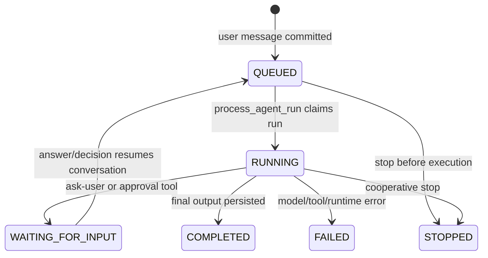

# Agent module

## Purpose

`app/modules/agent` owns agent definitions, conversations/messages, model runs,
runtime profiles, Agent Host dispatch, tool assembly, approvals, realtime
streaming, MCP access, widgets, and usage handoff. It is the central execution
module; external delivery belongs to [agent surfaces](agent_surfaces.md), and
sandbox lifecycle belongs to [workspace](workspace.md).

## Runtime contributions

| Contribution | Behavior |
| --- | --- |
| API routers | Agent CRUD/permissions, conversations/messages/SSE, runtime profiles, Agent Host pairing/dispatch, tools, widgets |
| Work kinds | `agent.turn` (`interactive`) and `agent.turn.automation` (`automation`), one per run and one at a time per conversation, written with the run; `agent.title`; `agent.approval.execute`, written with an approval decision; `agent.wait.fire`, `agent.wait.poll` and `agent.wait.resolve_child` for paused turns; `agent.followup`, `agent.subagent_result` and `pod_ask.deliver`, written in a finished run's transaction; `agent.pause_questions` after a run ends (its pause questions brought in line, its batch of questions to people sealed) and `agent.asked_question_closed` as one closes, which write `agent.replies_arrived` once the run has finished and nothing it asked still waits; `agent.pause_expired` when a paused question's time ran out (resumed as nobody answering, never approved) |
| Facts emitted | `AgentRunFinished` in every run's terminal transaction; workflow, schedule, surfaces and the parent's wait subscribe |
| Periodic work | `agent.host_dispatch_reconcile` (5 min), `agent.host_retained_state_cleanup` (daily) |
| After-commit projection | Drops a cached memory-brief section when the file behind it is written, from the committed `datastore.file.*` events |
| Mounted MCP apps | Conversation and pod tool servers are assembled by the backend root using agent services |

Everything that must follow a run's end is a work item or a fact written in the
transaction that ends it, so a crash between the end and its follow-ups cannot
lose one. Each step of a turn (a tool call, its return, the answer) commits
fenced by the turn's claim, so a worker that lost the turn's lease cannot add a
second answer, and a resumed turn whose answer had committed ends on it without
asking the model again. Lemma's database being unreachable mid-turn interrupts
the turn, which resumes; it is never recorded as the model failing. Transient
token/status frames go out through one publisher, `infrastructure/live.py`
(the `LiveEvents` port, on the core realtime-channel port's Redis Pub/Sub
adapter); the SSE stream, the web app's live socket and a visitor's page each
subscribe to that one publish and encode its frames (`domain/live_events.py`)
for their own wire. Each SSE connection leases one subscription connection and
releases it on completion, failure, or cancellation.

Migration `0056_agent_surface_bundle_work` arms every active wait. A turn that
was running on the old transport, and a conversation paused on an approval that
was decided but not yet executed, are failed with a message asking the person
to continue; nothing is replayed
([cutover](../operators/reliability.md#cutover-from-the-old-transport-design-13)).

## Main data model

| Table | Meaning |
| --- | --- |
| `agents` | Named prompt, schemas, toolsets, runtime selection, visibility |
| `agent_runtime_profiles` | Organization/user/system model provider configuration and encrypted credentials |
| `agent_host_pairings` | Single-use pairing codes a user authorizes; consuming one deletes the row, so presence is the whole validity check and a replayed code looks like one that never existed |
| `agent_hosts`, `agent_host_harnesses` | Paired Agent Host installations and their harness snapshots |
| `agent_host_commands`, `agent_host_run_leases` | Durable command handout and the single dispatch fence per run |
| `agent_conversations` | Pod thread, the agent it belongs to (the pod's assistant is a row like any other), parent/subagent and workspace metadata |
| `agent_messages` | User/assistant/tool messages and structured parts |
| `agent_runs` | One execution attempt, status, usage, errors, stop state, harness metadata |
| `agent_pauses` | One row per pausing tool call — the `Pause` aggregate (`domain/pauses`): its kind (question, approval, sign-in, budget, Agent Host permission, wait), status, deadline, resolution, the typed host request or budget, a wait's type, token, wake time and spec, and the one-shot execution claim of an approved tool; a partial unique index allows one PENDING wait per conversation |
| `agent_conversation_waits`, `agent_approval_decisions` | No longer written: kept one release after `agent_pauses` absorbed them (migration 0065) |
| `agent_feedback` | Feedback a run leaves through its tools |

### Repositories

Conversations, runs, messages and pauses are read and written through
`infrastructure/db`, one concrete repository per aggregate, each built from the
unit of work it shares a transaction with:

| Repository | Owns |
| --- | --- |
| `conversations.Conversations` | The conversation row, its status and row lock, the history list, titling's opening texts, the sub-agent tree, and (for now) the metadata key/value writes |
| `runs.Runs` | Starting a run, ending it exactly once (`finish_agent_run`), and the reads about one run |
| `messages.Messages` | Appending a message and reading the transcript |
| `queued_messages.QueuedMessages` | Messages sent while a run was working: counting, claiming, steering, withdrawing |
| `history_reads.HistoryReads` | The runs and run-less messages a prompt is built from |
| `pauses.Pauses` | Every pause: opened with its call, one `pending()` read of what a conversation or run is waiting on, endings written fenced on the status they were read with, the execution claim, and the pending-interactions inbox |

There is no port in front of them: each has one implementation, and their
tests run against Postgres. Every turn transaction takes the conversation's row
lock before its run's, the order `Runs.finish_agent_run` documents.

### Use cases

What a person, a work item or another module does to a conversation is a use
case under `application/`: one class per verb, with one public async method,
constructed with exactly the repositories, helpers and other use cases it
calls, and built from a unit of work by its own `build(uow)`. Controllers get
the request-scoped ones from `api/dependencies.py`; work handlers, contracts and
other use cases build the one they need. None is reached through another
object, and none inherits from another.

| Use case | Does |
| --- | --- |
| `conversations/start.StartConversation` | Open a conversation: its agent and the right to run it (`authorize_opening` checks that alone), its kind, where it works, the server-only facts |
| `conversations/update.UpdateConversation` | Change title, instructions, runtime, client tags, archived |
| `conversations/read.ConversationReads` | The query side: list, get, messages, runs, the pending-interactions inbox, and the oldest open pause of each kind |
| `turns/send_message.SendMessage` | Find or open the conversation, authorize the sender, then admit the message (`typed_in_lemma` only from Lemma's composer) |
| `turns/admit.AdmitMessage` | Under the conversation lock: join the live run, wait behind a pause, or start a run with its turn |
| `turns/follow_up.StartQueuedFollowUp` | The turn owed for what was said while a run ran, or the resume of a pause answered before its run finished pausing |
| `turns/stop.StopConversation` | Stop the run in flight, or close the pause it left, without resuming |
| `turns/withdraw.WithdrawQueuedMessage` | Take back a message no run has read |
| `turns/retry.RetryFailedRun` | A fresh run in place of a failed one |
| `pauses/decide.DecidePause` | A person deciding in Lemma: authorize, resolve, retire the platform's cards |
| `pauses/resolve.ResolvePause` | Record a decision once, queue an approved tool's execution, or reconcile |
| `pauses/reconcile.ReconcileDecision` | Write a decided pause's return exactly once, then resume |
| `pauses/resume.ResumeRun` | Write a pause's return and start the run that replays it, at most once |
| `pauses/supersede.SupersedeStalePauses` | Deny what the person moved past and cancel a wait typed past, in the caller's transaction |
| `agents/manage_runtime_profiles.RuntimeProfileCreation` | Create a model-provider or Agent Host runtime profile (discovery first, then the row) |
| `agents/edit_runtime_profile.AgentRuntimeProfileEditor` | Update, archive and restore a runtime profile |
| `agents/choose_organization_default.OrganizationDefaultService` | Set or clear the model an organization's teammates run on |
| `agents/check_provider.check_saved_provider_connection` | The Models page's "Test connection": list the models, send one message |
| `background/title.ConversationTitleService` | Title a conversation after its first run (first-message title unless a title model is configured) |
| `background/memory_pass.MemoryPass` | After a turn, keep what the person said that is worth remembering |

Each commits where the step it absorbed always did; `StartConversation`,
`UpdateConversation` and `SupersedeStalePauses` ride the caller's transaction.
The steps several share and that do not stand alone -- appending a pause's
return, starting a resume run (`services/pause_resume`), building
the return (`services/conversation_resume_return`), stopping one run
(`services/run_stop`), the access checks (`services/conversation_access`) -- are
in `services/`; what a message carries and the typed-reply vocabulary are pure
and in `domain/` (`turn_admission`, `interaction_reply`).

## Layout

| Layer | What is there |
| --- | --- |
| `domain/` | Pure: entities and value types, the run's resolved runtime (`resolved_runtime`) and the pure steps of runtime resolution (`runtime_choice`), history assembly (`runtime_history`), a provider PATCH (`runtime_provider_patch`), the live frames (`live_events`), a background call's terms (`background`), prompt assembly (the `prompt/` package), and the ports (`ports.py`: `Harness`, `ModelProvider`, `LiveEvents`) |
| `application/` | The use cases above; each opens and commits its own unit of work |
| `services/` | Shared steps that never commit on their own. The "one of each": `runtime_resolution.resolve_runtime(request, purpose=...)` is the one chain every model choice goes through (a turn, a title, the memory pass, the vision delegate, compaction); `background_model.BackgroundModel` resolves, builds, meters and runs every non-turn model call through the `ModelProvider` port; `run_session.RunSession` loads what a run works against once (conversation, agent, run, history, runtime, grants) and builds the tools' context for the runner, the resume path, the Agent Host MCP call (`run_session_relay`, with the runtime and grants cached per lease by grant generation) and the pod MCP server (`pod_tool_context`); the run's briefs are the `context_brief/` package |
| `infrastructure/` | Repositories (`db/`), model construction and vendor quirks (`providers/`, the only place besides the harness that imports pydantic-ai or a vendor SDK), the in-process harness on pydantic-ai (`harness/lemma/`), the Agent Host harness and its payload (`harnesses/`), the live publisher (`live.py`) and the MCP wire format (`mcp.py`, `mcp_content.py`) |

Nothing under `services/` or `application/` imports pydantic-ai or a model
vendor SDK; the MCP serving services still import the `mcp` SDK until their own
adapter is consolidated.

## API groups

| Routes | What they do |
| --- | --- |
| `/pods/{pod_id}/agents` | Agent CRUD plus resource permission replacement |
| `/pods/{pod_id}/conversations` | Create/list/read/update, messages, approvals, send, stream, stop |
| `/organizations/{org}/agent-runtime/profiles` | Discover/create model runtime profiles |
| `/me/runtime/agent-hosts...`, `/agent-host/link`, `/agent-host/transfers/{id}`, `/agent-host/runs/{run_id}/blobs/{sha256}` | Agent Host pairing and management; the host's link WebSocket (commands, events, harnesses, Lemma MCP), and the host-authenticated HTTP routes its bulk bytes take instead (file chunks, event images) |
| `/tools/*` | Server-side web search and feedback endpoints used by runtimes |
| `/public/widgets/serve...`, `/pods/{pod}/widgets...` | Render/submit a tool widget and mint an authenticated embed URL (`/widgets/serve...` is a legacy alias until 2026-11-08) |

## Run lifecycle

The runner loads the run's session (`RunSession.load`), resolves its runtime
through the one chain and its harness (the in-process one in
`infrastructure/harness/lemma`, Agent Host, or a test harness), builds only the
allowed toolsets, creates short UoWs for
message/status transitions, performs model/tool I/O outside them, publishes
realtime frames, and records usage. Tool calls receive a delegated workload
context; destructive operations require a standing grant or session approval.
Agent Host runs are fenced by a per-run lease row, so a host that reconnects
cannot double-dispatch a run already in flight.

Subagents are child conversations with inherited workspace context and reduced
toolsets. Widgets are tool outputs stored in conversation context and served
through signed, purpose-bound embed access.

## Prompt context

Prompts combine a compact pod resource map, the agent's role, reply guidance,
and fragments for its enabled toolsets. Resource authoring details live in
skills. Agent and conversation instructions follow
the static guidance; runtime context and the task list follow those to preserve
the cached prefix. In-process capabilities and Agent Host use the same fragments.

A message answering a line in a channel keeps which lines of the channel it
was handed as background, never what they said, and a member's line written
into a contact's conversation is a mark naming its line, never its words
(`contact_conversations.append_follow_up`). Both are read from the channel's
timeline as the run's history is put together
(`services/channel_background.with_channel_background`, from
`runtime_history.assemble_runtime_history` and for messages steered into a
run), so an edit, a deletion or a forgotten contact reaches every later
prompt; the visitor's page and an export read a follow-up the same way. Only
the runs carried whole get their background -- an older run is reduced to its
requests and answer -- so the read is bounded and moves in elision's blocks.
A run answering a line in Lemma answers the lines whose words it read
(`services/channel_answers`, recorded in `channel_line_answers`).

Three kinds of message belong to no run and still reach the model, placed by
sequence among the runs around them: notifications; what somebody outside
the pod said while a person had them, with whatever they were told instead
(`domain/held_turns`); and what a contact merge copied in from the person's
conversation that lost its seat (`contracts/folded_history`). None is carried
from after the turn being answered, nor, once older runs are cut from the
history, from before what remains of it
(`runtime_history.unattached_message_window`). The copies sit where the merge
put them, after what the kept conversation held then, so each stretch of them
is opened by a notice saying it is another chat's, and closed by one when
anything follows it (a closing notice after everything else would read as the
turn to answer). A copied message is read with no sending time, since its own
is the merge's. They have
their own bound, the newest `MAX_FOLDED_MESSAGES`, apart from the newest
`MAX_UNATTACHED_MESSAGES` of the other two, and the opening notice says when
it left some out (`domain/folded_turns`).

Table summaries include primary keys, column types and write constraints,
foreign keys, RLS, and visibility. Column descriptions are available through
table inspection rather than repeated in every prompt. Omission counts mark
truncated inventories and schemas.

## Key dependencies

- Pod/identity: tenant, membership, authorization, delegation.
- Datastore/connectors/function: agent-callable resources.
- Workspace: shell, Python, browser, file, and long-lived process sessions.
- Usage: reserve and record model cost.
- Agent surfaces: surface context and platform tools; this dependency is
  currently bidirectional.

## Tests and operations

The test suite covers tool assembly, messages, approvals, cancellation,
runtime profiles, Agent Host dispatch, MCP, widgets, usage, subagents, and
mocked/real harness paths. This module carries the largest orchestration classes
in the backend; their size and cross-module coupling are held flat by the
`make architecture` ratchet rather than reduced.
