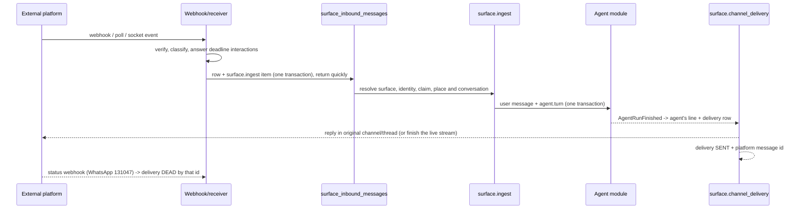

# Agent surfaces module

## Purpose

`app/modules/agent_surfaces` connects external messaging/email platforms to
pod-scoped agent conversations. It owns surface configuration, webhook/native
receiver ingress, signature verification, event normalization, external-user
identity resolution, placing each message in a channel and its conversation,
attachment ingestion,
platform tools, progress rendering, and outbound delivery.

Supported adapters are Slack, Microsoft Teams, Telegram, WhatsApp, and Resend
for email. Gmail and Outlook are **connectors**, not surfaces: an agent reaches a
Gmail account through the connector, but a pod is reached *on* email at its own
Resend address.

## Runtime contributions

| Contribution | Behavior |
| --- | --- |
| API routers | Pod surface CRUD/setup/catalog/send, current-user defaults, public webhooks/verification |
| Request-time intake | Every webhook route and receiver classifies a delivery, answers provider-deadline interactions in the request, and writes each message as a `surface_inbound_messages` row plus a `surface.ingest` item in one transaction |
| Work kinds | `surface.ingest` (`interactive`, one at a time per thread), `surface.platform_update`, `surface.reply` (`delivery`, one pump per destination, for held and resent messages), `surface.reply_for_run` (subscribes `AgentRunFinished`; posts the answer as the agent's line with a delivery to its place), `surface.channel_delivery` (sends one channel delivery and records the platform's message id on it; one at a time per place or member), `surface.receiver` (`receivers`, one leased item per polling credential), `surfaces.mobile_changed`, `surfaces.pod_deleted`, `surfaces.member_removed` |
| Periodic work | `surfaces.receivers.reconcile` (15 s), `surfaces.onboarding_cleanup` (1 min), `surfaces.web_visitors` (hourly), `surfaces.retention` (daily) |

## Main data model

| Table | Meaning |
| --- | --- |
| `agent_surfaces` | Pod/platform/name, the one agent it answers as, account binding, allowed channels, identity and send policy |
| `agent_surface_external_users` | Stable external identity to Lemma user/contact resolution |
| `surface_verified_identities` | One row per hashed platform/tenant/installation/actor binding: that this person proved who they are, and the pod and installation their private chat reaches. A check constraint keeps a revoked identity from holding a destination, so a live route beside a revoked proof is unrepresentable rather than merely unlikely |
| `surface_pending_onboarding` | Onboarding in flight for one binding — step, email challenge, offered pods, and the original inbound event held until there is a conversation to commit it to |
| `surface_onboarding_input_tokens` | Hashed handles for a native input form — a Slack modal, a Teams card, a WhatsApp prompt — each minted against one pending row, step and challenge. A submission is accepted only while all three still match, so a form left open across a step stops working rather than answering the wrong question; the cleanup sweep deletes handles at expiry |
| `surface_whatsapp_numbers` | The deployment's WhatsApp numbers, one row each and each independent: its own WABA, access token, verify token and Flow ids, every one falling back to settings when absent so a single-number deployment declares nothing. `role` separates the one `SHARED` line everybody rides from the `ALLOCATABLE` pool; `status` separates "stop handing this out" from "we no longer own it". Who holds a number is not stored here — it is `agent_surfaces.surface_identity_id`, so there is no second copy to disagree |
| `agent_surface_web_widgets` | A pod's chat on other people's web pages, each answering as one of its agents, and the door a form page adds rows through. `public_key` (unique, readable by anybody) names the widget; `signing_secret` (encrypted) signs host tokens on the customer's server; `allowed_origins`, `answer` (`off`/`known`/`anyone`) and `looked_after_by` as for a bot's contacts. See `services/web_chat.py`. A form is any page that adds a row to a table the pod opened to visitors (`datastore_public_rows`): `GET /public/web/{key}/table` says what to ask, `POST /public/web/{key}/rows` adds the row, and `/public/web/{key}/page?table=` is the form Lemma hosts, with the chat beside it. On a web visitor's run the agent's `fill_form` tool fills that form's fields; it never sends it. Answers reach the page live on `GET /public/web/{key}/stream`, one JSON object per line after an `open` handshake, at most two per session, translated by `agent/contracts/visitor_stream.py`: the answer's text as it is written, `typing`, the finished message and `done` -- never thinking, tool traffic or a private note's run |
| `visitor_sessions` (contacts' table) | One visitor's hold on one widget, found by a secret stored only as its digest and traded at `POST /public/web/{key}/session` for a 15-minute `visitor-access` token sent as `Authorization: Bearer` (`api/public_dependencies.py`). `strength` is `ANONYMOUS`, `CODE` or `HOST`; anonymous sessions end 90 days after they began, a contact's 30 days after last use, and a `HOST` session never refreshes without a fresh host token. Reissuing a widget's secret revokes its host sessions; forgetting a contact revokes theirs. Cascades from its conversation. CORS for `/public/web/*` is answered from the widget's own origins, never with credentials (`api/public_cors.py`), and nothing there is served unless `PUBLIC_WEB_ENABLED` is on |
| `agent_surface_web_codes` | One-time codes sent to email addresses web visitors typed, stored salted with their session, expiring in ten minutes after five guesses at most, each counted before it is compared. `events/visitor_retention.py` sweeps ended sessions and spent codes hourly; a visitor's conversation is a contact's, and is never swept |
| `surface_inbound_messages` | One row per inbound message any webhook or receiver accepted, unique on (receiver scope, the platform's event id), so a delivery retried a minute or three days later is the same row. RECEIVED → INGESTING → ROUTED, DROPPED or FAILED; the `surface.ingest` item that turns it into a turn is written with it. ROUTED and DROPPED rows are kept 7 days, FAILED 30 |
| `surface_message_claims` | The durable message-level claim: one row per platform message, owned by the inbound row that took it, taken in the transaction that routes it so a duplicate under another scope is answered once. Kept 7 days |
| `surface_deliveries` | The outbound messages with no channel line of their own: a held reply, a reply outside any run, a "please resend". A run's answer is a channel line and goes out as its `channel_message_deliveries` row. Unique on an idempotency key; PENDING → SENDING → SENT, or UNKNOWN when a send's outcome was lost (never re-sent), or FAILED. One `surface.reply` pump per destination sends them in order |
| `surface_receiver_state` | One cursor per polling receiver (Telegram offset, Resend cursor, the Telegram manager bot), written in the transaction that stores the messages before it, so a receiver that moves to another worker resumes without a gap or a duplicate |
| `slack_configuration_tokens` | An organization's Slack app configuration token per workspace: what lets Lemma create a teammate's own Slack app with `apps.manifest.create`. It is a person's token -- Slack creates every app as the Slack user who generated it (`slack_user_id`) -- so an owner or editor pastes its refresh token once and Lemma rotates it before use. Both halves are encrypted with the secret cipher and listed in `crypto.rotation.REGISTRY`. Refresh tokens are treated as single-use: `generation` moves on every stored pair, `rotation_claimed_until` is one rotator's lease on the database clock, `refused_at` marks a stored token Slack no longer accepts (cleared by the next paste), and `saved_at` is when a person last pasted one. Per (organization, workspace): several organizations may make their own teammates' apps in one workspace. Forgetting it does not revoke it at Slack, which offers no call to do so: it stays valid until its owner revokes it there |
| `slack_pending_app_bindings` | A teammate's Slack app waiting for the account its authorisation makes, unique per (agent, workspace) and per install (`auth_config_id`, cascading with it). Lemma creating the app writes one (`source` `WEB`; `SLACK` from Lemma's Home tab), a retried create answers from it, and `surfaces.slack_unauthorised_apps` deletes from Slack, with their installs, the apps nobody authorised within a week. `app_id` is null for an app the person brought, which Lemma never deletes |
| `slack_manager_installs` | Lemma's own Slack app in a workspace and the one organization it belongs to (unique per workspace and per connector account). Unlike configuration tokens, one organization per workspace: it is where that workspace's people meet the organization. Bound from a grant of Lemma's app finished in the binder's own browser session (`PUT .../slack/manager`); a second organization is refused, never moved, and removing Lemma's app in Slack (`app_uninstalled`) deletes the row and frees the workspace. `bot_user_id` is the manager bot, which `tokens_revoked` and a teammate's own join compare against |
| `slack_workspace_people` | Slack users proven to be Lemma people across a workspace, by Slack's own word: the install's grant naming its installer (`INSTALL`), or Sign in with Slack (`OIDC`, `services/slack_person_proof.py`); never a profile email, which a workspace admin can edit. One Slack user per Lemma user per workspace, both ways. A proof is written through to `agent_surface_external_users.resolved_user_id` (and any other Slack user of that workspace cached as the same person is cleared), so identity resolution and the group log see it. Not `surface_verified_identities`, which is scoped to one installation and written after an emailed code |

Where a message was said, and where a conversation's answer goes, are the
`channels` module's: every thread sits on a channel source, which keeps how to
write back to it, and every line on the channel's timeline keeps what answers
it in place (`channels.contracts.places`). A group the pod's bot is in is a
shared source of a `GROUP` channel, and carries the group's settings: its
title, whether the bot answers people outside the pod there, and
`owner_user_id`, the member who answers for them -- no owner means outsiders
are not answered. A WhatsApp group the bot asked Meta to create is a source
before its chat id is known: `external_channel_id` is null and `request_id` set
until the confirmation webhook fills in the id and `invite_link`. A group's id
is its source's. Conversation metadata still records the surface, platform and
external identifiers, for debugging.

Onboarding storage is deliberately private rather than pod-scoped: a person
being recognised and a person having somewhere to talk are different states,
and the gap between them is one a real user sits in while they pick or wait for
a workspace.

A WhatsApp number is shared across organisations and exclusive within one:
`uq_agent_org_whatsapp_number` is unique over (organisation, number), so several
organisations may hold one number and exactly one surface in each of them does.
That makes an arriving number ambiguous by construction, which is why routing
resolves the *sender* first and uses the number only as an additional predicate
on candidates already narrowed to the sender's pods. `agent_surfaces` carries
`organization_id` for that rule rather than joining `pods` for it, and a
composite foreign key `(pod_id, organization_id)` makes the carried copy
impossible to leave stale.

## API groups

| Routes | What they do |
| --- | --- |
| `/pods/{pod_id}/surfaces` | CRUD surface installations and send a message |
| `/.../setup`, `/.../channels`, `/surface-setup`, `/available-surfaces` | Setup state/guides and platform/account catalog |
| `/surfaces/me` | List reachable user surfaces and choose a default |
| `/surfaces/webhooks/{platform}`, `/surfaces/{surface_id}/webhook` | Platform-wide or direct webhook ingest/verification |
| `/surfaces/teams/admin-consent/callback` | Teams tenant consent completion |
| `/pods/{pod_id}/members/{member}/notices` | `POST {text}`: tell another member something, as a line in their own channel, pushed to them like any line of theirs (`services/direct_messages.py`). `member` is a pod member id, user id or email; takes `channel.write`; the same `Idempotency-Key` from the same caller is the same notice |
| `/pods/{pod_id}/surface-setup/slack/manager` | `GET` the workspaces Lemma's own Slack app manages for the pod's organization; `PUT {account_id}` binds one from a grant of Lemma's app this browser finished |
| `/surface-setup/slack/install` | "Add to Slack" from outside the app: `GET` whether Lemma's own Slack app is set up on this server (asked before a person with no organization is given one), `POST {organization_id}` Slack's consent page for it, bot scopes only, refused before anything is made when Slack isn't set up (`SLACK_NOT_SET_UP`) or the caller may not add the organization's installs |
| `/surface-setup/slack/people/sign-in` | `POST {team_id, slack_user_id}`: start Sign in with Slack for the signed-in person; its callback (`.../sign-in/callback`, not in the client spec) records the proof |
| `/pods/{pod_id}/channels/{c}/sources/{s}`, `/channels/whatsapp-groups`, `/channels/telegram-links` | A group source's settings (who answers its outsiders, and whether), starting a WhatsApp group (`Idempotency-Key`, `services/group_start_keys.py`) and minting a Telegram add-to-group link -- under the channel the group is, but here, since they talk to the platforms. The bot's settings page lists its groups with `GET /channels?source_surface=`, through the lister `api/controllers/source_controller.py` registers (`channels.contracts.source_settings`) |

## Ingress and egress

### Sending a channel delivery

`services/channel_deliveries.py` claims one `channel_message_deliveries` row,
sends it, and records the outcome on it (`services/delivery_outcome.py`).
Every outcome but `SENT` carries a `DeliveryReasonCode` beside the sentence a
member reads (`Outcome.code`): code that decides by why a delivery stands
where it does reads the code, never the sentence. Each try is a
`channel_delivery_attempts` row, begun at the claim and ended with the outcome
and the platform's HTTP status when it gave one (`SendOutcome.provider_status`,
read from a platform client's own error too). A `401` refuses the bot, not the
message: its surface carries the reason as `problem` (`surface_problems`, in
Redis) -- as it does a webhook the platform refused -- its `/setup` is not
ready, and a contact the bot was writing to waits on a person; a send that
goes clears it. A new surface whose webhook is refused is not kept.
A try is retried only when the retry cannot be the duplicate the person sees:

- **`FAILED`**, due again after the backoff -- and no sooner than a
  `Retry-After` the platform asked for -- when the platform's failure was
  transient and nothing of the message arrived, or when no platform was
  called at all (our own database failing first, or anything raising before
  the send: recorded before it propagates, not left as a lapsed claim).
- **`DEAD`** at once for a refusal, for part of a long message having
  arrived, and for a send whose answer never came back (a read timeout or a
  dropped connection after the request left: it may be on their screen) --
  except on a platform that dedupes a resend by the delivery's key
  (`channel-delivery-{id}`, Resend), where an ambiguous send is retried.
- **`SKIPPED`** when there was nothing to send to (no thread, a removed bot,
  a message that was nothing once reasoning was stripped) or a contact's rules
  refused it -- among them WhatsApp's 24-hour window, which only the contact's
  own message at the place opens (`channel_sources.last_inbound_at`): a line
  written in Lemma never does, so past it a member's or agent's line is
  `SKIPPED`, not sent to fail. A member's line counts against the contact's
  day only once it can actually go.

A sender that died mid-send leaves a lapsed claim: `SENT` when the platform's
id was noted before the call (a live stream closed in place), sent again when
its place is on a key-deduping platform (so a deploy mid-send costs nothing),
and otherwise `DEAD` saying it may not have arrived, for a member to retry.
The platform's id is noted on the row as soon as the platform answers, so a
status report (WhatsApp 131047, a Resend bounce) finds that one delivery even
before `SENT` is recorded, and a later `SENT` does not undo it. A bounce
suppresses the delivery's own place address, not everybody the email copied;
a bounce Resend could not classify is not permanent.

One channel's lines reach a place -- and a member's pushes reach them -- in
the order they were written: `surface.channel_delivery` runs one item per
target at a time (the fact's `target`), and the claim refuses a row while an
earlier line's row to the same target is pending, being sent, or failed and
waiting out its backoff; settling one announces the next.

A **push** to a member stands for every line of one channel they heard since
their last push from it (channels coalesces them, one push per member per
channel window): it carries the line it leads with and says how many more
wait in Lemma. It is sent under its delivery's key, charged to the member's
hourly push budget once per delivery (not per try), and never sent on a
second app after a send that may already be on the first. One that names the
member or asks them something (`Delivery.urgent`) is never held. Any other is
`SKIPPED` (`IN_APP`) once the member has read past it in the channel; while
they had the app open in the last `push_sends.PRESENT_FOR_SECONDS` it is held
(`FOLDED`) until its newest line is that old, and pushed then if still unread
-- the app open somewhere in the pod is not this channel read. Held by the
budget, `SKIPPED` (`FOLDED`): its lines go back into the member's window and
with their next push from that channel, no sooner than `push_sends.HOLD_FOR`. A plain
line in a group is not emailed unless the member chose email for it: email is
for their own channel, a contact's, and what names them or asks them
something.

A place's account (`domain/external_accounts.account_of`) is the Slack
workspace or Teams tenant *and* the bot, so two agents' apps in one workspace
keep separate places, tokens and history; the same app installed again keeps
its bot id and so its account. A surface that has not recorded its bot yet
reaches an account with no bot, which is given the bot when the surface learns
it -- one account, not two. A WhatsApp number's account is its phone-number id,
so a surface set up again for the number keeps its groups.

Adapters share a contract for parse, enrich, sender profile, `send_message`,
`deliver`, interaction parsing, processing indicator, and platform tool
construction. Attachments may be downloaded, stored through datastore,
transcribed, or referenced depending on size/type. Email surfaces use
subject/thread/address semantics rather than chat streaming.

**Outbound content goes through one seam.** An agent produces a
`SurfaceEnvelope` — text, resources, files, voice, choices, a decision — and
`deliver()` renders whatever the platform can and degrades the rest, returning a
`DeliveryReceipt` saying how each part landed (`NATIVE`, `DEGRADED`,
`UNDELIVERED`). The per-content `_render_*` hooks are a platform's private half
of that call and are reachable only from `deliver`; there is no public verb per
kind of content, which is what keeps "every platform gets the full product" a
behaviour rather than a promise each adapter keeps separately.

**How many messages a platform gets** is `DeliveryCardinality`. Chat platforms
are `MANY` and each part degrades on its own. Email is `ONE`: the whole envelope
folds into a single reply, so a file or a voice note is an attachment on it
rather than a second send.

`enrich_inbound_event` is optional for most adapters and **mandatory for
Resend**: its `email.received` webhook carries metadata only — no body, no
headers — so the adapter fetches the message from the Received Emails API and
drops the event if that fails. Running on what the webhook alone provides means
starting an agent on an empty prompt.

Each agent is provisioned its own inbound address, `{agent}.{pod}@{domain}` on
`RESEND_INBOUND_DOMAIN`, at creation. Inbound routing matches the surface by
that address, so it is unique-indexed: two pods colliding would silently deliver
one pod's mail into the other's.

### Interactive tools and indicators

`ask_user` and `request_approval` pause the agent run (`WAITING`); the run
observer renders them on the surface and a submission resumes the run.

- **Native first, text fallback, never swallowed.** `ask_user` renders as native
  choices and `request_approval` as native **Approve / Deny** (optionally
  **Approve for session** when the paused call carries `permission_ids`) buttons
  on Slack (Block Kit), Teams (Adaptive Card `Action.Submit`), Telegram (inline
  keyboard), and WhatsApp (reply buttons). Any platform without native support —
  or a native render that fails — falls back to a formatted text prompt.
- **Decision routing.** A tapped approval button carries its decision back
  through `parse_inbound_interaction` → `ParsedSurfaceInteraction.approval_decision`
  (a canonical `AgentRunApprovalDecision` value) → `handle_interaction`, which
  resolves the paused run APPROVE_ONCE / DENY / APPROVE_FOR_SESSION. `ask_user`
  answers ride back keyed by question header. Both reuse replay-dedup and
  submitter-owns-conversation authorization.
- **Indicators.** WhatsApp marks the inbound message read (blue ticks) and shows
  a typing bubble via one Cloud API `status:read` + `typing_indicator` call.
  Telegram/Teams use a refreshed typing indicator; Slack streams a status line;
  WhatsApp/email have no per-step streaming.
- **Email is interactive, asynchronously.** `ask_user`/`request_approval` on an
  email surface put the question in the one reply and end the run. The person
  answers by replying, and `maybe_resume_pending_interaction` resolves the pause
  through the same path a tapped Slack button takes. A typed reply that is not a
  decision is *not* consumed: it falls through to the ordinary message path,
  which supersedes the pending call with an explicit denial and delivers the
  person's actual words to the agent.

### Routing, defaults, and history

- **One precedence decides where a private message goes.** Routing answers only
  *which* pod, surface, agent and conversation a message belongs to, highest
  first: pod membership → a valid saved default (`/surfaces/me`) → a verified
  personal route → continuity → oldest-tiebreak. The saved default is the
  person's explicit choice, so it is **authoritative over a personal route and
  over continuity**; a stale default (pointing at a pod the user left) is cleared
  and ignored, and the personal route then answers again. `SurfaceRouter`
  documents the order; `select_surface` applies it to ordinary delivery and
  `deliverable_default` is how the personal route (Slack and Teams, which answer
  a private message from the person's own pod through a company installation)
  steps aside for a default that ordinary selection would honour on that
  delivery. WhatsApp and Telegram have no personal route -- their pod is a
  per-pod surface on the shared bot -- so selection alone decides there.
- **A private chat is one conversation wherever it is delivered.** The link key
  names a delivery address (surface, channel, thread id), and on WhatsApp that
  embeds the number the message arrived on. For a private chat that address is a
  delivery detail: when the exact key misses, selection and the binder look for
  the same person's latest private-chat link on a candidate surface (the pod's
  own surfaces, for the binder) and move that link to the new address, so a
  reassigned pool number keeps the conversation. Only a link whose conversation
  is the sender's own, in the route's pod and with the route's agent, is taken;
  the reset window still applies. Channel and email threads are never adopted.
- **A sender is a user only on proof.** A chat sender resolves to a Lemma user by
  the profile email the platform's API returns, or by a mobile number already
  *verified* on the profile (WhatsApp's signed sender, a Telegram contact the
  sender shares about themselves). A Telegram handle is matched on not at all,
  and a profile holds none: anyone can claim a free handle, and one given up on
  Telegram is taken by a stranger. An unresolved Telegram sender is asked to
  share their own contact; proven, the account stays resolved whatever their
  handle later says. A managed bot's creator is not bound by opening the setup
  link -- a link can leak -- and is recognised the same way, by a contact share
  in the new bot. Someone with no verified number cannot be recognised on a
  pod's own bot: they verify their number in account settings first, or sign up
  through the shared bot, whose email-code step verifies the contact they
  share. A number a profile merely lists does not match by
  default: it would hand the number's real owner's messages -- and the agent's
  replies, sent from the shared number -- to whoever typed it. That sender goes
  through signup instead. A deployment can accept that risk with
  `SURFACE_ALLOW_UNVERIFIED_PHONE_MATCH=true`: a number claimed by exactly one
  profile then routes to it, each such match is logged
  (`unverified_phone_match_used`). A verified owner always wins; a number claimed by several *unverified* profiles never matches.
- **One conversation per person, agent and channel.** Every thread sits on a
  channel source (`services/channel_places.py`): a private chat on the member's
  `DIRECT` channel or the contact's `CONTACT` channel, keyed by the person
  rather than the address it arrived on; a group, a shared Slack channel or an
  email thread with others on it on a `GROUP` channel of its own. The binder
  (`services/conversation_binder.py`) continues the person's conversation with
  the answering agent in that channel -- across another pool number, another of
  the pod's bots, another platform, or a quiet week -- and opens one only for a
  different agent or person. There is no inactivity reset; the per-surface
  `dm_conversation_reset_after_hours` field is accepted and ignored. This is
  the only place a surface decides which conversation a message joins.
- **Every line lands on the channel's timeline** (`services/channel_lines.py`):
  the message a run answers, as it enters the conversation, and every answer
  the platform took, said by the agent for the person it answered. Platform
  markup is read once, there (`domain/markup.py`, `services/line_markup.py`):
  Slack's `<@U…>` and `<url|label>`, Teams' `<at>` entities, Telegram's
  entities and WhatsApp's `@number` become `@Name` in the text and mention and
  link parts on the line. A mention tells only somebody who may see the
  channel (`channels.contracts.named_in`). A heard line keeps its reply target
  as `reply_ref` (`channel_lines.reply_ref_of`), so a member's reply to it in
  Lemma goes to its platform thread: the place, thread and message, the id to
  answer and the routing part of the event's metadata -- never the words, the
  sender's address, number or name, or the platform's payload. Its place keeps
  the same of what was last heard there (`delivery_ref`).
- **History is not the surface's.** A surface never trims or reshapes what the
  model sees. Once a message is bound to a conversation, the agent module alone
  decides how much history the run carries (run cap, whole recent runs,
  collapsed older runs, token compaction).

### Groups, and people outside the pod

A group chat holds members of the pod and people who are not. Members are
answered there as themselves, each in their own conversation, exactly as in
private. Everybody else -- a vendor, a client, a colleague from another team --
is answered *for the pod*, in a group the pod has opened to them.

- **A pod comes to know a group** when a member who may configure the bot adds
  it (Telegram's `my_chat_member`, handled on the lifecycle path). That member
  becomes the group's owner: the person who answers for its outsiders. Owners
  and the "answers people outside" switch are managed through
  `PATCH /pods/{pod_id}/channels/{channel_id}/sources/{source_id}` (`api/group_access.py`): by the owner; by anybody who
  may configure the bot when nobody in the pod answers for the group, which
  makes them its owner; or by an admin of the pod, whose change is a line in
  the owner's own channel. A member who has left the pod answers for nobody -- their
  groups read as ownerless and answer no strangers until someone takes them on.
- **The bot introduces itself.** When it is added to a Telegram group -- either
  way, and once -- it says how to ask it, that people outside the pod are
  answered from what is Public, and that the pod keeps what is said there; a
  WhatsApp group it creates carries the same words as its description
  (`services/group_hello.py`).
- **A group is a channel.** Every group the bot is in -- a WhatsApp or Telegram
  group, a Slack or Teams channel, a group DM -- is a source of one of the
  pod's GROUP channels, read like any channel (`/pods/{pod_id}/channels`):
  its timeline, who has spoken, what is new. What only the bot's side knows --
  whether its outsiders are answered and who answers for them -- is the
  source's settings (`GET`/`PATCH /pods/{pod_id}/channels/{c}/sources/{s}`,
  `services/source_settings.py`). Each of the bot's lines records whom it
  answered and whether that was from what is Public. An answer made with one
  member's own access shows its words to everybody in the group, unless the
  group keeps such answers to whoever asked (`answers_shared`, see
  [channels](channels.md#answers-made-with-a-members-access)).
- **A Telegram group can be added from Lemma.** `POST /pods/{pod_id}/channels/telegram-links`
  mints a one-use, hour-long code in Redis and returns
  `t.me/<bot>?startgroup=<code>` (`services/telegram_group_links.py`); Telegram
  asks the person which group, adds the bot, and the bot hears
  `/start@<bot> <code>` there. That message is claimed before anything treats it
  as a question (`services/telegram_group_join.py`): the group is adopted with
  the member the code was minted for as its owner, and the bot says hello. A
  spent or unknown code is swallowed, not answered. The code never links the
  Telegram account that used it to the member -- "add our bot to your group" is
  easily forwarded, and linking whoever used it would hand them the member's
  access in a private chat. Which account is theirs stays their profile's to say.
- **A Slack channel shared with another company is a group with outsiders.**
  Connected Slack channels and group DMs get a registry row the first time the
  bot hears them (`services/workspace_channels.py`), marked `shared_externally` when
  Slack says the channel is Slack Connect (`is_ext_shared_channel`). There, and
  only there, a sender whose workspace is not the installing one is an outsider
  and answered from what is Public; everyone in the pod's own workspace is a
  colleague, and one who is not in the pod gets the invite nudge -- unless the
  pod's organization holds the workspace (below, "Its workspace's people"). A Teams group
  chat (`conversationType: groupChat`) is a group DM too, not a DM. What is said
  in all of them is logged as the channel's lines, a platform thread as a
  thread; a run still reads a Slack or Teams channel's history from the
  platform.
- **A mirror is private unless the platform says otherwise.** A Slack or Teams
  place's channel is public only on the platform's word
  (`domain/place_privacy.py`): a Slack `message` names its channel type, an
  `app_mention` does not, so before the first mirror of a place is made Slack
  is asked (`conversations.info`) and Teams' Graph (`membershipType`, under the
  manifest's `ChannelSettings.Read.Group`); the answer rides on the event and is
  kept five minutes in Redis (`services/place_privacy.py`). No answer, no
  public mirror. A Teams group chat and every WhatsApp or Telegram group are
  private. A Slack channel converted to private turns its mirror private on
  the next message naming the new type; nothing turns one back.
- **Who is in a mirror follows the platform.** A person who leaves the place --
  Slack `member_left_channel`, Teams `membersRemoved`, Telegram
  `left_chat_member` -- leaves its channel, unless somebody in Lemma put them
  there (a member added them, or an admin joined on request): a seat the
  platform made has no `added_by_user_id`. The bot taken out (Slack
  `channel_left` / `group_left`, Teams removing the bot, Telegram
  `my_chat_member` to left or kicked) archives the channel; put back, it
  returns. Slack `channel_shared` / `channel_unshared` set `shared_externally`.
  These arrive as `surface.platform_update` items, read by each adapter's
  `parse_group_updates` and applied by `services/group_updates.py` to the
  places on that chat in the receiving surfaces, or -- on a shared app's
  webhook -- in the workspace or tenant the event names. WhatsApp's
  participant updates are not read.
- **An app removed from Slack stands down what ran on it.** Slack's
  `app_uninstalled`, or `tokens_revoked` naming the bot, sends no leave per
  channel and refuses every later send. Both are classified to
  `surface.platform_update` in the request and handled by
  `services/app_uninstall.py`, before any actor authorization -- the event
  names nobody, and the signature that resolved its receivers is its
  authority. The verification candidates for these two include surfaces in
  every status, so a paused one hears it too. Scoped to the verified
  receivers, narrowed to the app the event's `api_app_id` names (so an
  unsigned local delivery cannot stand down another app in the workspace),
  the connector account each bot ran on is marked `REAUTH_REQUIRED` and every
  group the bot was in is archived through `place_stopped`, as the bot taken
  out of one is. The surface keeps its channels and settings: its setup reads
  the account through `SurfaceConnectionResolver` and shows one blocking
  `slack_reinstall` step -- "reconnect it" to the person who connected it,
  "ask them, or connect your own and switch this surface to it" to anyone
  else -- and its status reads `NEEDS_SETUP`. Reconnecting repairs the account
  in place; each group returns as the bot is invited back (`BOT_RETURNED`). A
  person's private chat stays open, and its sends fail until then. An
  Enterprise Grid org-wide `app_uninstalled_team` is not read.
- **A WhatsApp group is one the bot opened.** A business number cannot be added
  to a group, only create one, so a member asks in their own WhatsApp chat and
  the agent calls `whatsapp_open_group` (offered only in a member's private
  chat; `services/whatsapp_group_tool.py`). Meta answers the creation with a
  `request_id` only, so the row is recorded pending
  (`services/whatsapp_groups.py`) and the member's turn waits a few seconds
  for the `group_lifecycle_update` webhook (`services/group_updates.py`), which
  gives the row its group id and invite link -- fetched when the webhook omits
  it. A confirmation that overtakes its pending row is handed back to the
  inbox to retry. Asking again for the same title answers from the row. The
  deployment's Meta app must subscribe to the `group_lifecycle_update` webhook
  field, or groups stay pending. Everything that names a group -- creating it,
  its link, a message to it -- goes to Graph `v23.0`, the version the Groups
  API was published under; ordinary messaging stays where it was.
- **A created group belongs to the pod that created it**
  (`bot_creates_groups`). Every pod on a shared number sees every message the
  number receives, so a WhatsApp group message is narrowed to the surfaces
  whose rows name the group before anything else is asked
  (`services/created_groups.py`), and a group no surface knows is dropped.
- **Nothing marks a mention on WhatsApp.** Meta documents no mention field and
  no reply context for groups, so the bot is addressed when the text
  `@`-mentions the business number, quotes the bot's own message, or speaks to
  the agent by name -- "Kit, ...", "hey Kit: ...", "Kit can you ...", "@Kit";
  a name merely at the start of a line ("Sales numbers are up") is not enough
  (`domain/addressing.py`, read in ingress once the surface's agent is known).
  The name is the one the app shows
  (`services/group_names.py`): the pod's own name for the pod's assistant --
  "Sales, ..." -- with the older "Lem" still heard, and an agent's own name
  otherwise. A group message nobody put to the bot is logged and left alone.
- **A group takes text.** Meta refuses interactive messages there, so questions,
  approvals and resource cards go as words (`WhatsAppRecipient.is_group`); read
  receipts, typing and reactions are not documented for a business in a group,
  so none are sent. Groups hold at most eight people.
- **Who counts as an outsider** is anyone not in the surface's pod, asked the
  way routing asks it. Membership is checked first, so members never pay for the
  group lookup.
- **Who they are**: a contact of the pod, by the handle the platform vouched
  for (`services/sender_handles.group_handle`): their Telegram id, their
  WhatsApp number, or `{team}:{user}` for a Slack sender from the other company
  in a shared channel -- or from a workspace the pod's organization holds
  (`workspace_handle`, their own team, never the installing one). Opened the
  first time they put the bot to work there, and only by the door, after the
  sender is resolved: the group log runs before that and only finds a Slack
  colleague's contact, never opens one, so a member not recognised yet is never
  made a contact.
- **Where their turn runs**: in a conversation of their own in that group,
  looked after by the group's owner and naming the contact in its
  `contact_id` column, in the group's channel. The agent module runs every turn in it as that contact: a context
  pinned to the pod that reads what the pod marked Public. The column is the
  server's alone, so nothing a client writes to the conversation changes whom
  it answers.
  What such a run may do:
  - **Tools, by name.** Toolsets are cut to pod reads, web search and
    messaging, and then each tool is allow-listed one by one
    (`tools/outsider_tools`): the pod's read tools, `web_search` and
    `ask_a_person`. `web_fetch` (it fetches inside the
    owner's sandbox) and the pod's write tools are withheld by name, and the
    harness's last capability (`capabilities/outsider_gate`) and the tool
    dispatcher drop anything not on the list, however it arrived. A workspace
    -- sandbox, host session, the owner's files -- is never opened for such a
    run (`refuse_owner_workspace`), and a test fails until any new tool in a
    kept toolset is classified.
  - **What it is told.** A brief naming the owner by display name only -- no
    email, no ids -- as who looks after the conversation; no task list; no
    sandbox described. The agent's and conversation's own instructions are
    pod configuration and stay.
  - **What it remembers.** Nothing a private note started: the owner's note in
    a contact's conversation, and its run's answer, are left out of every later
    turn of theirs. From the group's log, nothing the bot answered with a
    member's own access (`answer_withheld_from`). Nothing the pod keeps about
    the contact either: their own rows are offered only where they alone read
    the answer -- their private chat, email thread or web page.
  - **Who it reaches.** Nobody by name: `ask_a_person` flags the contact's
    channel as waiting on a person, leaves the pod's members a note there, and
    tells the member who looks after them where to look. A member steps in by
    writing in the channel. `list_pod_members` and the channel tools refuse.
  - **Where it runs.** Only in process, on a model the organization or the
    system provides -- never a coding agent's shell holding a token minted for
    the owner, and never the owner's personal model (the agent module's
    `services/outsider_runtime`).
- **A contact who needs a person gets one, in their own channel.** Their run
  never forwards their words into a member's inbox; it calls `ask_a_person`,
  and a member answers in the contact's channel, which goes back to the place
  the contact wrote from. What the contact wrote stays in their channel, and
  forgetting them takes it with it.
- **Nothing a stranger types resolves a pause.** Their conversation belongs to
  the owner, so a typed "approve" would be recorded as the owner's decision;
  `write_inbound_message` never consults a pending interaction for them, and
  their runs never pause.
- **Files** they send are not saved -- the owner's space is the only place they
  could go -- and the run is told so.
- **Limits**: `SURFACE_OUTSIDER_TURNS_PER_PERSON_PER_10_MINUTES` and
  `SURFACE_OUTSIDER_TURNS_PER_GROUP_PER_DAY`, counted in Redis and failing
  closed. Only a turn that runs is charged to the group, so one person looping
  cannot spend everybody's day. A member opens at most
  `OPENS_PER_MEMBER_PER_DAY` WhatsApp groups on one bot a day, and only one who
  may configure the bot may open any.
- **The bot's own switch.** `config.groups.answers_outsiders` on a surface,
  on by default, closes every group that bot is in to people outside the pod at
  once.
- **The group log** is the group's channel timeline. Every group message the
  bot receives on Telegram and WhatsApp is a line of it, before anything
  decides whether it was addressed (`services/group_log.py`), said by the
  member the sender resolved to or by a contact made the first time they
  speak; every answer joins it once delivered. A run in a group is handed the
  recent lines as background, chosen by whose access it acts with
  (`group_log.group_background`): a contact's run reads what the channel lets
  a contact read -- never an answer made with a member's access; a member's run
  is not shown what people outside the pod wrote, the bot's answers to them,
  or members' notes -- on Slack, lines from another workspace are left out the
  same way. What is left out is counted. Each line is one quoted line however
  many it spanned. Nothing is deleted automatically. The run's message keeps
  which lines, not what they said (`services/run_background.py`): they are read
  from the timeline as its prompt is built, so an edit or a forgotten contact
  reaches it. A platform's history read live keeps the lines the pod heard as
  references, by the platform's message id at that place.
- **A message edited or deleted on the platform is edited or deleted here.**
  Slack's `message_changed` / `message_deleted`, Teams' `messageUpdate` /
  `messageDelete` and Telegram's `edited_message` are `surface.platform_update`
  items, not turns (`services/inbound_classifier.py`; a Slack channel's only
  where a group adopted it), applied to the line heard as that message at that
  place -- the chat among the receiving surfaces' places, held to the event's
  workspace or tenant, or the sender's own place for a DM -- and never to a line
  the bot carried there (`services/line_changes.py`). An edit is read as the
  message was heard, so whom it names follows. The Slack manifest's
  `message.*` subscriptions already deliver them.
- **A member answering in front of outsiders is told so.** A member's run keeps
  the member's access, but when people outside the pod read the answer -- they
  have spoken in the group, the group answers them, the Slack channel is shared,
  or an email reply-all copies them -- its message carries who they are and asks
  for an answer the member would give in front of them
  (`services/group_audience.py`, rendered by the agent module's
  `audience_notice`).
- **A member's run is told who else is in the room.** Beside the recent lines it
  is handed the group's people -- everyone the pod's log has heard speak there,
  most recent first and bounded -- each marked as in the pod or not, rendered by
  the agent module's `group_participants_notice`. The run acts with the member's
  access and posts where all of them read it, so knowing who else is reading is
  what the answer is shaped by. A stranger's run is handed no roster: it acts as
  nobody, and who holds access to the pod is not its to know. Where the pod
  keeps no log (Slack, Teams) the roster comes from the history fetched for that
  run instead, and membership is never read off it: a platform names who spoke,
  and marks only a line from another company's workspace, so a speaker counts as
  a member only where the pod itself resolved them to one
  (`group_log.live_participants`). The roster is who *else* is there: the asker
  is left off, and so is an app's line -- the bot's own answers among them.
  People are told apart by platform id, never folded by name, so an outsider
  showing a member's name stays on it. Somebody with no name is counted, never
  named by their platform id (a phone number on WhatsApp). Only the current turn
  carries a roster -- a replayed one would still name people since removed --
  and a failed roster read leaves the turn without one rather than failing it.
- **Own bots are no different.** A pod's own Telegram bot or WhatsApp number is
  delivered to at `/surfaces/{id}/webhook`; its group messages go through the
  same log, mention check, name addressing and admission as a shared bot's
  (`services/group_ingress.py`), and WhatsApp's confirmations are applied from
  there too.
- **A Slack group DM needs no channel route.** Somebody started it with the bot
  in it, so -- like a Telegram group -- being in it is the authorization
  (`is_slack_group_dm`): no allow-list entry, still only answered when the bot
  is @mentioned or a reply lands in its thread. It is a Slack conversation, so
  Slack's own history is its background and no group log is kept.
- **A line for a member is never delivered into a group.** Reaching a member
  proactively reuses only private threads; a member whose only thread with the
  bot is a group is reached by email, or in their own channel in Lemma alone.
- **A word for one person is never posted in the group.** `surface_send_message`
  reaches the current conversation's user alone. In a group that conversation is
  one member's but its address is the group, so the message goes to that
  member's own chat with the bot (`services/private_message.py`, over
  `SurfaceDelivery.private_thread_for`, the latest one *in this pod*) -- and a
  member who has never had one is not reached at all rather than reached in
  front of everybody. On an email thread that copies other people it goes to the
  sender alone on the same thread, without the copies. The tool tells the run
  which happened: sent, nobody to reach privately, or a send that failed.
- **An email thread with other people on it is a group.** The inbound
  normalizer keeps To and Cc; a reply goes to the sender and copies the others
  (at most `MAX_REPLY_CC`). Copied is not asked: an email that only Cc's the
  pod is answered only when a line speaks to the agent by a name it goes by.
  Mail that names the pod in neither To nor Cc -- forwarded, an alias, a Bcc --
  was sent to it on purpose and is answered. A message that says nothing but
  thanks on a thread with others on it starts no run, and a refusal or sign-up
  reply goes to the sender alone (`platforms/resend/email_recipients.py`).
- **A private note stays in Lemma.** Every run in a conversation that lives on a
  platform answers there. A message written in Lemma with
  `metadata.private_note = true` starts a run marked private (see the agent
  module's `domain/private_notes`); the run observer then sends nothing of it to
  the platform -- no stream, no typing, no answer, no approval card -- and
  `display_resource` delivers only in Lemma, on Agent Host too. Later turns see
  the note labelled as unseen in the chat (in a person's own DM, only as not
  sent). A run answers one kind: a note typed while an answer to the platform
  is under way is not steered into it, a message for the platform is not
  steered into a note's run, and the follow-up, resume or retry that answers
  either keeps its kind. `surface_send_message` from a note's run is refused.
  In a contact's conversation a note is the keeper's alone: no later turn of
  the contact's reads it.
- **A turn its model cannot run is said, once, not retried.** A teammate on a
  member's own runtime runs only for them; anybody else's message to it is
  refused before a run exists (`RuntimeUnavailableError`,
  `runtime_profile_not_shareable`, or a model that is gone). The message is
  still written as its line, and the member it was for gets one note in their
  own channel per place, agent and reason (`services/refused_turns.py`, through
  `tell_member` with a key): members-only, never pushed, nothing said in a
  shared place. A direct message is answered in place too. It used to be
  retried until the inbound went dead, and a group was told nothing.

### Lemma's own Slack app manages a workspace

One Slack app is one bot user, so each teammate answers in Slack through an app
of its own (`slack_app_provisioning.py`). Lemma's own app is the workspace's
**manager**, and answers nobody (`services/slack_manager.py`): its Home tab is
the roster of the viewer's teammates, one row per agent with an app there and
an "Add to Slack" for each pod's own agent that has none
(`slack_manager_bots.py`); invited to a channel, it asks the inviter which
teammate should join, invites that bot (`conversations.invite`, public or
private, so teammates need no `channels:join`), and leaves. A DM or mention is
answered with who does answer.

- **Its own lane.** A delivery is the manager's when Lemma's app signed it, no
  teammate's surface receives it, and Lemma's app manages that workspace --
  `_verify_inbound_request` returns that as `InboundVerification.manager_team`,
  never as an empty receiver list. The controller decides it once, before
  onboarding and before `accept()`: nothing the manager receives becomes a
  `surface_inbound_messages` row, is classified, or reaches
  `apply_group_updates` (where its own `channel_left` would read as the bot
  leaving and archive the teammate's mirror). What Slack's three seconds
  require -- opening a modal, answering a submission -- is answered in the
  request; everything else is one `surface.slack_manager` item carrying ids,
  keyed by Slack's event id. **Webhook only**: the manager has no surface, so
  Socket Mode never reaches it.
- **Secrets typed into its modal** (a configuration refresh token, a hand-made
  app's client and signing secrets) never go into a work item: the request
  encrypts them with the secret cipher into Redis for ten minutes
  (`slack_manager_form.py`) and the item carries a reference.
- **Proof of a person** is Slack's: the install grant names its installer, and
  everybody else signs in with Slack from their Home's link. The link says only
  whom it was shown to; the callback requires the same Lemma session that
  started it, that Slack names that same user and workspace, and that the
  person is in the workspace's organization. A link sent by somebody else is
  refused, whoever opens it.
- **Handing a channel over** writes the teammate's route and place first --
  private unless Slack says the channel is public -- then invites; a refused
  invite takes both back. The teammate's own `member_joined_channel`, invited by
  the manager bot, prompts nobody. Its first word is the group hello
  (`group_hello.hello_for`), which says the pod keeps what is said there.
- **An Allow from Slack finishes itself.** The modal's connect request carries
  the purpose `slack_teammate_app`; connectors' `ConnectorAccountConnected`
  (new and renewed grants) feeds `surface.slack_app_allowed`, which makes the
  teammate's surface for the pending row's agent and deletes the row. An
  ordinary Slack connect has no purpose and is never one.
- **"Add to Slack" adopts a workspace on its own** (`services/slack_install.py`).
  The web page `/slack/install` signs the person in the ordinary way, takes the
  organization they pick (or the first one main's `POST /users/me/first-
  workspace` gives them, once `GET .../install` says Slack is set up here), and
  starts a grant of Lemma's app on the organization's `SYSTEM_DEFAULT` install
  -- the one the web app's Connect makes, found or made by
  `own_apps.ensure_system_install`, which reads the winner when two starts
  race. The connect request carries the purpose `slack_workspace_install` and
  omits Slack's `user_scope`: the installer is named by `authed_user` without
  it. `surface.slack_workspace_installed` subscribes to
  `ConnectorAccountConnected` for that purpose **and** `browser_bound` only, so
  an ordinary Slack connect for tools never adopts or says anything, and a
  consent link somebody else completed is not even queued. It runs
  `bind_manager`, the reach sheet's binding: one organization per workspace,
  conflict-tolerant, and the installer proven `INSTALL`. A refusal (another
  organization holds it, the person may no longer add installs) is a DM from
  the app just installed, keyed `install-refused:<account id>`. Someone who
  already connected Slack is renewed rather than told "already connected"
  (connectors renews any request with a purpose in place). An Enterprise Grid
  org-wide install names no workspace and is refused the same way.
- **Its workspace's people are the organization's** (`services/slack_workspace_people.py`).
  One predicate, `held_for_pods` -- Lemma's app holds the workspace for the
  organization of the bot's pod -- answers for all four places that ask: a
  teammate's `ContactDoor` and `OutsiderDoor`, onboarding, and a new bot's
  default. There, a sender whose own team (`sender_team_id`) is the workspace
  and who resolution says is not in the pod is a `SLACK` contact
  `{team}:{user}`, vouched for by Slack's signature: answered privately when the
  bot answers contacts, and in a group that welcomes outsiders. Privately only
  a full member -- `users.info` must say `is_restricted` and
  `is_ultra_restricted` are both false (`ResolvedSurfaceUser.is_guest`, read
  off each message's profile); a guest, or somebody Slack would not describe,
  is refused as before. Nobody unknown there is asked to sign up by email code
  (`onboarding_transport.among_the_workspaces_people`, asked where onboarding
  would open a signup): ordinary routing takes the message. A teammate made in
  such a workspace answers `anyone`, looked after by whoever connected it if
  they hold `contact.read`, unless its contacts were set. A Slack "stop" is no
  opt-out: nothing reaches a Slack handle but an answer. A bot of another
  organization in that workspace is untouched by all of it. Proof is identity
  across the workspace: written through to the cache, read again by
  `identity_resolution_service._slack_proof` when the cache row was cleared,
  and a Slack user with no proof whose profile email is a proven person's does
  not resolve to them (`_unless_proven_elsewhere`). Each colleague answered
  counts toward the organization's `max_contacts` and budget like any contact,
  and their private chats are their own `CONTACT` channel, which the pod's
  editors and admins read.
- **A new binding owes one welcome**, staged by `bind_manager` in the
  transaction that inserts the `slack_manager_installs` row and keyed
  `welcome:<install id>`: "Lemma is in <workspace>" with an "Add" button for
  the first teammate the installer may add. A reauthorisation of the same
  binding says nothing; one made again after Lemma was removed is new.
- **Its messages are Slack-native**, not channel lines: the manager belongs to
  an organization, not a pod, and has no channel to deliver through. Views,
  modals and ephemerals answer whoever just acted; a message that is owed ("X
  is in Slack now", a teammate's hello) is a work item
  (`surface.slack_manager_message`, `surface.slack_teammate_hello`) staged in
  the transaction that owes it and keyed by its cause.

## Authorization and security

Management routes use pod permissions and ensure connector account ownership.
Webhook security handles Slack signatures, Teams/Telegram/WhatsApp verification,
email provider metadata, timestamp windows, and challenge responses. Identity
policy controls whether unknown external senders are rejected, linked, or
represented as contacts. The inbound row's unique key and the message claim
(`surface_message_claims`) make a repeated provider delivery one message.

The contact path (`services/contacts.py`) never answers mail a machine sent
(`platforms/email_automated.py`, plus the pod's own addresses), and treats a
message that is only "STOP" as an unsubscribe -- from email only when the
sender's address is vouched for (the parser's SPF/DKIM/DMARC verdict is a
pass). Anybody can write "STOP" under somebody else's address, and honouring
it would cut the real person off; an unvouched one is parked for the member
who looks after contacts like any unverified mail, and the signed one-click
unsubscribe every email carries still works for whoever it reached. What it says or notes without a
model -- a refusal, a parked-mail note, "a person will reply" -- is windowed in
Redis by `services/contact_windows.py`, failing closed. Before a run for
somebody outside the pod starts, `services/outside_cap.py` asks whether the
organization's contacts cap is reached -- first, in a unit of work of its own
(`organization_capped`), from the running total the run's requests would be
admitted on -- or a member answers the contact by hand
(`services/contact_hold.py`: the channel's agent is switched off, or a member
stepped in by writing there -- the assignee of its current case -- and has
written within the channel's hand-back window; past it, the member is let go
and told). If so the message is kept
-- in the conversation and on the channel's timeline -- and no run starts. At
the cap the member is told, pushed -- or, when the member who looks after them
cannot open a contact's channel, told how to get access while the pod's
administrators are told it is theirs -- and the person hears once a day that a
person will reply, as the pod's line carried to their place like any other
(their rules apply; an email carries the unsubscribe footer and headers), and
only when somebody who can open their channel was told; with the agent off the channel waits on a reply and the member who
looks after them is told, and -- if the pod set `config.contacts.auto_acknowledge`
-- the contact hears that line once, until a member writes to them or their
case is closed (`services/contact_acknowledgement.py`); a member who stepped
in reads it where they write. A web chat's answers go on the channel's timeline,
their delivery `SENT` at once, rather than to any platform thread the same
conversation has (`services/run_reply_lines.py`), and a member's follow-up is the member's
line there, not the agent's. `SurfaceTurnStarter` calls it for chat and
email surfaces, before the typing indicator and any file handling. Writing first to a
contact takes `contact.message`: `POST /pods/{pod}/contacts/{id}/outreach`
(`services/contact_outreach.py`) posts the member's line at the place one of
the contact's handles is reached through -- for email the pod's mailbox,
opened if new; for WhatsApp and Telegram only a place they wrote from -- once
`contacts.contracts.outreach.may_send` allows it.

A contact shared during Telegram signup is matched by `onboarding_contact`: a
verified profile number first, then -- only with
`SURFACE_ALLOW_UNVERIFIED_PHONE_MATCH` -- exactly one unverified claim, the same
rule identity resolution applies to later messages. Whether an account's email
must be verified to chat follows `AUTH_EMAIL_VERIFICATION_REQUIRED`
(`identity.infrastructure.chat_account_policy`).

A pooled WhatsApp number answers with its own pool row's credentials for
everything done to a message that arrived on it -- the read receipt, the typing
indicator, the media download, the fallback and the reply -- through
`SurfaceCredentialResolver`'s `arrived_on`. A delivery the per-number webhook
refuses logs `whatsapp_number_signature_rejected.denied` (the number, why, and
which secret was tried, never the secret) or `whatsapp_number_mismatch.denied`,
and counts on `lemma.surface.webhook.rejected` by `platform` and `reason`.

## Tests and operations

The large unit/e2e matrix uses real payload fixtures and mock provider servers
for platform parsing, signatures, conversation reuse, identity, attachments,
approvals/forms, progress, and delivery. Measure this module's coverage with
`uv run pytest -m "not e2e" app/modules/agent_surfaces --cov=app/modules/agent_surfaces`;
CI enforces the committed floor. The in-module README is a pointer back here and
deliberately carries no route examples of its own.
