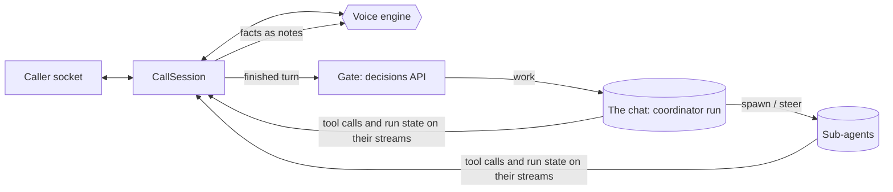

# Calls module

## Purpose

`app/modules/calls` holds live voice calls between a person and a pod agent.
A call is held in a conversation -- the chat it was started from, or a new one
when it was started from nowhere -- so the call, the agent's work and the
transcript are one chat. The agent in it is the call's **coordinator**: it
hears what the person says as messages, hands work to sub-agents, decides what
the voice says, and shows things on the call's **canvas**. A separate voice
model does the talking. The module owns the socket, the voice and the turn;
everything the agents do is the agent module's ordinary runs.

The module owns no tables. A call's record is its conversation, marked in the
conversation's metadata (`agent/domain/calls.py`): the mark says which call it
is, whether a socket holds it right now (`live`), when the conversation became
a call (`since`), and how long it has been held over all its connections. Its
sub-agents carry the mark too, at any depth; its canvas is the canvas tool
calls across all of them since the conversation became a call; its transcript
is written into the conversation as the call goes.

## Runtime contributions and API

| Route | Behavior |
| --- | --- |
| `GET /pods/{pod_id}/calls/config` | Which voice engines this server has keys for, the configured default first |
| `POST /pods/{pod_id}/calls` | Open a call: in `conversation_id` (the caller's own chat, picked up again if a call was held there before), or in a new conversation with `agent_name` or the pod's default agent, its model pinned when `CALL_COORDINATOR_MODEL` is set. Refused (422) when the caller cannot run the model the coordinator would run on, with the reason a turn would give |
| `WS /pods/{pod_id}/calls/{call_id}/socket` | Hold the call (below). Authenticates itself like the pod live socket; only the person who owns the conversation may hold it |

## The socket

Binary frames carry audio: the caller's microphone up (16 kHz, 16-bit mono
PCM), the voice down at the rate the `ready` frame names. Text frames are JSON.

| Direction | Frame | Meaning |
| --- | --- | --- |
| up | `start` | First frame: `teammate`, `pod`, `context` (the pod and the chat, for the voice), optional `engine`, `muted` |
| up | `mute`, `text`, `end` | Mute the microphone; a typed turn; hang up |
| up | `canvas.focus` | The person paged to an item; the voice is told what they see |
| up | `canvas.render_failed` | An item could not draw; the coordinator is told, once per item and never for one replayed from before, so it can show a corrected one |
| down | `ready` | The voice is connected: `engine`, `sample_rate` |
| down | `transcript` | `speaker` (`caller` / `voice`), `text`, `final` |
| down | `clear` | The caller cut in: drop queued audio |
| down | `canvas.item` | Something shown on the canvas: the tool call that showed it, from the coordinator or a sub-agent; `replay` on reconnect |
| down | `work` | Whether anyone in the call -- the coordinator or a sub-agent -- has a run going |
| down | `notice` | Something the person should see: a request the team cannot take, a run that failed |
| down | `ended` | The call ended, with a reason when it was not the caller |

Close codes: 4401 unauthenticated, 4403 no pod access, 4404 not this person's
call, 4429 too many calls at once (`CALLS_PER_USER`, across replicas) or the
call's time used up, 4503 the voice engine could not start or the person's
budget is spent.

## How a call runs

- **Voice engines** (`infrastructure/engines/`) turn a provider into one event
  vocabulary (`domain/voice.py`): `gemini_live` (Gemini Live over its
  WebSocket, resumed across its connection limit, with notes kept across a
  reconnect; a Gemini API key, or Vertex AI as the server's service account),
  `openai_realtime` (OpenAI's realtime model, the mini one by default), and
  `cascade` (Deepgram Flux speech-to-text, which also decides when a turn
  ended, a Lemma model through the agent module's runtime, and Deepgram Aura
  text-to-speech).
- **The gate** (`services/gate.py`) asks one interactive decision per finished
  turn: conversation for the voice alone, or work for the agents. Anything
  short of a confident "conversation" is work. Turns the gate keeps from the
  agents ride along with the next turn that reaches them, labelled as what
  they are: said on the call, not sent to the agents.
- **Turns** reach the coordinator through `start_surface_turn`, so a turn that
  arrives mid-run steers that run.
- **The coordinator's brief** goes in the run's context while the call is
  live (`agent/services/brief_lines.call_brief`), and its `relay_to_voice` tool
  is attached only then: a chat a call happened in reads as itself again once
  the call ends. It is told to relay a status for every turn it gets.
- **What the voice is told** (`services/narration.py`) is only what the call
  has established: a request was passed on (and only then may the voice say it
  is in hand), the team is working or nothing is running, a run failed and
  why, a run finished without relaying anything (with its last words), what is
  on the screen. A request the team cannot take is said once, shown on the
  screen and written into the conversation.
- **Relays and the canvas** are read off the conversations' own event streams
  (`services/agents.py`): `relay_to_voice` from the coordinator, and
  `display_resource` from anyone in the call. A relay is either known to the
  voice at once or queued on the floor (`domain/floor.py`) until both sides
  pause; an urgent one waits for the caller at most 20 seconds. The module
  never relies on a provider's own "when idle" scheduling.

## Connections

A call outlives its connections. One holds it at a time (`services/lease.py`,
Redis): a reconnect -- a dropped network, a second tab -- takes the call, the
old session ends, and the new one waits briefly for the old to write its
transcript before reading the call back. On connect the session subscribes
first, then reads back what a gap could have lost: the canvas (replayed, and
the voice told what the screen shows), relays sent while nobody listened, and
whether anything is still running. The voice is briefed with what was said on
the call before. The call's time limit and the person's budget hold across
connections.

A session's loops are supervised: one that fails ends the call with a reason,
its own tasks are finished or cancelled before it is over, and every step of
winding down runs whatever the step before did. A call nothing was said in is
archived when it ends.

## The canvas

The canvas is not a tool of its own. Everything any run in the call shows with
`display_resource` -- the coordinator's and every sub-agent's -- is on it, in the
order it was shown, so an item reads the same on the call screen, in the
conversation afterwards and on any surface.

- Visuals given as data use the widget library's `show` widgets
  (`/skills/lemma-widget/library/show/`): `diagram` (Mermaid), `chart` (a
  Vega-Lite spec), `note` (markdown) and `image` (an https URL).
- The voice is told about an item by its `fallback`, the plain-text line every
  surface that cannot render gets.
- A widget that cannot draw reports it through the widget kit (`lemma.fail`,
  and any uncaught error) as a `lemma-widget-error` message to its frame; the
  call screen sends it up the socket, and the coordinator is told once per item.

## Configuration

`CallsSettings` in `config.py`; see [configuration](../../../docs/configuration.md#calls).

## Tests and operations

Unit tests cover the floor, PCM conversion, the cascade's turn (drafting
early, barge-in, what the talker is told it said) against scripted Deepgram
and model stand-ins, Gemini's frames, the agents' stream reading (working
across sub-agents, failed and silent runs), the gate, and the session end to
end against a scripted caller, voice and agents (what the voice is told, the
transcript as the call goes, a failing loop, a call held elsewhere). E2e tests
open calls over HTTP against a real database: in a chat, refused in another
person's chat or a sub-agent's, refused on a runtime the caller cannot run,
and what a resumed call reads back.

`calls.socket.ended.observed` carries the caller's audio seconds, caller turns
and voice lines, so a call that "stopped answering" says whether audio stopped
arriving or turns stopped being heard.
