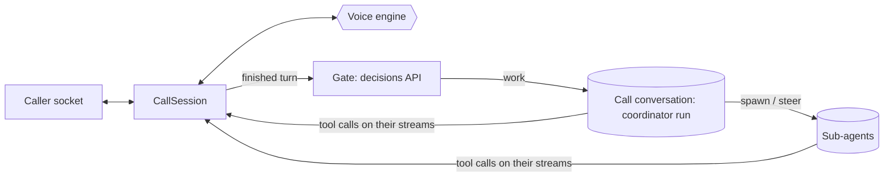

# Calls module

## Purpose

`app/modules/calls` holds live voice calls between a person and a pod agent.
A call is a conversation: the agent in it is the call's **coordinator**, which
hears what the person says as messages, hands work to sub-agents, decides what
the voice says, and shows things on the call's **canvas**. A separate voice
model does the talking. The module owns the socket, the voice and the turn;
everything the agents do is the agent module's ordinary runs.

The module owns no tables. A call's record is its conversation (marked in the
conversation's metadata, `agent/domain/calls.py`), its sub-agents are the
conversation's children, its canvas is the canvas tool calls across all of
them, and its transcript is written into the conversation when it ends.

## Runtime contributions and API

| Route | Behavior |
| --- | --- |
| `GET /pods/{pod_id}/calls/config` | Which voice engines this server has keys for, the configured default first |
| `POST /pods/{pod_id}/calls` | Open a call: a new conversation with the pod agent, the coordinator's brief as its instructions, and its model pinned when `CALL_COORDINATOR_MODEL` is set |
| `WS /pods/{pod_id}/calls/{call_id}/socket` | Hold the call (below). Authenticates itself like the pod live socket; only the person who opened the call may hold it |

## The socket

Binary frames carry audio: the caller's microphone up (16 kHz, 16-bit mono
PCM), the voice down at the rate the `ready` frame names. Text frames are JSON.

| Direction | Frame | Meaning |
| --- | --- | --- |
| up | `start` | First frame: `teammate`, `pod`, `context` (what came before the call), optional `engine` |
| up | `mute`, `text`, `end` | Mute the microphone; a typed turn; hang up |
| up | `canvas.focus` | The person paged to an item; the voice is told what they see |
| up | `canvas.render_failed` | An item could not draw; the coordinator is told, once per item, so it can show a corrected one |
| down | `ready` | The voice is connected: `engine`, `sample_rate` |
| down | `transcript` | `speaker` (`caller` / `voice`), `text`, `final` |
| down | `clear` | The caller cut in: drop queued audio |
| down | `canvas.item` | Something shown on the canvas: the tool call that showed it, from the coordinator or a sub-agent; `replay` on reconnect |
| down | `work` | Whether the coordinator has a run going |
| down | `ended` | The call ended, with a reason when it was not the caller |

Close codes: 4401 unauthenticated, 4403 no pod access, 4404 not this person's
call, 4429 too many calls at once (`CALLS_PER_USER`, across replicas), 4503
the voice engine could not start.

## How a call runs

- **Voice engines** (`infrastructure/engines/`) turn a provider into one event
  vocabulary (`domain/voice.py`): `gemini_live` (Gemini Live over its
  WebSocket, resumed across its connection limit), `openai_realtime` (OpenAI's
  realtime model, the mini one by default), and `cascade` (Deepgram Flux
  speech-to-text, which also decides when a turn ended, a Lemma model through
  the agent module's runtime, and Deepgram Aura text-to-speech).
- **The gate** (`services/gate.py`) asks one interactive decision per finished
  turn: conversation for the voice alone, or work for the agents. Anything
  short of a confident "conversation" is work. Turns the gate keeps from the
  agents ride along as context with the next one that reaches them.
- **Turns** reach the coordinator through `start_surface_turn`, so a turn that
  arrives mid-run steers that run.
- **Relays and the canvas** are read off the conversations' own event streams
  (`services/agents.py`): `relay_to_voice` from the coordinator, and
  `display_resource` from anyone in the call. A relay is
  either known to the voice at once or queued on the floor (`domain/floor.py`)
  until both sides pause; the module never relies on a provider's own "when
  idle" scheduling.

## The canvas

The canvas is not a tool of its own. Everything any run in the call shows with
`display_resource` -- the coordinator's and every sub-agent's -- is on it, in the
order it was shown, so an item reads the same on the call screen, in the
conversation afterwards and on any surface. The coordinator also gets
`relay_to_voice` (agent module, `tools/call/`), attached by the conversation's
call mark rather than by the agent's configured toolsets.

- Visuals given as data use the widget library's `show` widgets
  (`/skills/lemma-widget/library/show/`): `diagram` (Mermaid), `chart` (a
  Vega-Lite spec), `note` (markdown) and `image` (an https URL).
- The voice is told about an item by its `fallback`, the plain-text line every
  surface that cannot render gets.
- A widget that cannot draw reports it through the widget kit (`lemma.fail`,
  and any uncaught error) as a `lemma-widget-error` message to its frame; the
  call screen sends it up the socket, and the coordinator is told once per item.

## Configuration

`CallsSettings` in `config.py`; see [configuration](../../../docs/configuration.md#calls).

## Tests and operations

Unit tests cover the floor, PCM conversion, the cascade's turn (drafting
early, barge-in, what the talker is told it said) against scripted Deepgram
and model stand-ins, Gemini's frames, the agents' stream reading, the gate, and
the session end to end against a scripted caller, voice and agents.
