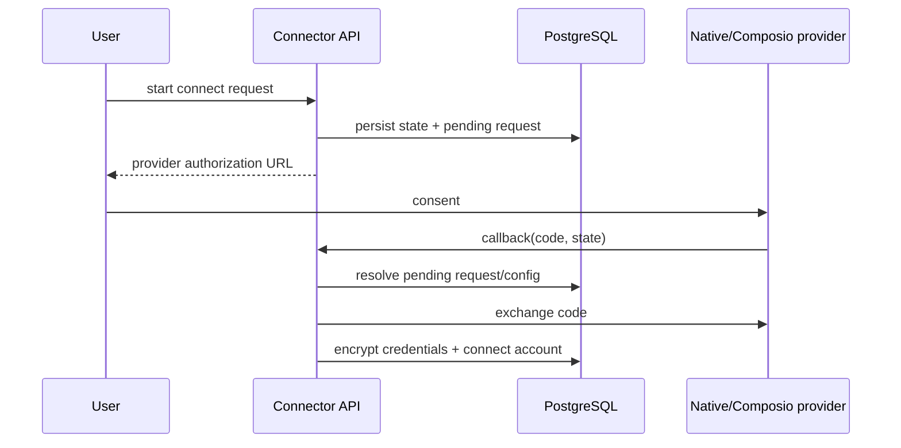

# Connectors module

## Purpose

`app/modules/connectors` manages third-party application capabilities. It owns
the connector/operation/trigger catalog, organization auth configurations,
user-owned connected accounts, OAuth/credential flows, operation discovery,
and operation execution routing between native Lemma integrations and Composio.

## Runtime contributions

The module contributes nine API routers, no event consumer, and one cron
(`renew_mcp_event_subscriptions`, every five minutes).
Long external operation calls use a resolve -> external call -> persist saga so
a pooled database connection is not held during provider I/O.

## Main data model

| Table | Meaning |
| --- | --- |
| `connectors` | Provider-independent application catalog entry |
| `connector_operations` | Searchable operation metadata and JSON input/output schemas |
| `connector_triggers` | Available external trigger metadata |
| `auth_config_operations` | Operations discovered for one organization's install. MCP tools and OpenAPI-URL endpoints describe a customer's own systems, so they are kept out of the global catalog entirely rather than held there behind a nullable tenant column |
| `auth_config_events` | Events an MCP install's server lists with `events/list`, discovered beside its tools and kept per install for the same reason |
| `connector_event_subscriptions` | One subscription to an MCP server's event, made on a person's account for one schedule: our id (in the callback URL), our encrypted `whsec_` secret, the server's id and `refreshBefore` |
| `auth_configs` | Organization installation/configuration and encrypted OAuth client secrets |
| `accounts` | User-owned encrypted provider credentials and connection status |
| `connect_requests` | Short-lived OAuth state and authorization flow metadata |
| `pod_connectors` | A pod's declaration of one org installation under a pod-local slug, with its mode: PER_MEMBER (each caller's own account) or SHARED (one pod account). The only thing an operation is run through, so the account is the connector's decision and never an argument |
| `pod_accounts` | One org account in use in one pod, owned by the account's owner, with a visibility only that owner may widen (PERSONAL, POD, RESTRICTED). A row rather than an inference so a pod's use of an account is recorded, authorized like any pod resource, and removed with the member. `allow_sandbox_use` is the owner's "allow use inside sandboxes": only with it may the sandbox git bridge write a shared account's token into another member's workspace; withdrawing the account clears it, and turning it off takes the token back out of a session on its next git command |
| `connector_installations` | Which organization an installation of an app Lemma operates belongs to (`connector_id` + the upstream's `external_id`; GitHub today), and who bound it. Not an auth config: that is an org's app registration, this is ownership of one upstream tenant. One org per installation: a first claim needs proof from GitHub that the claimant administers it and `org.installation.manage` in Lemma; token minting and webhook routing reach an installation only through its own org; GitHub's `installation.deleted` releases it |

## API groups

| Routes | What they do |
| --- | --- |
| `/connectors` | Public catalog, connector detail, and generated skill text |
| `/organizations/{org}/connectors/status` | Installed/connected capability summary |
| `/.../auth-configs` | Create/list/get/delete organization auth configurations |
| `/.../accounts` | Create/list/get/delete user accounts and resolve account credentials |
| `/.../connect-requests` + callback | Start OAuth and exchange callback state/code. Named by connector id in an organization with no install of it, the request installs Lemma's own app first when the caller holds `org.installation.manage`, and otherwise answers 404 `CONNECTOR_NOT_INSTALLED` naming who can. The same person asking again for the same install and return path within ten minutes gets the pending request back rather than another one |
| `/.../{auth_config}/operations` | Search and read an install's operations |
| `/pods/{pod}/connectors[/{slug}]` | Declare, list, change and remove the pod's connectors (`pod.connector.manage`). A declaration names an installation (`auth_config_id`) or a catalog connector (`connector_id`, installed as for a connect request); `slug` defaults to the installation's name. A change naming a field it cannot change (`slug`, the installation) is a 422 naming it. Each carries `can_use`: whether a call by the caller would run once their own account is in place -- false for a viewer, someone a RESTRICTED connector or shared account leaves out, a disabled installation, a shared connector with no account, and a per-member one asked with nobody behind it |
| `/pods/{pod}/connectors/{slug}/coverage` | For an editor: how many of the members allowed to use a PER_MEMBER connector have a working account, and who it waits on (missing, or `REAUTH_REQUIRED`) -- names only, never their accounts. One connector per call, because it weighs each member's own access; listings leave it out |
| `/pods/{pod}/connectors/{slug}/ask-members` | An editor asks those members to connect: one line each in their own channel, from the pod's agent for the editor (the path `channel_post` writes). Once per connector per member per day, held in Redis and marked only after the line is committed |
| `/pods/{pod}/connectors/{slug}/operations[/{op}[/execute]]` | Discover and run operations through a pod connector. `slug` may also name the caller's own installation, which the first execute declares as their PER_MEMBER connector in the call's own transaction (a refused call leaves none), or an installation or catalog connector they have not connected: discovery reads its operations, and execute answers `CONNECTION_REQUIRED` with the pod's connect link |
| `/pods/{pod}/connector-accounts[/{id}]` | The accounts in use in the pod; their owners add, share and withdraw them |
| `/pods/{pod}/connector-accounts/{id}/share-as` | "Share as <slug>": the owner, who must also manage connectors, shares the account and points or declares a SHARED connector on it -- every check first, then both in one transaction |
| `/me/connectors/accounts/{id}/pods` | Where one of my accounts is used |
| `/organizations/{org}/installations/{id}/impact` | What removing an installation would stop: accounts, pod accounts, pod connectors, and the surfaces, schedules and MCP event subscriptions running through them (via the `agent_surfaces` and `schedule` contracts). Counts are org-wide; pods are named only where the caller can open them. Fails soft: if the second half cannot be read it says `complete: false` rather than erroring |
| `/.../{auth_config}/triggers` | Discover provider triggers |

A trigger's `config_schema` is returned by the single-trigger endpoint, not by
the list — the list is deliberately lean. It declares the parameters a schedule
may narrow the trigger by, and those go at the top level of the schedule's
config, which is what the routing key is matched against. Keys a person cannot
sensibly supply are bound when the schedule is created: GitHub's
`installation_id` comes from the connected account's `external_ref`, which is
where the App install redirect recorded it.

## OAuth and execution flows

Storing a grant -- a new account, or an existing one granted again -- emits
`ConnectorAccountConnected` (`contracts/facts.py`) in the same transaction,
for other modules to subscribe a work kind to. It carries the account, the
install, the connector, the organization and the person; the `purpose` the
request's starter recorded (`own_apps.start_authorization(purpose=...)`), so a
subscriber acts only on the grants it started; and `renewed`. The callback
refuses a browser that does not carry the starter's own Lemma session before
anything is claimed or exchanged, so every stored grant is the starter's own
consent, and a grant may be taken as proof of who the provider's user is. A
request with a
purpose renews an account its person already has connected for the same
provider identity instead of refusing it as `ACCOUNT_ALREADY_CONNECTED`: its
starter asked for a fresh grant. `start_authorization(omit_authorize_params=)`
drops some of the install's own authorize parameters for one request (Slack's
`user_scope`, for installing Lemma's app with its bot alone), and
`own_apps.ensure_system_install` finds or makes an organization's
`SYSTEM_DEFAULT` install the way the web app's Connect does. Two first installs
of one connector at once collide on being its default, which is a
`ConnectorConflictError` like a taken name, never a 500. A refusal on the
provider's own page (`?error=`) returns to the request's recorded return path,
like a success, rather than to the app root. The analytics
`connector.connected` event is a projection, not this contract. Credential
accounts made without an OAuth round trip do not emit it.

For execution, a short UoW resolves the auth config, operation, account, and
decrypted credential values into a session-free DTO. The provider call happens
outside a UoW; a final short UoW marks accounts for reauthentication when an
unauthorized response is classified.

A provider refusing the connected account's credential, still refused after one
refresh, reaches the caller as a 424 `OPERATION_EXECUTION_UNAUTHORIZED`, with
the provider's own status in `details.upstream_status`. It is never a 401: every
client of this API reads a 401 as the caller's own Lemma session ending, so the
browser's session interceptor and the SDKs would resend the operation and a pod
app would sign its user out over somebody else's API key.

A credential refresh fails one of two ways, and they answer differently. When
the provider says the grant itself is gone (`invalid_grant`, `invalid_client`,
`unauthorized_client`, a Composio connection in a terminal state), or an expired
token has nothing to refresh with, the account is marked `REAUTH_REQUIRED` and
the caller gets a 409 `CONNECTOR_REAUTH_REQUIRED` naming the account to
reconnect. A provider that is unreachable or answers 5xx is a 502
`OAUTH_FLOW_ERROR`, because retrying may help and reconnecting will not.

A Composio toolkit's `system_default_available` can turn false on a later
catalog import. Connecting through a Lemma-default install of such a toolkit is
refused with the same 400 as creating one, and the importer disables those
installs and flags their accounts `REAUTH_REQUIRED`, so the organization is
asked to bring its own OAuth app.

## Authorization and secrets

- Auth configurations are organization-scoped; accounts remain owned by one
  user even when the auth configuration is shared.
- Credentials are encrypted by the shared versioned secret cipher.
- Operation execution resolves the caller's permitted account and scopes before
  calling a provider.
- Provider-specific capabilities live behind auth-provider and operation-gateway
  adapters.

## Tests and operations

Tests cover native and Composio routing, OAuth state, account identity,
credential encryption/refresh, catalog import, and operation timeouts. Dynamic
connector schemas are parsed by a restricted AST reader, never `exec()`; see
`infrastructure/schema_compiler.py` and its hostile-input tests.

## MCP server events

An MCP install's server may offer events through the MCP Events working-group
draft (webhook slice, revision 2026-07-28) — the same draft a pod speaks to
ChatGPT from `mcp_access`. Here the pod is the subscriber:

- **Discovery.** `events/list` is called beside `tools/list` whenever the
  install's tools are discovered; a server that offers none (method not found,
  an older revision) is an install with no events, not a failed discovery. A
  server that cannot be reached keeps the events stored the last time it
  answered. The descriptors go to `auth_config_events`, never to the global
  trigger catalog: the one `mcp` connector is every server anyone connected.
- **Subscribing.** `contracts/mcp_events.subscribe_to_mcp_event` is what a
  WEBHOOK schedule with `config.source = "mcp"` calls when it is created. It
  refuses an account outside the pod's organization, checks the event is
  offered and its arguments present and of the declared type, commits a
  pending row with a fresh secret, then calls `events/subscribe` with the
  callback `{api_url}/webhooks/mcp?subscription=<our id>`. The commit comes
  first because the server proves the callback with a signed challenge before
  it answers. Our id becomes the schedule's `provider_trigger_id`.
- **Delivery.** `webhook_sources/mcp.py` verifies each request against that
  subscription's secret (Standard Webhooks, five-minute skew), checks the
  server's `X-MCP-Subscription-Id` once it has named one, echoes a challenge,
  and routes an occurrence by our id, for that account's schedules only, with
  `mcp:<id>:<sha256 of eventId>` as its `source_event_id`. `gap` and
  `terminated` notices run nothing.
- **Renewal.** The cron renews each subscription halfway through what the
  server granted, by subscribing again with the same identity. Each row holds
  `renew_after`, when it is next tried, and the cron takes only rows past it,
  oldest first. A failure is noted on the row and pushes `renew_after` on by a
  wait that doubles from five minutes to six hours (never past the last pass
  that could still renew a live grant), so a row the server keeps refusing
  cannot hold the place of one that would renew. A pass stops starting
  renewals after four minutes. One row's undecryptable secret or database
  error is that row's failure, not the pass's end; a row deleted since the pass
  began is not renewed; a pending row a crashed subscribe left is dropped after
  ten minutes. `mcp_listening_page` / `mcp_listening_states` tell `schedule`
  how each subscription stands, for its reconciler and its responses. Unsubscribing (schedule edited or deleted) is best effort
  at the server and certain here: the row goes, so a late delivery verifies
  against nothing.
- **Calls to the server** are raw JSON-RPC POSTs
  (`infrastructure/adapters/mcp_events_client.py`) through the SSRF guard, with
  redirects refused, and the account's credentials as headers.
