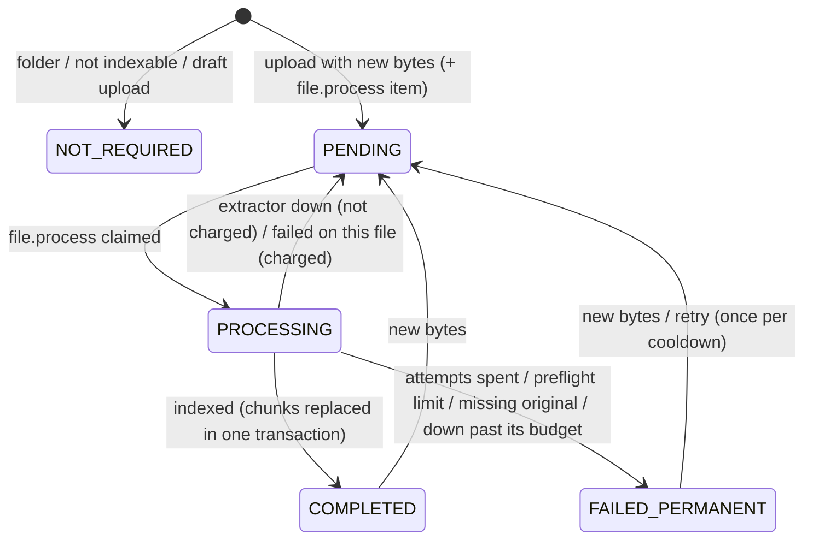

# Datastore module

## Purpose

`app/modules/datastore` gives each pod structured tables/records and a searchable
file tree. It manages dynamic PostgreSQL schemas, row-level authorization,
object storage, document-to-Markdown conversion, embeddings/search, signed
downloads, and live record-change streams.

Operator configuration for local, GCS, S3, and Azure storage is documented in
[Object storage](../operators/object-storage.md).

## Runtime contributions

| Contribution | Behavior |
| --- | --- |
| API routers | Table, record, SQL query, file, signed/public file, and WebSocket change APIs |
| Work kinds | `file.process` and `file.cleanup` (`ingestion`), written in the transaction that uploads, updates or deletes; `pod_schema.migrate`, `pod_schema.backfill`, `datastore.parent_backfill` and `datastore.storage_copy` (`admin`), the backfills armed as periodics |
| Periodic work | Daily, drop the schemas of pods deleted more than `DATASTORE_ORPHAN_SCHEMA_RETENTION_DAYS` ago (0 disables, `datastore.orphan_schemas_reap`) and purge expired signed-link rows (`datastore.signed_links_purge`) |
| API lifespan | Starts local embeddings when configured. Nothing that reads stored data: the query role is ensured lazily |
| Worker lifespan | Runs the change-log handoff (LISTEN on the datastore database plus a poll), which turns a watched write's wake row into a `changes.deliver` item |
| Change-log work kinds | `changes.sync_subscribers`, `changes.deliver` (`events`), `changes.retention` (hourly, `admin`); see [Record change log](#record-change-log) |

## Storage model

| Storage | Meaning |
| --- | --- |
| `datastore_tables` | Registry and JSON column schema for each logical table |
| `datastore_public_rows` | Tables open to people outside the pod: one grant per table saying who may add rows (`contacts` or `anyone`), which columns, and the member who opened it. Rows are added as that member, through `RecordService`. A form is any page that adds such a row; see `domain/public_rows.py` and `PUT /pods/{pod_id}/datastore/tables/{table}/public-rows` |
| Per-pod PostgreSQL schema | Physical record tables, constraints, indexes, and RLS policies. Born readable by the ad-hoc query role (schema `USAGE` plus a per-schema default privilege for its tables); a schema from before that heals on its first query |
| `datastore_files` | Hierarchical metadata, ownership, processing status, Markdown/index metadata |
| Object storage/local store | Original bytes, derived Markdown, images, and page renders. Keyed by path (`storage_layout = path`) or, once `DATASTORE_OBJECT_STORAGE_LAYOUT` is on, by `objects/{file_id}/{sha256}/content` and `…/{sha256}/derived/` (`object`), so a rename moves no bytes; `datastore.storage_copy` moves existing files across and reads look in both layouts |
| `datastore_signed_links` | Durable `/public/s/{code}` capability grants: object key, expiry, hit ceiling, and revocation. Redis still serves every fetch and keeps the spend counter; the row is what makes a link's lifetime a promise rather than a function of how the operator deployed Redis |
| Search tables/indexes | Per pod schema: `search_files` (one row per indexed file: path, sha256, chunk count) and `reserved_chunks` (stored `tsv`, `UNIQUE(file_id, chunk_index)`, HNSW). Versioned by `public.lemma_pod_schema_versions`; see `pod_schema_migrations.py`. Search reads either version and never runs DDL |

## API groups

| Routes | What they do |
| --- | --- |
| `/pods/{pod_id}/datastore/tables` | Create/list/get/update/delete tables and add/remove columns |
| `/.../tables/{table}/records` | CRUD, filter/sort/page, and bulk create/update/delete records |
| `/pods/{pod_id}/datastore/query` | Restricted ad-hoc datastore query under the RLS subject role |
| `/pods/{pod_id}/datastore/files` | Upload, folders, metadata/content update, Markdown attachment, tree, search, preview/download |
| `/public/datastore/files`, `/public/s/{code}` | Signed file delivery paths (`/s/{code}` is a legacy alias until 2026-10-17) |
| `/pods/{pod_id}/live` | The pod's live socket ([live.md](live.md)); this module provides its `records` topic (see below) |
| `/pods/{pod_id}/datastore/changes` | The previous one-table change socket, kept for one release as one implicit subscription on the same hub |

## Live socket

The pod's live socket is core's ([live.md](live.md): frames, limits, close
codes). This module provides its `records` topic -- `{"op":"subscribe",
"topic":"records","table":…,"ops":…,"when":…,"since":…}`, answered with
`changes` frames -- defined in `domain/live.py` and registered from
`module.py` (`services/live/topic.py`).

Each API process keeps one hub per watched pod (`services/live/hub.py`). The hub
holds one Redis Pub/Sub subscription to `pod:<id>:changes` (a wake, published
after a record write commits), reads the pod's change log once per wake from its
own cursor, fetches the current rows once per table per batch, and fans out in
memory, so database work grows with watched pods and writes, not with sockets.
A lost wake costs latency only: the hub also reads on an idle poll.

- **Visibility**: table read permission is checked at subscribe. RLS rows reach
  only their owner (the change row carries `owner_user_id`), as the record API
  scopes them by default. The hub fetches current rows naming a principal
  every row policy admits (`RowPrincipal.every_row`) and applies that rule
  itself: per-user tables are `FORCE ROW LEVEL SECURITY`, so a fetch that named
  nobody would match no per-user row wherever the API's database role is not a
  superuser or `BYPASSRLS`, and no per-user change would be sent. When the pod's
  grants epoch moves (file writes do not move it), and every
  `LIVE_AUTHZ_RECHECK_SECONDS` regardless, the hub re-checks every
  subscription and ends the ones that lost their table with `unsubscribed`. A
  re-check that fails is made again on the next pass. The previous
  `/datastore/changes` socket has no `unsubscribed` frame, so there losing the
  table closes the socket with `4403`.
- **`when`**: a subscription on one table may carry `when` conditions in the
  trigger grammar (`app/core/domain/record_conditions.py`, the one evaluator
  both use), limited to its value operators (`equals`, `not_equals`, `in`,
  `not_in`): the socket sees the current row, with no prior image to ask
  `changed`/`written`/`from`/`to` of, so those are refused with `invalid`. The
  hub tests each insert or update against the row it fetched, after the RLS
  check; deletes always pass, and a row updated out of the filter is not sent.
- **Resume**: `subscribe` with `since` replays that subscription's gap from the
  log. A cursor older than the log keeps, or one that is not a change-log
  cursor, answers `resync`; so does a batch with more than
  `LIVE_MAX_CHANGES_PER_BATCH` changes for one subscription.
- **Back-pressure**: each socket has a bounded send queue
  (`LIVE_SOCKET_QUEUE_BYTES`); overflow replaces its queued change frames with
  one `resync` per subscription. A slow client never slows the hub.
- **Limits** are the socket's, in [live.md](live.md#limits).

## Record change log

Every record write appends one slim row per record to its pod schema's
`reserved_changes`, in the writing statement; row snapshots are kept only for a
`(table, op)` a durable subscriber (a DATASTORE trigger, an MCP event
subscription) watches, and only for a write intent (`normal`, `bulk`,
`import`) one of them wants rows for -- a bulk import every watching trigger
skips writes slim rows, from which the skips are still recorded. Readers (`changes/reader.py`) only see rows whose
transaction id is below the oldest transaction still open
(`pg_snapshot_xmin`), which is what makes a read final and gap-free. The cost
of that rule is that delivery and the live socket wait for the **oldest open
transaction on the datastore database's cluster**, whatever it is doing.

A record write never migrates its pod schema. It checks the change log is
there (`ensure_change_log`): a per-process memo, or one unlocked read. A schema
the `pod_schema.backfill` periodic (armed at the first worker boot of a release
that adds a pod-schema version) has not reached yet gets only the change log's
own two tables, never the search-chunk rewrite of version 2.

**Cutover.** Record writes used to stage events in the datastore database's
`domain_event_outbox`, which a dispatcher published to `datastore.events` for
the `schedule-datastore-events` and `mcp-access-event-deliveries` consumer
groups. Every write appends to the change log now. A record event the old
transport still owed is not carried over: a trigger or MCP subscription sees
the changes written after the upgrade. See
[the cutover](../operators/reliability.md#cutover-from-the-old-transport-design-13).

**Operating it.** A transaction left open on the datastore database -- an
`idle in transaction` session, a long migration, a stuck backfill, or the main
database if it shares the cluster -- holds the horizon back: DATASTORE triggers
stop firing, MCP event deliveries stop, and live sockets go quiet, while writes
keep succeeding. Every worker exports the age of the oldest open transaction
as the gauge `lemma.work.oldest_transaction_age` (seconds, label `database` =
`main` or `datastore`, sampled with the other `lemma.work.*` gauges every
`WORK_GAUGE_INTERVAL_SECONDS`). Alert when the `datastore` series stays above
30 seconds. To find the culprit:

```sql
SELECT pid, usename, application_name, state, now() - xact_start AS open_for, query
FROM pg_stat_activity
WHERE xact_start IS NOT NULL AND now() - xact_start > interval '30 seconds'
ORDER BY xact_start;
```

Runbook: find the oldest row above. A worker or API session idle in
transaction is a bug to report, and is safe to end with
`pg_terminate_backend(pid)`; a migration or backfill should be let finish or
cancelled by its owner. Delivery catches up by itself once the horizon moves --
nothing is lost, because cursors only advance past rows that were read. The
statement and idle-in-transaction timeouts bound how long this can last;
`changes.retention` never deletes a row a durable cursor has not passed.

## File lifecycle



The worker can use Kreuzberg/Xberg, MarkItDown, or Docling-compatible
processing. The HTTP adapter speaks both the Kreuzberg v4 and Xberg 1.x wire
formats — the response envelope, the removal of `POST /chunk`, and the
`layout.strategy` key are all handled in one client — so the engine can be
swapped by changing the image tag.

`DatastoreSettings` owns original, Markdown, attached-image, and request-batch
upload ceilings as well as document-processing controls.

### How ingestion is scheduled

Processing is a `file.process` work item (`ingestion` class), written in the
transaction that makes a file need it and keyed by `file:<id>:<sha256>`. Bytes
identical to the ones the row holds are not reprocessed, and do not reopen a
permanent failure.

- **Fairness** is the work runtime's: the `ingestion` class's per-pod cap and
  round robin, so one pod's bulk upload waits behind itself, not in front of
  everyone else. `load_tests/file_work_fairness.py` measures it.
- **Two budgets.** A failure caused by the document — including a Kreuzberg
  5xx, timeout or 413 on it while Kreuzberg's health check passes — spends one
  of `DOCUMENT_PROCESSING_MAX_ATTEMPTS`. Evidence the extractor or embedding
  provider is down (connection refused, health check failing, the circuit
  open, 429, an embedding 502/503) is waited out without charging, for up to
  `DOCUMENT_PROCESSING_UNAVAILABLE_BUDGET_SECONDS`. The circuit breaker counts
  each document once, so one poison file cannot hold it open.
- **Preflight.** Size, PDF pages, scanned pages and expected chunks are checked
  before the extractor is asked; over a limit is `FAILED_PERMANENT` with a
  `too_large:` reason.
- **Leases.** A running extraction keeps its lease by heartbeat; a worker that
  dies loses it and the file is run again, charged to its lease-loss budget.

Whichever budget runs out, the file is `FAILED_PERMANENT` with the reason in
`last_processing_error`. `FAILED` is no longer written.

Note that in practice **embedding, not extraction, dominates ingestion cost**
(measured at roughly 2.6x extraction on a 100-paper arXiv corpus), so worker CPU
sizing should be driven by the embedding backend.

## Authorization

- Table, record, and file services require a pod `Context` and apply role,
  resource-grant, visibility, ownership, and RLS rules.
- `/me` is a public alias for the current user's private file root; internal
  paths retain the user UUID.
- Signed URLs are purpose-bound, expire, and can have a Redis-enforced hit cap.
- The changes WebSocket filters emitted rows through the caller's visibility.

## Dependencies and consumers

Agents expose datastore/file tools; DATASTORE triggers and MCP event
subscriptions read the record change log; bundles export/import schemas and
seed data. The module uses identity/pod context. Its committed `datastore.*`
domain events feed the after-commit sink only (analytics and the agent
memory-brief invalidation).

## Tests and operations

Tests cover schema/record validation, SQL safety, RLS, files, storage adapters,
document processing, recovery, signed URLs, WebSockets, and e2e CRUD. One
MarkItDown unit test is skipped when the optional package is absent.
