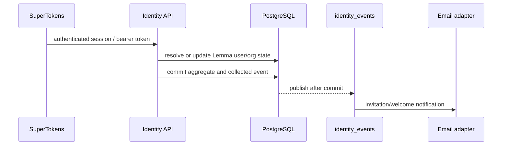

# Identity module

## Purpose

`app/modules/identity` owns a person's Lemma identity and organization-level
tenancy. It integrates SuperTokens authentication with Lemma user rows, manages
organizations/members/invitations, and emits email-oriented identity events.
Pod membership is deliberately owned by the [pod module](pod.md).

## Runtime contributions

| Contribution | Behavior |
| --- | --- |
| API routers | `/users`, `/organizations`, `/auth` |
| Work kinds | `identity.email` (invitation, welcome and invitation-accepted emails), `identity.whatsapp_verification` and `identity.account_deleted` (`delivery`), written in the transaction that causes them; `UserMobileChanged` is a fact emitted with the number change, `AccountDeleted` one emitted with an account deletion |
| API lifespan | Closes the Redis-backed user cache |
| External systems | SuperTokens and SMTP/email adapter |

## Main data model

| Table | Meaning |
| --- | --- |
| `users` | Lemma profile keyed to the SuperTokens user id |
| `organizations` | Organization name, slug, policy, and owner context |
| `organization_members` | User membership and organization role |
| `organization_invitations` | Pending/accepted invitation lifecycle |
| `identity_email_challenges` | An email verification in progress — purpose, binding hash, the SuperTokens pre-auth session/code/device ids, a three-attempt ceiling, and terminal verified/revoked state. It is durable so a challenge outlives the browser session that started it |

Organization roles are `ORG_OWNER`, `ORG_EDITOR`, and `ORG_MEMBER`. Pod roles
are a different authorization layer.

## API groups

| Routes | What they do |
| --- | --- |
| `GET/POST /users/me...` | Read current user/profile and upsert profile preferences |
| `DELETE /users/me` | Delete the caller's own account (below) |
| `/organizations` | Create and list organizations, suggestions, slug availability, and auto-join |
| `/organizations/{org_id}` | Read/update organization and manage members/invitations |
| `/organizations/{org_id}/permissions/me` | The organization-level permission ids the caller holds, asked of the authorizer: what pages gate on (`org.installation.manage`), never a role |
| `/organizations/invitations...` | Inspect, accept, and revoke invitations |
| `/auth/verify-token` | Resolve bearer/delegation claims into user, pod, organization, function, and scope context |
| `/auth/cli/*` | Publish CLI login metadata, mint a CLI session from a browser session, and refresh CLI tokens |

## Key flows

SuperTokens initialization and recipe overrides synchronize authentication
events with Lemma profiles. The CLI endpoints mint a separate session so a CLI
can rotate access/refresh tokens without borrowing browser cookies.

### Deleting an account

`DELETE /users/me` takes the account's own email address, typed back, and
unlinks the person from their data rather than wiping shared work
(`services/account_deletion.py`):

- The `users` row becomes a tombstone: same id, so every foreign key to it
  holds, with the name "Deleted user", an undeliverable `@deleted.example`
  address, every other profile field cleared, and `is_deleted` set. The row is
  never deleted -- most foreign keys to `users` cascade.
- Each organization membership is removed through the ordinary departure, so
  `PodMemberRemoved` and `OrganizationMemberRemoved` fire and connectors revoke
  and delete the person's accounts there.
- An organization the person is the only member of is deleted: its pods
  through `PodService.delete_pod` (the pod contract `delete_organization_pods`),
  its pending invitations revoked, and its row kept memberless and renamed,
  because a cascade from it would take rows the pods' cleanup still reads.
- Refused with nothing written when the person is the only owner of an
  organization others are in (409 `ACCOUNT_DELETION_SOLE_OWNER`), or when the
  billing guard says no.
- `AccountDeleted` is announced in the same transaction. Identity's own
  subscriber revokes every SuperTokens session and deletes the SuperTokens
  user, which frees the address to sign up again; the request does the same
  straight after its commit, and the work item is the retry. Agent hosts,
  MCP grants, proved chat identities and the sender name on channel lines are
  let go by their own modules' subscribers.

**Billing.** Billing is not in this repository, so identity asks a question
of it through `contracts/account_deletion.py`: a billing provider registers an
`AccountDeletionGuard` with `configure_account_deletion_guard`, and a refusal
it returns is answered as 409 with the provider's code and message. A
deployment with no plans needs no guard. A deployment with plans
(`build_plan_limits` answers) and no guard refuses with 503
`ACCOUNT_DELETION_UNAVAILABLE`, rather than delete an account that may still be
paying.

## Authorization and security

- `CurrentUser`/`request.state.user` is populated by the global auth middleware.
- Organization services require membership and enforce owner/editor/member
  operations; email events carry only notification data.
- The module provides identity repositories/ports used by pod, connectors,
  surfaces, usage, and workspace.
- CLI refresh is intentionally callable without a current access token; the
  refresh token is the credential.
- `DELETE /users/me` is closed to workload tokens and to a pod app's page by
  `actor_policy`, which opens neither to it: only the person, on a session of
  their own, deletes their account.

## Tests and operations

Unit and e2e tests cover organization lifecycle, SuperTokens configuration,
profile behavior, and invitation flows.
