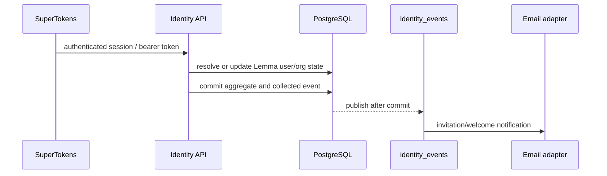

# Identity module

## Purpose

`app/modules/identity` owns a person's Lemma identity and organization-level
tenancy. It integrates SuperTokens authentication with Lemma user rows, manages
organizations/members/invitations, and emits email-oriented identity events.
Pod membership is deliberately owned by the [pod module](pod.md).

## Runtime contributions

| Contribution | Behavior |
| --- | --- |
| API routers | `/users`, `/organizations`, `/auth` |
| Work kinds | `identity.email` (invitation, welcome and invitation-accepted emails) and `identity.whatsapp_verification` (`delivery`), written in the transaction that causes them; `UserMobileChanged` is a fact emitted with the number change |
| API lifespan | Closes the Redis-backed user cache |
| External systems | SuperTokens and SMTP/email adapter |

## Main data model

| Table | Meaning |
| --- | --- |
| `users` | Lemma profile keyed to the SuperTokens user id |
| `organizations` | Organization name, slug, policy, and owner context |
| `organization_members` | User membership, organization role, and when the member last marked the organization's Home seen (`home_seen_at`) |
| `organization_invitations` | Pending/accepted invitation lifecycle |
| `identity_email_challenges` | An email verification in progress — purpose, binding hash, the SuperTokens pre-auth session/code/device ids, a three-attempt ceiling, and terminal verified/revoked state. It is durable so a challenge outlives the browser session that started it |

Organization roles are `ORG_OWNER`, `ORG_EDITOR`, and `ORG_MEMBER`. Pod roles
are a different authorization layer.

## API groups

| Routes | What they do |
| --- | --- |
| `GET/POST /users/me...` | Read current user/profile and upsert profile preferences |
| `/organizations` | Create and list organizations, suggestions, slug availability, and auto-join |
| `/organizations/{org_id}` | Read/update organization and manage members/invitations |
| `/organizations/navigation`, `/organizations/{org_id}/home` | Every organization with its pods, and one organization's pods with their apps, agents and the caller's roles -- one call each |
| `/organizations/{org_id}/needs-you`, `/recents`, `/apps`, `/home/seen` | The organization overview: what waits on the caller, what moved in each pod, every app, and when they last looked at Home -- across every pod they may open (below) |
| `/organizations/{org_id}/permissions/me` | The organization-level permission ids the caller holds, asked of the authorizer: what pages gate on (`org.installation.manage`), never a role |
| `/organizations/invitations...` | Inspect, accept, and revoke invitations |
| `/auth/verify-token` | Resolve bearer/delegation claims into user, pod, organization, function, and scope context |
| `/auth/cli/*` | Publish CLI login metadata, mint a CLI session from a browser session, and refresh CLI tokens |

## Key flows

SuperTokens initialization and recipe overrides synchronize authentication
events with Lemma profiles. The CLI endpoints mint a separate session so a CLI
can rotate access/refresh tokens without borrowing browser cookies.

## Organization overview

Four reads answer for every pod the caller may open in one organization, so a
client can draw an overview of all of them without a request per pod. Each
starts from `services/organization_scope.load_member_scope`: the caller's
membership, the pods `pod.contracts.list_visible_pods` lists for them (every
pod for an organization owner, the joined ones for everybody else), and one
listing context per pod built in a single query
(`core.authorization.listing_contexts`). A caller who is not a member gets 403,
as `org.home` does. Each read is a fixed number of queries whatever the pod
count -- `test_a_read_costs_the_same_for_one_pod_as_for_five` holds that. The
one exception is deliberate and narrow: Needs you decides `contact.read` with
the same `ctx.can` the pod's own contact list uses, only for pods that have a
contact waiting, and where the caller's role does not settle it that costs a
grant lookup.

| Read | What it returns | Read through |
| --- | --- | --- |
| `GET .../needs-you` (`org.needs_you.list`) | One list, oldest first, capped at `limit` with `truncated`: questions, approvals and Agent Host permission requests in the caller's own conversations (one item per conversation, aged by its longest wait); workflow forms and decisions assigned to their pod memberships; contacts waiting on a person, in pods where their own context holds `channel.read` and `contact.read`. Each item carries `kind`, `pod_id`/`pod_name`, `title`, `detail`, `since` and what to open: a `conversation_id` (with the pause's `tool_call_id`), a `workflow_run_id`, or a `channel_id` | `agent.contracts.conversation_summaries`, `workflow.contracts.assigned_waits`, `channels.contracts.contacts_waiting` |
| `GET .../recents` (`org.recents.get`) | Per pod, quiet ones included: the caller's latest chats (conversations of no channel they talk in, plus any waiting on them), the workflows and schedules that ran in the window -- one each, with the newest run, its status, a count, and what it opens -- and one count per day of the window of the caller's root conversations by the day each was last active, split into started by an agent (`schedule`, `workflow`, `notification`, `task`, `ask`) and by a person. `days` (1-31), `chats` (1-25) and `timezone` (an IANA name; days are its calendar days) shape it | `agent.contracts.conversation_summaries`, `workflow.contracts.run_activity`, `schedule.contracts.fire_activity` |
| `GET .../apps` (`org.apps.list`) | Every app the caller may open, newest first, each filtered by its own visibility against their permissions in its pod | `apps.contracts.pod_summaries.list_readable_apps_by_pod` |
| `GET`/`PUT .../home/seen` (`org.home.seen.get`, `org.home.seen.set`) | When the caller last marked Home seen, and what it was before a write. A write takes an optional `seen_at` (aware; a future moment is read as now) and only ever moves the mark forward, so an older tab cannot undo a newer one | `infrastructure/organization_home_seen` |

Chats and day counts are the caller's own conversations, as every
conversation list is. Automations are the pod's: every run of a workflow, or
fire of a schedule, the caller may read, whoever started it -- a run is
readable by whoever may read its workflow. Internal schedules and fires a
schedule's filter skipped are left out. Where a conversation came from is one
rule in two forms, `agent/domain/conversation_origin.origin_of` and its SQL
twin `origin_column`, held to each other by
`test_conversation_origin_sql_agrees_e2e`; the web client reads the same keys.

The workflow runs are read by `ix_workflow_flow_runs_pod_created`, which
migration 0064 adds; conversations by `ix_agent_conv_user_pod_roots_activity`,
one lateral range per pod for the chats; schedule fires by
`ix_schedule_runs_schedule_fires`. Nothing here is cached: Needs you is what a
person acts on, and a stale list is the failure it exists to prevent.

## Authorization and security

- `CurrentUser`/`request.state.user` is populated by the global auth middleware.
- Organization services require membership and enforce owner/editor/member
  operations; email events carry only notification data.
- The module provides identity repositories/ports used by pod, connectors,
  surfaces, usage, and workspace.
- CLI refresh is intentionally callable without a current access token; the
  refresh token is the credential.

## Tests and operations

Unit and e2e tests cover organization lifecycle, SuperTokens configuration,
profile behavior, and invitation flows.
