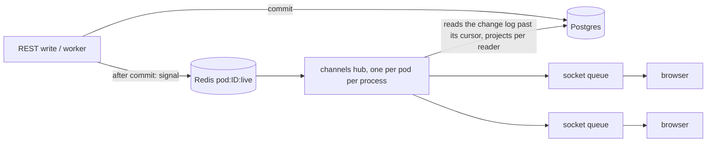

# The pod live socket

`/pods/{pod_id}/live` is the web app's one realtime connection to a pod: one
websocket per client and pod, carrying many **subscriptions** (each to a
**topic**) and **calls** (small ephemeral actions answered on the same
socket). Everything durable -- posting, editing, answering, membership,
settings -- stays REST; its effect arrives on the socket as an event.

Core owns the transport (`app/core/live`): authentication, the per-socket
queue, limits, presence and the frames below. Modules own what flows over it
and register it through `LemmaModule.live`:

| Topic / call | Module | What it carries |
| --- | --- | --- |
| `records` | datastore | A pod's table rows ([datastore.md](datastore.md#live-socket)) |
| `channel` | channels | One channel's timeline: lines, questions, the channel, read position, typing, answers being written |
| `inbox` | channels | The reader's counts across the pod's channels, and questions newly waiting on them |
| `conversation` | agent | A conversation's run events -- the SSE stream's events, unchanged |
| `typing`, `read` | channels | Calls: "I am typing here"; "I have seen this channel up to line `seq`" |
| `presence` | core | Call: who in the pod has a live socket open |

The SSE endpoints (`/pods/{pod}/conversations/{c}/stream`, workflow runs) stay
for the CLI, the SDKs and the Agent Host, which hold one stream and gain
nothing from multiplexing. The public web visitor stream stays separate too.

## Connecting

Open `wss://<api>/pods/{pod_id}/live`, authenticated by any one of:
`Authorization: Bearer <access token>` (CLI, SDK), the session cookie
(browser), or `?access_token=<token>` (a browser cannot set headers on an
upgrade). The server always accepts first and then authenticates, so a refusal
is a close frame the client can read, never a failed upgrade:

| Close code | Meaning | Client should |
| --- | --- | --- |
| `4401` | No session, or it expired; or, on an open socket, the session it was opened with ended (signed out, revoked, expired) | Refresh the session, then reconnect |
| `4403` | The caller may not read the pod (`pod.read`); or, on an open socket, no longer may -- checked as the socket refreshes its slot (every 30 s) and on `presence` | Stop |
| `4404` | No such pod | Stop |
| `4429` | The user already holds `LIVE_MAX_SOCKETS_PER_USER_PER_POD` sockets on this pod | Close another, or wait |
| `1011` | Server error | Reconnect with backoff |
| `1009` | A message over 1 MiB: the server stops reading it as it arrives | Do not send it again; nothing a client sends is that large |

A socket ends with its session. Signing out, or anything that revokes a
user's sessions (a password reset, a deactivated account), closes every live
socket opened with them, in every API process, with `4401`. Once the access
token a socket was opened with has expired, its session is also looked up
every 5 minutes and the socket closed with `4401` if it is gone; a session
that lives on keeps its socket, whatever the token's age.

Once the session is taken the server sends `ready`. Only `ready` -- not the
socket's `open` event -- says the connection is usable; (re)send every
subscription after each `ready`, each with its own last cursor.

```json
{"type": "ready", "connection": "6f1c…", "topics": ["channel", "conversation", "inbox", "records"], "calls": ["presence", "read", "typing"]}
```

## Frames

The client names each subscription and each call with its own `id` (1-64
characters, unique among the socket's open subscriptions); the server answers
on that id. Client frames are JSON text, at most 16 KiB of UTF-8. A larger one
is refused with an `invalid` error and the socket stays open -- up to 1 MiB,
the most the server reads of any websocket message (`WS_MAX_BYTES`,
`app/core/server_limits.py`). Past that the server closes the socket with
`1009` while the message is still arriving, so it is never held whole. The
ceiling is uvicorn's (`ws_max_size`), the same for every socket the API
serves, and every launcher passes it (`--ws-max-size 1048576`;
`test_ws_max_size_everywhere` holds them to it). Bulk bytes -- files, images --
travel over the HTTP API, never a socket; that holds for the Agent Host link
too.

### Client to server

| `op` | Fields | |
| --- | --- | --- |
| `subscribe` | `id`, `topic` (default `records`), `since` (a cursor, optional), and the topic's own fields | Start a subscription |
| `unsubscribe` | `id` | Stop it; answered with `unsubscribed` (`reason: "client"`) |
| `call` | `id`, `method`, `params` (object) | Answered with `result` or `error` |
| `ping` | | Answered with `pong`; send one every ~25 s to keep proxies from idling the socket out |

### Server to client

| `type` | Fields | |
| --- | --- | --- |
| `ready` | `connection`, `topics`, `calls` | The socket is usable |
| `subscribed` | `id`, `cursor` | The subscription is live from `cursor` (`null` for topics without one) |
| `events` | `id`, `cursor`, `events` (array) | A batch of the topic's events, in order. `cursor` is where a resume from here starts |
| `changes` | `id`, `cursor`, `changes` (array) | The `records` topic's batch (its own name, kept for its existing clients) |
| `resync` | `id`, `cursor`, `reason` | Events were not or cannot be sent: refetch the subscription's state over REST, then carry on from `cursor` |
| `unsubscribed` | `id`, `reason` | The server ended it: `access_revoked`, `gone` (the channel was deleted), `client`, or for `records` `table_dropped` |
| `result` | `id`, `result` | A call's answer |
| `error` | `id` (or `null`), `code`, `message` | A subscription or call refused, or a frame that could not be read. The socket stays open |
| `pong` | | |

`stream_id` is also present on `subscribed` and `resync` (equal to `cursor`),
for the previous SDK.

### Errors

| `code` | Meaning |
| --- | --- |
| `invalid` | The frame or its fields are wrong (unknown topic or method, a bad id, a duplicate subscription id, a frame over 16 KiB) |
| `forbidden` | The caller lacks the permission the topic or call needs |
| `not_found` | What it names does not exist *or the caller may not see it* -- the socket never says which, exactly as REST answers 404 |
| `limit` | Over a limit: subscriptions per socket, or calls per minute |
| `unavailable` | The server could not decide just now; retry later |

### Resync reasons

| `reason` | |
| --- | --- |
| `cursor_expired` | `since` is not a cursor this topic gave out, is ahead of what it covers, or is older than the changes kept (a `channel` cursor: 14 days) |
| `too_many` | More changes than `LIVE_MAX_CHANGES_PER_BATCH` to send one by one |
| `permission_changed` | What the subscription covers changed under it (the reader's own access in the pod moved) |
| `overflow` | The socket fell behind and its queued batches were dropped |
| `no_replay` | The topic keeps no history (`inbox`, `conversation`) and `since` was given |

On `resync`, refetch over REST (the timeline, `/inbox`, the conversation) and
keep the subscription: events after the resync's `cursor` keep coming.

### Cursors and resuming

A cursor is opaque: store the last one seen per subscription (`subscribed`,
`events`, `resync` all carry one) and pass it back as `since` after a
reconnect. Within a batch split across several frames, only the last frame
carries the batch's new cursor; the earlier ones carry the cursor before the
batch, so a client that drops mid-batch receives the whole batch again.

**Events may repeat** -- after a resume, or across a batch boundary -- and
always carry whole objects, so apply them as upserts by id.

## Topic `channel`

```json
{"op": "subscribe", "id": "c1", "topic": "channel", "channel_id": "<uuid>", "since": "<cursor>"}
```

Needs `channel.read` and that the caller may see the channel -- the REST rule
(`channels/api/access.py::visible`): a member's own DIRECT channel, a CONTACT
channel with `contact.read`, a public group, a private group they are in.
Anything else is `not_found`. A subscriber who stops being able to see it --
taken out of a private group, a grant removed -- gets
`unsubscribed {reason: "access_revoked"}`; a deleted channel,
`unsubscribed {reason: "gone"}`.

The cursor is the channel's change counter plus its newest line
(`"<rev>:<seq>"` today; treat it as opaque). Every line, edit, delete,
question state, channel setting and membership change takes the next change
number under the channel's row lock and is kept in the channel's change log,
so a resume from a cursor is exact however long the client was away (up to
`too_many`) -- back to 14 days; a cursor older than that is answered `resync`
(`cursor_expired`).

Every line is the **REST line** (`ChannelMessageResponse`, as
`GET …/messages` returns it) for this reader: an answer an agent made with
another member's own access, and not shared, is `withheld: true` with no
`text` or `parts` (in a group that shows agents' answers to everybody, such
an answer is shared as it is posted).
Thread replies are sent too (they carry `thread_root_id`), and each one sends
its root again (`line.edited`) with the new `reply_count`. A line is sent
again too when a platform message heard nameless is heard again with who said
it.

| Event | Fields | |
| --- | --- | --- |
| `line.created` | `message` | A line new to this subscriber |
| `line.edited` | `message` | A line it had, changed (its text, or its question's state) |
| `line.deleted` | `message` (`deleted: true`, `text: null`) | A line deleted; it keeps its place |
| `question.closed` | `channel_id`, `message_id`, `state` (`ANSWERED`, `CANCELLED`, `EXPIRED`) | Sent after the `line.edited` that shows the closed question; not sent where the line is withheld |
| `channel.updated` | `channel` (`ChannelResponse`, as the channel list shows it, with the reader's `unread`) | Title, topic, visibility, archive, agent switch, assignee, status, members changed |
| `read.updated` | `channel_id`, `read_seq` | The reader's own read position moved (another tab, the `read` call, `POST …/read`) |
| `typing` | `channel_id`, `user` (`PersonRef`), `thread_root_id` (or `null`) | Somebody else is typing -- in the thread with that root, or in the channel. Show it for ~5 s; it is not repeated by the server |
| `answering.started` | `channel_id`, `message_id` (the line being answered), `agent_id`; for the member it answers, also `conversation_id`, `agent_run_id` | "Lem is answering…" |
| `answering.finished` | `channel_id`, `message_id`, `agent_id` | The run ended (answer posted, failed, stopped or paused) |
| `line.streaming` | `channel_id`, `message_id`, `agent_id`, `agent_run_id`, `kind`, `delta` | A piece of the answer as it is written -- only to the member it answers, since the finished line is withheld from everyone else. `kind` is the run's token kind (`text`, `thinking`, `stream_reset` …), or `snapshot`: the answer's text so far, in one piece, replacing whatever the client had built for it. Display only: the answer arrives as its `line.created` |

Example:

```json
{"type": "events", "id": "c1", "cursor": "42:17", "events": [
  {"type": "line.created", "message": {"id": "…", "channel_id": "…", "seq": 17, "sender": {"kind": "MEMBER", "id": "…", "name": "Priya"}, "text": "Ship it", "withheld": false, "parts": [], "created_at": "…"}}
]}
```

`typing`, `answering.*` and `line.streaming` are ephemeral: they carry the
subscription's current cursor and are not replayed. A subscriber who joins
while an answer is being written is sent `answering.started` straight after
`subscribed` and -- if it is the member the answer is for -- a `line.streaming`
`snapshot` of the text so far (up to 32,000 characters), then the deltas that
follow. The snapshot is whole when the member had any subscription on the
pod's socket in that API process when the answer started (an open `inbox` is
enough), since only then was the answer followed from its first word;
otherwise it starts where the process first heard of it, and a socket that
connects to a process that never heard the `answering` signal is not told of
the answer until its line arrives.

## Topic `inbox`

```json
{"op": "subscribe", "id": "i1", "topic": "inbox"}
```

Needs `channel.read`. After `subscribed`, fetch `GET /pods/{pod}/inbox`; apply
events that arrived meanwhile *after* the fetch resolves (they are absolute,
so the later one wins). With `since`, the server answers `resync`
(`no_replay`): refetch `/inbox`.

| Event | Fields | |
| --- | --- | --- |
| `inbox.updated` | `channel_id`, `unread` (`lines`, `mentions`, `waiting`, `read_seq`), `totals` (`channels`, `mentions`, `waiting`) | One channel's counts and the reader's totals now, as `/inbox` and the channel list count them |
| `question.waiting` | `channel_id`, `message_id`, `message` | A new question waits on the reader |

Only channels the reader may see are counted or named. A channel that stops
being one they may see -- taken out of a private group, a grant gone, the
channel deleted -- is sent once more as `inbox.updated` with every count at 0
(and the totals now), so its badge clears; after that it is not named to them
again. Each change is counted for a reader in a fixed number of reads,
however many channels moved. A reader whose own access in the pod changes --
a role, `contact.read` -- is sent `resync` (`permission_changed`) to refetch
`/inbox`; one taken out of the pod, or losing `channel.read`, is sent
`unsubscribed` (`access_revoked`). A grant moving elsewhere in the pod, or a
file written, costs other readers nothing.

## Topic `conversation`

```json
{"op": "subscribe", "id": "v1", "topic": "conversation", "conversation_id": "<uuid>", "agent_run_id": "<uuid, optional>"}
```

Who may read the conversation (pod membership and the conversation read rule
of `GET /pods/{pod}/conversations/{c}`); anything else is `not_found`. Each
event is exactly an SSE frame's JSON of
`/pods/{pod}/conversations/{c}/stream` -- `token` (with `kind`), `message`,
`status`, `completed`, `error`, `stopped`, `title` … -- with its
`agent_run_id`. Subscribe first, then read the conversation's messages over
REST: the server is listening before it says `subscribed`. Runs are not
replayed; with `since`, `resync` (`no_replay`). Access is decided again when
the pod's grants move, and every `LIVE_AUTHZ_RECHECK_SECONDS` regardless: a
subscriber who may no longer read the conversation is sent `unsubscribed`
(`access_revoked`).

Right after `subscribed` comes one `run` event, `{"type": "run",
"agent_run_id", "status"}`: the run being watched -- `agent_run_id` if the
subscription named one (a run just started), else the conversation's active
run -- and its status (`RUNNING` …), or `null`s when nothing runs. If that run
has already finished, its ending follows at once (`completed`, `error` or
`stopped`, exactly as the SSE stream replays it). While a run is watched and
nothing is heard for 15 s, it is read again, and its ending is sent if it
finished meanwhile -- so a client need not poll the conversation to find a
run that ended while its socket was away. A `status` event naming a new run
moves the watch to it.

## Calls

| Method | `params` | `result` | Needs |
| --- | --- | --- | --- |
| `typing` | `channel_id`, `thread_root_id` (optional: typing in that thread) | `{}` | `channel.write`, may see the channel, and `contact.message` in a CONTACT channel. Reaches the channel's other subscribers, never the caller's own sockets. Send at most every ~3 s while typing |
| `read` | `channel_id`, `seq` (≥ 0) | `{channel_id, read_seq}` | `POST /channels/{c}/read`, the same rule and the same write: it never goes back, and never past the newest line. Other sockets hear `read.updated` and `inbox.updated` |
| `presence` | | `{online: [user_id, …]}` | A socket on the pod. Users with a socket open now (claims lapse after 90 s without one). The same record says who had the app open lately (`core/live/presence.seen_within`), which channels reads to hold a push a few minutes while the member may read it in the app ([channels.md](channels.md#posting-a-line)); with Redis unreachable it says nobody, so the push goes |

## Limits

| Setting | Default | |
| --- | --- | --- |
| `LIVE_MAX_SOCKETS_PER_USER_PER_POD` | 5 | Across every API process; past it, close `4429` |
| `LIVE_MAX_SUBSCRIPTIONS_PER_SOCKET` | 50 | Past it, `error {code: "limit"}` |
| `LIVE_LIMIT_OVERRIDES_JSON` | | Per-pod exceptions to the two above |
| `LIVE_MAX_CHANGES_PER_BATCH` | 500 | Past it, `resync {reason: "too_many"}` |
| `LIVE_SOCKET_QUEUE_BYTES` | 4 MiB | Past it, `resync {reason: "overflow"}` per subscription |
| `LIVE_TYPING_CALLS_PER_MINUTE` | 30 | Per socket; past it, `error {code: "limit"}` |
| `LIVE_TYPING_CALLS_PER_USER_PER_MINUTE` | 60 | Per user per pod, across their sockets and every API process (Redis); past it, `error {code: "limit"}` |
| `LIVE_READ_CALLS_PER_MINUTE` | 120 | Per socket |
| `LIVE_ANSWER_STREAM_SECONDS` | 900 | Longest an answer is relayed as `line.streaming` |
| `LIVE_AUTHZ_CHECK_SECONDS` | 2 | How often a hub looks at the pod's grants epoch |
| `LIVE_AUTHZ_RECHECK_SECONDS` | 60 | How often every subscription's access is re-checked whether or not the epoch moved: the bound on a lost epoch bump |

A batch frame is at most 256 KiB; a larger batch is split.

## How it works



- **Signals, not data.** A write publishes a small signal after it commits
  (`app/core/live/signals.py`): `channel` (its change counter moved), `read`,
  and the ephemeral `typing` and `answering`. A hub that hears one reads what
  changed from Postgres. A lost signal costs latency, never a change: each hub
  also polls every `LIVE_IDLE_POLL_SECONDS` -- the channels it watches, and
  of the pod's other channels only those with a change logged since the last
  poll (every change number is a row of the channel's change log, stamped by
  the database's clock), so a poll costs the same however many channels and
  contacts the pod has -- and after
  its Redis listener reconnects, or a read fails, compares every head of the
  pod.
- **One hub per pod per process** reads each change once and projects it once
  per kind of reader, so database work grows with watched channels and writes,
  not with sockets. The datastore's `records` hub works the same way over the
  record change log (`pod:<id>:changes`).
- **Back-pressure.** Each socket has a bounded queue; a hub never waits on a
  socket.
- **A hub outlives its own faults.** A read that fails -- the database or
  Redis away, or a bug -- is logged (`channels.live.hub_drain_failed`,
  `channels.live.hub_loop_failed`) and retried after a backoff (1 s doubling
  to 30 s), comparing everything it watches; its cursors -- a head per
  channel, the inbox's heads -- move only once every subscription has been
  offered the changes before them, so a read failing part way is read again
  and nothing is skipped. Metrics: `lemma.live.channels.reads`,
  `lemma.live.channels.drain_seconds`, `lemma.live.channels.hub_loop_failures`,
  `lemma.live.resyncs`.
- **Authorization** is checked per subscription and per call, and again when
  the pod's grants epoch moves (`app/core/authorization/authz_epoch.py`,
  looked at every `LIVE_AUTHZ_CHECK_SECONDS`) and every
  `LIVE_AUTHZ_RECHECK_SECONDS` regardless, so a bump lost to Redis delays a
  revocation, never cancels it. The epoch is taken as seen only once every
  re-check has gone through: one that fails is made again. A `channel`
  subscription's visibility is decided under the hub's lock, after its head is
  read, so a removal racing the subscribe is not missed. File writes move a
  separate files epoch (what a search may reach), not the grants one, so an
  upload re-checks no socket.
- **Sessions.** Every open socket is held by its session handle
  (`app/core/live/sessions.py`); a revocation is announced on Redis
  (`live:sessions:ended`) by the session recipe's revoke functions and each
  process closes the sockets it holds for it.

## Writing a topic

A module returns a `LiveContribution(topics=…, calls=…, streams=…)` from its
`LemmaModule.live` thunk (`app/core/live/topics.py`). A topic's
`subscribe(connection, request)` parses `request.params`
(`parse_params`), authorizes, puts a `LiveSubscription` (an `id`, an
`active` flag and `release()`) at `connection.subscriptions[request.id]`,
offers `subscribed`, replays from `request.since`, and from then on offers
events (`connection.offer_events`). It refuses by raising
`LiveRequestInvalid` or `LiveAccessDenied`. A **stream** is a named source of
transient events (`agent.conversation`) another module's topic may follow
without importing the module that owns it.
