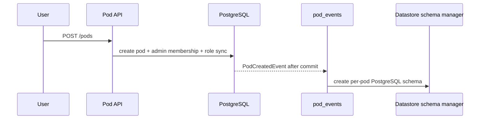

# Pod module

## Purpose

`app/modules/pod` is the tenant boundary for team work. It owns pod lifecycle,
pod membership, pod roles, join requests, the permission catalog exposed to
clients, and resource-level grants for users, roles, and workloads.

## Runtime contributions

| Contribution | Behavior |
| --- | --- |
| API routers | Pods, members, roles, effective permissions, join requests, resource access |
| Work kinds | `pod.provision` (the pod's datastore schema, written with the pod), `pod.join_request.email` (`delivery`) |
| Facts emitted | `PodDeleted` and member removal, which agent, schedule, surfaces and MCP access subscribe to; `PodOutcomeChanged`, which datastore subscribes its weekly reading to |

## Main data model

| Table/state | Meaning |
| --- | --- |
| `pods` | Organization-owned resource container with typed `PodConfig` and deletion state |
| `pod_members` | Organization member to pod mapping plus assigned pod-role names |
| `pod_join_requests` | Pending/approved access requests |
| Core authorization tables | Role permission bundles and named resource/workload grants |

Built-in pod roles are normalized in `domain/roles.py`; custom roles and their
permission bundles use the shared authorization repositories.

## API groups

| Routes | What they do |
| --- | --- |
| `/pods` and `/pods/{pod_id}` | Create/read/update/soft-delete pods and list by organization |
| `/pods/{pod_id}/members` | Add, find, list, re-role, and remove members |
| `/pods/{pod_id}/roles` | CRUD custom roles and replace their permission bundles |
| `/pods/{pod_id}/permissions/*` | Permission catalog and current user's effective permissions |
| `/pods/{pod_id}/resources/.../access` | Read/replace/delete a grantee's resource grant |
| `/pods/{pod_id}/join*` | Direct policy-based join and reviewable join requests |
| `/pods/{pod_id}/outcome` | Set or clear what the pod owns (`PUT`, `DELETE`) |

## Key flows

Pod deletion is a soft delete followed by events consumed by dependent modules
to clean up schedules and surfaces. A named workload's authority is its own
grants intersected with the invoking user's, so it can never reach past the
person who ran it; the default pod agent holds no grants and mirrors its
invoking user's rights exactly. Destructive operations additionally require
standing authority or a session approval.

## What a pod owns

`PodConfig.outcome` is the one thing a pod owns: a sentence, its kind (`week`, a
bar held every week, or `date`, a finish line by `due`), a target with its unit
(`%` makes it a share from 0 to 100), and a measure -- one read-only SQL query
over the pod's tables that answers a single number. These are the front matter
fields of the plan the workspace keeps at `/plan.md`; the plan's prose stays in
that file, and the agent's brief points at it.

It changes only through `PodOutcomeService`. `PUT /pods/{pod_id}/outcome` and
the agent's `set_what_you_own` tool both go through `set_outcome`, which needs
`POD_UPDATE` and checks a new or changed measure through the `OutcomeMeasures`
port (`app/core/ports/outcome_measures.py`, implemented by datastore) before
keeping it. A measure is read for the whole pod, so the check refuses anyone who
cannot read every row it counts. `PodService.create_pod` and `update_pod` keep
the stored outcome whatever a request's config says. `set_starting_outcome` is
the one unchecked path: a Lemma started from a template keeps the template's
measure before its tables exist, for a pod its caller has just made.

`since` is stamped the day it is first set and kept while only the wording,
target or measure change. Every change emits `PodOutcomeChanged`.

## Dependencies

The module uses identity's organization/user models and the icon service. It is
consumed by nearly every pod-scoped module. The datastore consumer eagerly
creates the physical schema from the durable `pod.created` event; first-table
creation also performs the same idempotent bootstrap under an advisory lock.
No infrastructure-job state is stored on the pod aggregate.

## Tests and operations

Tests cover CRUD, custom roles, join policy, resource grants, authorization
hardening, delegation, and event behavior.
