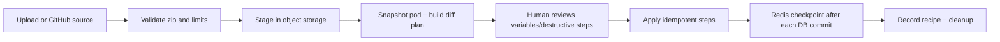

# Pod bundle module

## Purpose

`app/modules/pod_bundle` exports a pod as a portable bundle, plans the diff for
an uploaded/GitHub bundle, applies an approved plan step by step, and publishes
a bundle to GitHub through a connected account. Format primitives are shared
with the CLI through the top-level `lemma-pod-bundle` package.

## Runtime contributions

| Contribution | Behavior |
| --- | --- |
| API routers | Import/upload/plan/apply/replan/cancel/events, export/status/download, publish/status/events |
| Work items | `pod_bundle.{export,plan,import_github,import_url,apply,publish}`: admin class, pod namespace, one per pod at a time, written with the job's state row in the request's transaction; `pod_bundle.set_up_lemma` plans and applies a template for a Lemma just started, then starts its setup chat (see [Starting a Lemma](#starting-a-lemma)) |
| Periodic work | `pod_bundle.staging_sweep` (30 min): sweep expired staging objects, end jobs nothing will run again, delete job rows past retention |
| Realtime | Redis pub/sub SSE plus polling snapshots |
| SQL tables | `pod_bundle_jobs`, `pod_bundle_job_steps` |

Job state is authoritative in PostgreSQL and mirrored to Redis, not the other
way round: a Redis flush loses the realtime mirror, not the job. Every job
writes one `pod_bundle_jobs` row and one `pod_bundle_job_steps` row per plan
step, so the two tables grow with every export, import and publish — the sweep
deletes rows whose `completed_at` is past retention (30 days, the
`JOB_ROW_RETENTION_SECONDS` constant in `infrastructure/job_retention.py`), and
steps go with their job through the FK cascade. Zip archives are staged in
object storage. Completed import provenance is appended to `PodConfig.recipes`.

A worker that dies mid-job loses its lease and the next one resumes from the
first pending step (apply) or file (publish); a stopping worker hands the job
back at the next step boundary, uncharged. Cancel stays cooperative for a
running job and ends a queued one in its own transaction. An item that goes
dead (attempts, lease losses, the 30-minute cap) ends its job FAILED, or
CANCELLED if it was cancelling, in the dead transaction.

## Job state

| Job | Typical states |
| --- | --- |
| Export | `QUEUED -> EXPORTING -> READY` or `FAILED`; ready state includes signed download URL |
| Import | `QUEUED/FETCHING -> PLANNING -> AWAITING_CONFIRMATION -> APPLYING -> COMPLETED` or `FAILED/CANCELLED`; `PARTIALLY_CANCELLED` when steps had already been applied |
| Publish | `QUEUED -> EXPORTING/UPLOADING -> COMPLETED` or `FAILED` |

## API groups

| Routes | What they do |
| --- | --- |
| `/pods/{pod_id}/bundle/uploads` | Stage a local zip and mint a signed Lemma URL |
| `/.../bundle/imports` | Start URL/GitHub planning, poll, replan, approve apply, cancel, or stream SSE. An import is its starter's: anyone else gets 404 (`POD_BUNDLE_IMPORT_NOT_FOUND`), since its plan was computed with the starter's authority and lists their own accounts |
| `/.../bundle/exports` | Start/poll an export; authenticated signed-token download is `/pods/bundle/download` |
| `/.../bundle/publishes` | Start/poll/stream GitHub publication |
| `/pods/bundle/templates` | The templates that ship with the server, as cards: what a Lemma made from one owns, how it is counted, and the first lines of its plan |
| `/pods/start` | Start a Lemma: a pod that owns something, from a template or the caller's own words |

## Import flow

Every non-app apply step opens its own authorization/UoW scope and commits
before the Redis `DONE` checkpoint. App steps self-scope around a sandbox
build. A crash between commit and checkpoint replays an idempotent upsert. The
format handles pod connectors, tables/data, files, functions,
agents/grants/toolsets, workflows, schedules, apps/source, surfaces, and pod
metadata.

**Pod connectors** (`connectors/<slug>/<slug>.json`) carry the catalog
connector, mode, `required` and `purpose` -- never the installation or the
account a SHARED one runs as, which the exporter refuses to write. The plan
(`infrastructure/connector_planning.py`, over the connectors module's
`contracts/bundles.py`) maps each to the importing org's installations (default
first), says whether the importer may install Lemma's app for a missing one, and
lists the importer's own accounts a SHARED one could share; it never shares one
by default. `ApplyImportRequest.connectors` makes those choices, and
`domain/connector_plan.resolve_connector_choices` checks them before anything is
queued: no installation (`NEEDS_INSTALLATION`, unless creating one was chosen)
or a slug the pod already uses for another connector (`CONFLICT`) refuses the
apply with 422; a SHARED connector with no account imports `NEEDS_ACCOUNT`
with a warning. CONNECTOR steps run first, so every schedule, surface and grant
naming a slug finds it declared.

A slug the pod already declares is kept only when it is the same catalog
connector in the same mode (`EXISTS`); another connector or the other mode is
`CONFLICT`. Plan and apply ask the same `connector_plan.declared_conflict`, so a
declaration changed between the two is refused at its step
(`POD_BUNDLE_CONNECTOR_CONFLICT`) rather than kept. A SHARED connector's account
is shared and the connector declared in the one CONNECTOR step's unit of work,
after the connector checks, so a refused declaration leaves no account widened.
An account the importer shares here with only some people is never widened to
the whole pod: the apply is refused with 409
(`POD_BUNDLE_ACCOUNT_SHARED_WITH_SOME`) before anything is queued, as lemma-cli
refuses it.

A schedule exported before pod connectors names an account rather than a pod
connector. One the importer could not use -- somebody else's not shared with
them here, or gone -- is planned as skipped with a warning
(`infrastructure/account_checks.py`): at planning for an id in the bundle, when
the apply is requested for one given as an import variable. The rest of the
bundle imports.

**Format version.** `pod.json`'s `format_version` is 4 for a bundle that
declares a pod connector, and 3 for one that does not
(`lemma_pod_bundle.bundle_format_version`): 4 added only `connectors/`, so a
reader of 3 still reads every bundle it read before. Both exporters write it
after the connectors. `lemma_pod_bundle.check_format_version` refuses a newer
one at planning (and in the CLI's direct import) instead of importing a bundle
with what it added left out.

**Grants** travel in the manifest of the agent or function that holds them
(`permissions.grants`, by resource name), as a deferred `*_GRANTS` step after
every resource they could name exists. They are conferral: the plan
(`infrastructure/grant_planning.py`) asks the conferral bound, as the importer,
about every grant whose resource already exists -- only what the write adds
over what the same-named workload already holds, as the apply's
`replace_grantee_resource_grants` does -- and keeps what fails on its step
(`detail.refused`) and in the plan's warnings. Applying such a plan is refused
`403 CONFERRAL_EXCEEDS_HOLDER` with the pod untouched; the step itself asks
again of everything when it writes.

## Starting a Lemma

A template is a bundle under `templates/<name>/` whose `pod.json` also says
what a Lemma made from it owns (`outcome`, with a measure over the tables it
brings) and how to show it (`lemma`: face, place, what it brings, the first
lines of its plan). An import with `kind=TEMPLATE` packs and stages it like an
upload; `GET /pods/bundle/templates` lists the cards.

`POST /pods/start` (`application/start_use_cases.py`) writes a Lemma in one
transaction: the pod (under a free name), what it owns, a first `/plan.md`, and
a conversation with the pod's agent opened with the caller's first message.
From the caller's own words the agent's turn is staged with it. From a template
the archive is staged before anything is written, the conversation is opened
held -- its run written without its turn -- and `pod_bundle.set_up_lemma` is
queued: it plans the import, applies it without the confirmation an uploaded
bundle waits for (a shipped template, into a pod with nothing to overwrite),
and starts the turn in its completion transaction. A plan that would need the
person after all is left awaiting them, and the turn starts beside it. If the
item dies, its `on_dead` hook ends the import and starts the turn in the same
commit, so no setup chat waits on a job that will not run again.

## Security and limits

Archive extraction is zip-slip and zip-bomb guarded. Import requires pod update;
export/publish require pod read plus account ownership where applicable.
Destructive table changes require explicit confirmation. Configurable per-item,
record, data, app, archive, and uncompressed-byte caps bound work, and a Redis
daily limiter bounds starts. Download URLs are purpose-signed and require a
logged-in user in addition to the token.

## Tests and operations

Unit/e2e tests cover format/diff, staging, limits, plan/apply idempotency,
variables, executable imported resources, apps, surfaces, GitHub import/publish,
SSE, expiry, and cleanup.
