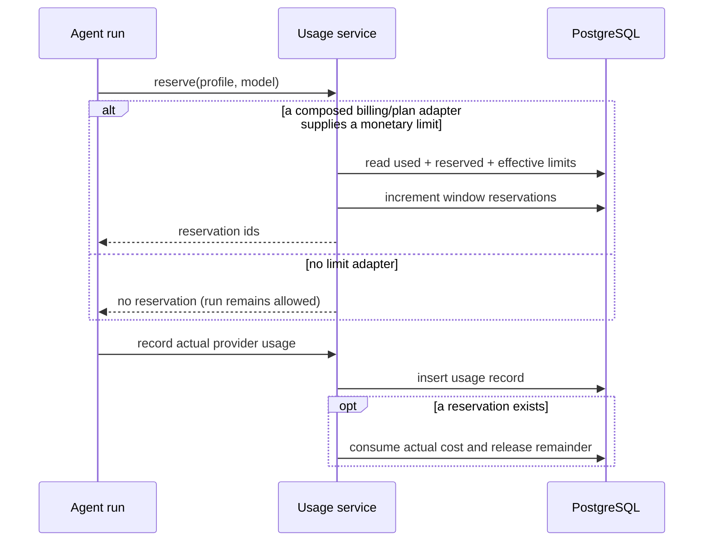

# Usage module

## Purpose

`app/modules/usage` meters model work, calculates system-provider cost,
optionally reserves budget before a run, records final usage, exposes
organization/user reports, and provides an extension port for billing/plan
limits.

## Runtime contributions

| Contribution | Behavior |
| --- | --- |
| API router | Organization summaries/events/stats/limits and current-user usage |
| Domain events | Usage-recorded and limit-denied events are collected with the UoW |

## Main data model

| Table | Meaning |
| --- | --- |
| `usage_records` | Immutable run/profile/model/token/unit/cost/status attribution |
| `usage_limit_counters` | One row per limited organization/user time window: `used_usd`, the window's running system spend, which settlement adds to and every limit check reads instead of summing `usage_records`: each provider request, a run's start (`check_run_budget`), the message that starts it (`UsageService.spent_windows`), and a surface's contacts-cap check before a contact's turn (`contacts_cap_reached`). It is recounted from the ledger when new, when `basis` -- the digest of which rows it counts -- or the limit no longer matches, after another writer's ledger insert, after an owner sets the contacts cap (the `contacts_month` counter only), and at least every `USAGE_COUNTER_REFRESH_SECONDS` (see `docs/design/usage-accounting.md`). The row also keeps the older `reserved_usd` hold |
| `usage_contacts_caps` | What an organization lets its bots spend answering contacts and group outsiders a month, set by an organization owner (`org.billing.manage`) through `PUT /usage/organizations/{id}/contacts-cap`; no row means `USAGE_CONTACTS_MONTHLY_DEFAULT_USD`, a row with no limit means none. `contracts/contacts_cap.contacts_cap_reached` is asked before a surface starts an outside run, in a unit of work of its own, and reads the `contacts_month` counter the run's requests are admitted on; `check_run_budget` holds an outside run to it as well. Such runs are recorded as `contact_run` / `outsider_run`, charge the organization and never the personal windows of the member who looks after the conversation, and are held to a `contacts_month` window counting only those sources |

System-scoped runtimes use registered per-model pricing when available. An
unknown model is still metered, but its record has `cost_usd = null` and
`metadata.pricing_missing = true`; missing pricing never blocks the run.
User-owned provider profiles are recorded but do not count as Lemma system
cost. Every record without a cost says `pricing_missing`, whatever the reason:
an unknown model, a profile Lemma does not price, or a request still in flight
(`metering_state = PENDING`, written before it is sent, until its receipt
lands). A bare null sums as zero, and the ledger would read the run as free.

## API groups

All routes are under `/usage/organizations/{organization_id}`: aggregate
summary, paginated events, time-bucketed/grouped stats, effective limits, and
the current user's view. Access is organization-membership/role scoped. The
limits routes sum `usage_records` for each window: they report windows with no
limit, which keep no counter. The contacts-cap route sums the month's outside
spend for the same reason: it reports it whether or not a cap applies.

## Reservation and recording flow

`UsageLimitPort` lets another composed module supply plan-specific values. The
OSS/local default is unlimited so an unregistered custom model cannot prevent
an agent run. OSS does not define environment-backed plans or a fail-closed
pricing policy; deployments that need monetary admission install a
`UsageLimitPort` and register the prices they want reflected in usage records.
Direct model-call token/request guardrails are independent of monetary
admission.

A paid request that is not a model call -- a classifier reached over HTTP, say
-- is metered through `contracts.metering.metered_request(profile, source=...)`
inside the same `metering_execution`. It is admitted against the limits before
anything is sent, then recorded from what the caller reports: `settle` with the
provider's token counts (priced by the rate card registered for the profile's
`model_name`), `reject` for a refusal that cost nothing, or neither, which
records the request as unconfirmed. `decisions` meters Typesafe System One this
way.

## Tests and operations

Tests cover optional pricing, unlimited defaults, injected reservations,
atomic counter concurrency, queries, and API authorization.
