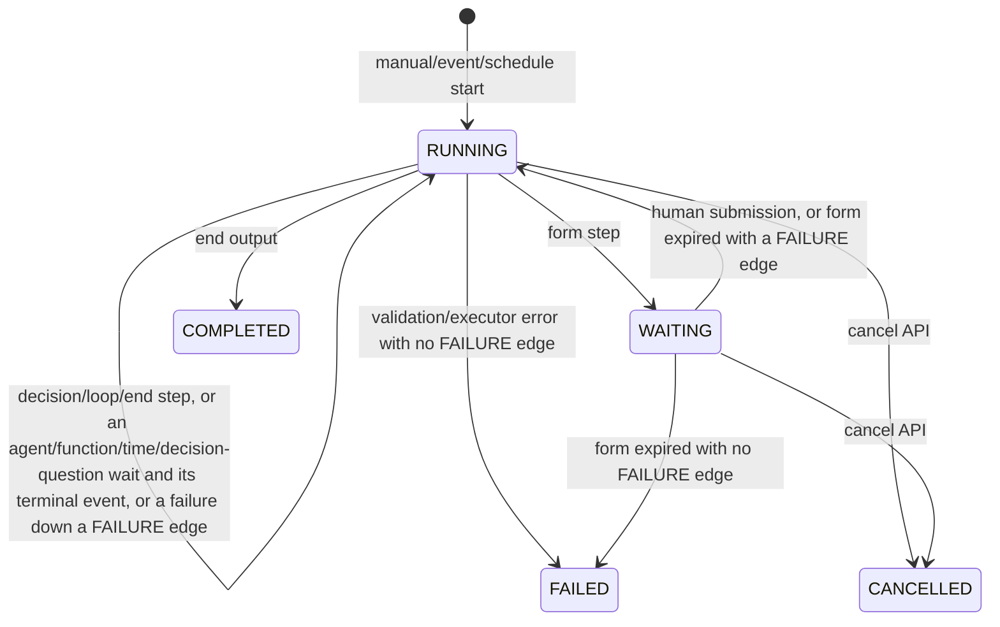

# Workflow module

## Purpose

`app/modules/workflow` defines and executes directed workflow graphs. A graph
can combine functions, agents, decisions, loops, waits, human forms, and end
nodes. The module persists run context and step history, pauses on external
work, and resumes from function, agent, schedule, or user-form events.

## Runtime contributions

| Contribution | Behavior |
| --- | --- |
| API routers | Workflow CRUD/graph/visualization, run create/list/detail/cancel/form/visualization |
| Work kinds (FAST) | `workflow.resume` (a function run ended, or a timer is due), `workflow.wait_expire` (a wait outlived its ceiling), `workflow.admit` (room appeared outside a finishing run), `workflow.start` (another module asks for a run), `workflow.form_expired` (a form's question expired in its assignee's inbox: the run fails as a form nobody answered) |
| Work kinds (JOB) | `workflow.decide` (ask a decision node's question), `workflow.notify_form` (tell a form's assignee) |
| Fact subscription | `FunctionRunFinished` -> `workflow.resume`; channels' `ChannelQuestionClosed` (an expired `wf:` question) -> `workflow.form_expired` |
| Facts emitted | `WorkflowRunFinished` in every terminal transaction; `WorkflowStartRefused` when a start item gives up |
| Fact subscription | `AgentRunFinished` -> `workflow.resume_for_agent`, for a run started by an AGENT step |
| Periodic work | `workflow.waits_prune` (hourly) |

## Main data model

| Table | Meaning |
| --- | --- |
| `workflow_flows` | Named pod graph, typed start configuration, visibility |
| `workflow_flow_runs` | Status, trigger/run context, step records, output/error |
| `workflow_run_waits` | Active/completed external or human wait assignment and payload |

## Graph vocabulary

| Node | Behavior |
| --- | --- |
| Function | Starts a function run and waits for its terminal event |
| Agent | Starts/continues an agent conversation and waits for completion |
| Decision | Evaluates ordered rule expressions and chooses a branch, or asks one closed question about some evidence and routes on the answer (see below) |
| Loop | Iterates items while maintaining a scoped loop frame |
| Form | Persists a human wait with schema/assignment and resumes on submission |
| Wait until | Pauses until a time/schedule signal |
| End | Resolves output bindings and completes the run |

## Waits

A step that cannot finish inside the run's transaction writes one ACTIVE row in
`workflow_run_waits` and suspends, and the same transaction writes the work
items that end the wait. Only a form wait moves the run to WAITING; the others
keep it RUNNING while the row says what it is on.

| Wait type | Written by | Items written with it | Resumed by |
| --- | --- | --- | --- |
| `HUMAN` | Form node | `workflow.notify_form` (when assigned), `workflow.wait_expire` | The assignee submitting the form |
| `AGENT` | Agent node | none yet (the reconciliation sweep) | The agent run's completion event |
| `FUNCTION` | Function node | `function.run` (with the run), `workflow.wait_expire` | `workflow.resume`, written by the function run's terminal transition |
| `TIME` | Wait-until node | `workflow.resume` at `scheduled_at` | That item |
| `DECISION` | Decision node with a `question` | `workflow.decide`, `workflow.wait_expire` | The decide job, with the answer's route |
| `QUEUED` | A start past `max_concurrent_runs` | none | Admission in the transaction that ends a run of the workflow |

The resume and expiry handlers lock the run, act only while the wait is still
ACTIVE, and advance inline in one transaction, so a duplicate or late item is a
no-op and a crash repeats a step rather than losing one. Executors receive the
transaction's `WorkWriter`, never a network client. A wait's ceiling is
`WORKFLOW_WAIT_MAX_AGE_SECONDS` (or the step's own `timeout_seconds`), twelve
times that for a form; timers and parked runs have none.

## Decision questions

A decision node has `rules` or a `question`, never both. A question asks one
closed question through `decisions.contracts.decide`: `instruction` (trusted),
`evidence` (an input binding resolved against the run context), `answer` (one
property of the decisions schema subset: a choice, yes or no, or a scale; a
multi-choice cannot be routed), and optional `examples`. It routes on the
answer:

| Answer | Next node |
| --- | --- |
| A value with a route (`routes` keys are the value as a string: `true`, `3`, `billing`) | That route |
| No value, or a confidence below `min_confidence` (ignored when the provider reports none) | `unsure_next_node_id` |
| Anything else | The default edge, the node's first outgoing edge |

Saving checks the question against the decisions contract, that every route key
is an answer and every target exists, and that every answer and unsure has
somewhere to go -- a route or the default edge.

The executor resolves the evidence, writes the whole request onto a `DECISION`
wait and suspends, writing the `workflow.decide` item in the same transaction.
The job reads the wait in one short transaction, asks with no session open, and
in its fenced completion picks the route from the flow as it is then and
resumes the run there. The node's output is
`{answer, confidence, provider, model, route}`.

No failure takes an answer's branch. A provider that did not answer, or a rate
limit, is retried with backoff (at least the limit's `retry_after_seconds`) up
to six attempts, then the node fails naming the cause. An invalid question, a
spent usage limit, too much evidence for one decision (`token_limit`) or no
configured provider (`not_configured`) fail it at once, as does an answer with
no route and no default edge. A failed node fails the run unless it has a
FAILURE edge (below). A cancelled run's job finds no active wait and does
nothing. A job whose workers keep dying goes dead and fails the node.

## Failure edges

An edge has a `kind`: `NEXT` (the default, and every edge saved before kinds
existed) is followed when its source finishes; `FAILURE` is followed when its
source fails, instead of failing the run. A graph with no FAILURE edge behaves
exactly as one did before they existed.

| Rule (checked on save) | Why |
| --- | --- |
| At most one FAILURE edge per node | One place for a failure to go |
| None from an END | Nothing runs after it |
| Not back to its own source | A retry with no limit |
| FAILURE edges do not count as branching, and are never a decision's default edge or a loop's one outgoing edge | They are not a way on from a node that finished |

What counts as a node failing: its executor raising (a required input that
resolves to nothing, an agent it may not run), or its wait failing -- the
function run or agent conversation failed or vanished, the decision could not
be asked, the wait outlived its ceiling, the form expired. Not a failure: a
cancelled run, the database being unavailable (the work item retries the step),
a cycle past `MAX_STEPS_PER_ADVANCE`, or a node missing from the graph.

When a node fails, `RunStepper.divert_failure` looks for a FAILURE edge on the
node, then on each enclosing LOOP from the innermost out:

- The step is recorded `FAILED` with its reason, and the node's output becomes
  its partial output (a failed agent's, say) plus `error`, so the branch reads
  `<node_id>.error`. The run's `error` and `failed_node_id` stay empty.
- Caught by an enclosing loop, that loop -- and any inside it -- ends where it
  stood: its output is `{results, count, error, failed_node_id}` (the completed
  iterations' results, and which body node failed), and the run goes on at the
  loop's FAILURE target. A body node's own FAILURE edge pointing back at its
  loop node skips that item instead, as any edge back to the loop ends an
  iteration.
- The branch is ordinary nodes. A node on it that fails is handled the same
  way, so a failure with nowhere left to go fails the run there.

A wait's failure (`execution/wait_failure.py`) continues the run down the
branch in the same transaction that fails the wait, as the run's owner, the way
a resume does; an expired form's question is closed first. With no FAILURE
edge the run fails as before. The debug views draw a FAILURE edge labelled "on
failure".

## API groups

`/pods/{pod_id}/workflows` provides CRUD, graph replacement, manual run
creation, run history, and definition visualization.
`contracts/graph_checks.workflow_graph_issues` answers, for another module,
whether a graph as a manifest carries it would be accepted -- the node models
and `WorkflowGraphValidator`, nothing else -- so a bundle import can refuse one
at planning rather than fail part-way through its apply. `/pods/{pod_id}/workflow-runs`
provides assigned waits, form submission, cancellation, detail, and run
visualization.

A run takes no free-form input; inputs arrive through FORM nodes. A person
starting one may name the one record it is about (`POST .../runs` with
`{"about": {"table": "deals", "record_id": "<the record's key>"}}`,
`api/run_about.py`): the record is read as them, through the table permission
and row scope the datastore applies
(`datastore.contracts.event_reads.read_record_as`), and handed to the run as a
table change would hand it -- its fields in `start.payload`, `table_name` and
`record_id` in `start.metadata` -- so one workflow serves a table trigger and an
app's button about one row. A record they cannot read is a 404, the same as
none. Like a run a table trigger started, the run then carries the record's
fields as they were read: whoever can read the run sees them in its start.
A retry with the same `Idempotency-Key` returns that run before the record is
read again, so a record changed or deleted since does not turn the retry into
a 404 or a second run. A `record_id` the table's key cannot hold is a 400.

## Execution flow

`WorkflowEngine` loads a run and graph; `WorkflowStepper` selects the current
node and delegates to a typed executor. Input/output bindings use literals or
expressions over the run context. External executors create durable waits before
returning, with the work items that end them. A run that ends announces
`WorkflowRunFinished` and admits the workflow's parked runs under its row lock,
in the same transaction.

## Authorization and dependencies

Workflow definition/run operations use pod permissions and resource grants.
Human form assignment resolves pod members. Adapter ports invoke agent,
function, and schedule modules. Scheduled start configuration imports schedule
value types directly, while schedule also calls workflow services. That cycle is
in the architecture baseline and cannot grow; see `make architecture`.

## Tests and operations

Tests cover graph validation, expressions, every node executor, waits/forms,
resumption, cancellation, authorization, visualization, schedules, and e2e
function/agent execution. Current unit coverage is 67.6% (1,618 of 2,393
statements). Event-ack reliability remains a review finding.
